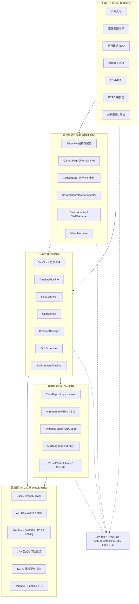
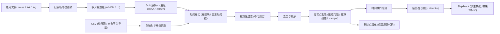
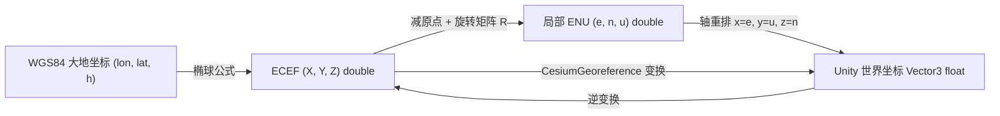
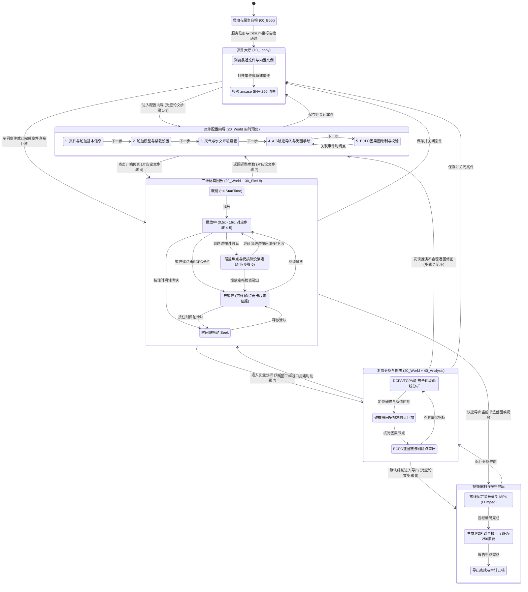
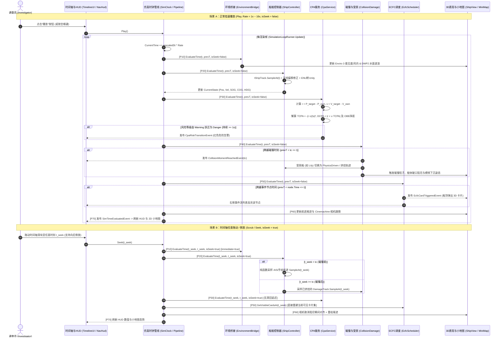
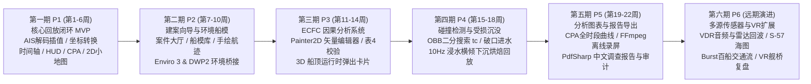
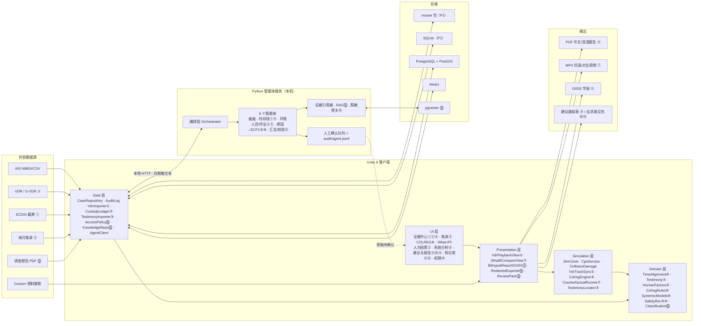
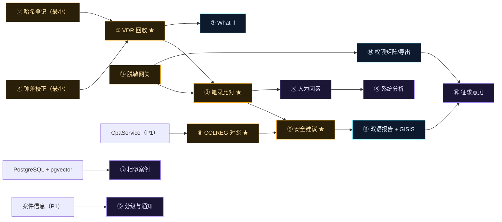

# 海事事故调查三维仿真系统 —— Unity 工程架构设计（ARCHITECTURE.md）

> 项目代号：**MCIS**（Maritime Casualty Investigation Simulation）
> 依据：Mark Wen（文明忠）硕士论文《Design and application research of maritime casualty investigation simulation based on Unity 3D》及 `BRIEF.md`
> 文档版本：v0.9（架构草案，供第一期开发评审）
> 适用引擎：Unity 6 LTS（6000.0.x）及以上；Cesium for Unity 1.x；Enviro 3；NWH Dynamic Water Physics 2（下称 DWP2）；Cinemachine 3.x；Input System；UI Toolkit + uGUI(TextMeshPro)
> C# 命名空间根：`Mcis`

---

## 目录

- [0. 文档约定](#0-文档约定)
- [1. 设计目标与原则](#1-设计目标与原则)
- [2. 需求追溯：论文 → 系统模块](#2-需求追溯论文--系统模块)
- [3. 总体分层架构](#3-总体分层架构)
- [4. 模块划分与职责](#4-模块划分与职责)
- [5. 关键数据结构与 C# 接口签名草案](#5-关键数据结构与-c-接口签名草案)
- [6. 事件总线与游戏状态机](#6-事件总线与游戏状态机)
- [7. 仿真主循环与回放时序](#7-仿真主循环与回放时序)
- [8. 模块依赖关系](#8-模块依赖关系)
- [9. UI 技术选型](#9-ui-技术选型)
- [10. 目录结构与程序集划分](#10-目录结构与程序集划分)
- [11. 案件文件格式（.mcase 包与 JSON Schema）](#11-案件文件格式mcase-包与-json-schema)
- [12. 分期实施路线图](#12-分期实施路线图)
- [13. 风险与注意事项](#13-风险与注意事项)
- [14. 测试与质量保障](#14-测试与质量保障)
- [附录 A 术语与单位](#附录-a-术语与单位)
- [附录 B 默认参数表](#附录-b-默认参数表)
- [附录 C 示例案件 Lily / Mary（虚构）](#附录-c-示例案件-lily--mary虚构)
- [15. P6+ 国际对标功能规划](#15-p6-国际对标功能规划)

---

## 0. 文档约定

| 约定 | 说明 |
|---|---|
| 时间 | 系统内部一律使用 **UTC**。仿真时间用 `double` 秒表示，记作 `SimTime`，等于“距案件纪元 `caseEpochUtc` 的秒数”。界面显示时按案件时区（默认 UTC+8）换算。 |
| 距离 / 速度 | 内部计算用 **米、米/秒**（SI）。界面和报告显示用 **海里（nm）、节（kn）、分钟（min）**。1 nm = 1852 m，1 kn = 1852/3600 m/s。 |
| 角度 | 航向 COG、船首向 HDG、方位都是**真北顺时针 0–360°**。内部三角运算用弧度。 |
| 坐标 | 地理坐标 WGS84（经度 λ、纬度 φ、椭球高 h）→ ECEF（`double3`）→ 局部 ENU（东-北-天，`double3`）→ Unity 世界坐标（`Vector3`，x=东、y=天、z=北）。 |
| 精度 | 地理、ECEF、ENU 计算一律用 `double`（`Unity.Mathematics.double3`）。只有最后写入 `Transform` 时才转成 `float`。 |
| 数据来源标记 | 每个运动学样本都带 `SampleProvenance`（实测 / 插值 / 推算 / 手绘 / 推定 / 剔除），UI 和报告必须能区分显示。 |
| 接口代码 | 本文所有 C# 代码都是**签名草案**，用来约定职责边界。实现时可以调整，但修改公共接口要走评审。 |

---

## 1. 设计目标与原则

### 1.1 产品目标（“把调查仿真做成一款好用的游戏”）

1. **可信**：轨迹、时间、CPA 数值都能追溯到原始证据。仿真生成的内容和推定内容在视觉上明确区分，可以作为调查报告附件。
2. **好用**：基层调查员不写代码，按论文 5.3 节的 8 步流程（录入 → 选船 → 设轨迹与环境 → 开始 → ECFC 弹卡 → 碰撞 → 回放分析 → 导出）在 **30 分钟内**出第一版重建动画。
3. **好看**：电影级画面（倾斜摄影 + Cesium 地形 + Enviro 3 天气 + 动态水面），HUD 采用 ECDIS / 舰桥指挥风格，深色玻璃拟态。
4. **可扩展**：以后能接入 VDR、雷达回波、ECDIS 海图（S-57/S-101）、多船交通流、VR 复盘（对应论文第 6 章的展望）。

### 1.2 架构原则

| 原则 | 落地方式 |
|---|---|
| **时间是唯一真相源** | 回放模式下，全部仿真状态 = `f(SimTime)`，是纯函数采样，所以可以随意拖动、倒放、逐帧。物理（碰撞后漂移、沉没）采用“首次计算并烘焙 → 之后回放烘焙结果”。 |
| **分层单向依赖** | UI → 表现 → 仿真 → 领域 → 数据，只允许上层依赖下层。下层通过事件总线或接口回调通知上层。用 asmdef 强制约束。 |
| **领域层零 Unity 依赖** | `Mcis.Domain` 只引用 `Unity.Mathematics`（纯数学库），可以在 EditMode 和独立的 .NET 测试中运行。CPA、坐标转换、AIS 解码、ECFC 校验都可单元测试。 |
| **第三方插件适配器隔离** | Cesium、Enviro 3、DWP2、Recorder 都通过 `Mcis.Integrations.*` 适配器接入。插件升级或替换只影响适配器。 |
| **原始证据不可变** | 导入的原始文件按原样存进 `.mcase` 包并计算 SHA-256。清洗、插值的结果另存为派生数据，并记录处理参数。 |
| **数据驱动** | 船型库、环境预设、风险阈值、UI 主题都放在 ScriptableObject 或 JSON 中，不硬编码。 |

---

## 2. 需求追溯：论文 → 系统模块

| 论文章节 | 需求要点 | 承接模块 | 期次 |
|---|---|---|---|
| 2.4 证据收集 | 人证、物证、书证三类证据，需要保存和控制 | `EvidenceStore`、`AuditLog`、`.mcase/evidence/` | P2/P5 |
| 2.5 ECFC | 事件=矩形、条件=椭圆；事件之间实线箭头，条件指向事件或条件用虚线箭头；推定项用虚线框；主序列水平一线、箭头加粗；次序列放在上下；事件“一个名词 + 一个主动动词”、尽量量化、带时间 | `Ecfc` 领域模型 + `EcfcValidator` + `EcfcLayout` + `EcfcEditor`（UI）+ `EcfcCardPresenter`（运行时卡片） | P3 |
| 3.2 风、浪、流 | 环境力影响船舶运动（论文中主要作可视化） | `EnvironmentBridge`（可视化）+ `IManeuverModel`（可选推演模式里的环境力） | P2/P4 |
| 3.3 碰撞理论 | 船体实际接触、产生损害；也包括船撞桥、码头、灯塔 | `CollisionDamage`（`CollisionDetector`/`DamageModel`/`FloodingModel`/`SinkingController`） | P4 |
| 3.4 DCPA/TCPA | 全程实时刷新显示 | `CpaService` + HUD + 分析曲线 | **P1** |
| 4.3 地形 | 水深 + 高程融合 | 已有：倾斜摄影 + Cesium 地形；`TerrainLayerConfig` | 已有 |
| 4.4 船模库 | 典型船型模型库 | `VesselModelLibrary`（ScriptableObject + Addressables） | P2 |
| 4.5.1 | 选船模、设地形 | 案件配置 → 船舶与模型库界面 | P2 |
| 4.5.2 | 风、浪、流、光照、雾、雨 | 场景与环境界面 → `EnvironmentBridge` | P2 |
| 4.5.3 | 轨迹来自 GPS(AIS) 或手绘 | `AisImport` + `TrackEditor`（手绘样条） | **P1**/P2 |
| 4.5.4 | ECFC 嵌入 Unity | ECFC 编辑器 + 运行时卡片 | P3 |
| 4.5.5 | 2D 小地图，显示完整航迹 | `MiniMap` | **P1** |
| 4.5.6 | 实时显示 GPS、航速、航向、风、DCPA/TCPA | `NavHud` | **P1** |
| 5.1.4 | Box Collider + Rigidbody 碰撞，桥梁、建筑也带碰撞体 | `CollisionDamage`（运动学触发 + 可选物理） | P4 |
| 5.1.5 / 5.3-8 | 导出动画和 PDF | `Recorder` / `ReportExporter` | P5 |
| 5.3 八步流程 | 应用主流程 | `AppStateMachine`（大厅 → 案件配置 → 仿真 → 分析 → 导出） | P1–P5 |
| 5.4 案例 | Lily / Mary 窄航道碰撞，Lily 受损下沉 | 内置示例案件 `Demo_LilyMary.mcase`（虚构数据） | P1 起 |
| 6 展望 | 雷达、ECDIS、AIS、VDR | `ISensorOverlay` 扩展点 | P6 |

**论文 5.3 节 8 步 → 状态机映射：**

| 步骤 | 内容 | 应用状态 / 界面 |
|---|---|---|
| ① | 收集资料，录入基本信息，开始填 ECFC | `CaseSetup.BasicInfo`、`CaseSetup.Ecfc` |
| ② | 选船模，设尺度、装载状态 | `CaseSetup.Vessels` |
| ③ | 放置起点，设航迹、航速、天气和水况 | `CaseSetup.Tracks`、`CaseSetup.Environment` |
| ④ | 点“开始”，船按轨迹航行，状态栏显示航速、GPS、DCPA | `Simulation.Playing` + HUD |
| ⑤ | ECFC 卡片按时间顺序在不同位置弹出 | `EcfcCardPresenter` |
| ⑥ | 发生碰撞，显示碰撞效果 | `Simulation.CollisionFocus` |
| ⑦ | 仿真结束，回放分析；结果不合理就调整后重跑 | `Analysis` ⇄ `CaseSetup`（回到配置） |
| ⑧ | 导出动画和 PDF | `Export` |

---

## 3. 总体分层架构

### 3.1 五层职责

| 层 | 程序集 | 职责 | 允许依赖 |
|---|---|---|---|
| **数据层 Data** | `Mcis.Data` | 案件包读写（.mcase）、原始文件导入（NMEA/CSV/JSON）、证据存储与哈希、审计日志、配置与资源库（ScriptableObject/Addressables）、序列化版本迁移 | Core |
| **领域层 Domain** | `Mcis.Domain` | 纯业务模型与算法：案件、船舶、航迹、AIS 消息、ECFC 图、CPA 公式、风险分级、坐标数学（WGS84/ECEF/ENU）、轨迹清洗与插值。**不引用 UnityEngine** | Core、Unity.Mathematics |
| **仿真层 Simulation** | `Mcis.Simulation` | 仿真时钟、时间驱动流水线、船舶控制（回放/手绘/推演）、碰撞检测与损伤、浸水/沉没烘焙、CPA 服务、ECFC 触发调度、环境时间线 | Domain、Data、Core |
| **表现层 Presentation** | `Mcis.Presentation` + `Mcis.Integrations.*` | 3D 场景：船模实例化、尾迹与航迹线、相机系统（Cinemachine）、Cesium 地理参考适配、Enviro/DWP2 适配、世界空间 ECFC 卡片、视频录制 | Simulation、Domain、Core |
| **UI 层 UI** | `Mcis.UI` | 屏幕空间界面（UI Toolkit）：大厅、案件配置向导、HUD、时间轴、小地图、ECFC 编辑器、分析图表、导出对话框；ViewModel 与数据绑定 | Presentation、Simulation、Domain、Core |
| 横切 Core | `Mcis.Core` | 事件总线、状态机框架、服务定位/依赖注入、日志、本地化、`SimTime`、结果类型 | 无 |

### 3.2 分层架构图



> [!NOTE]
> UI 层可以直接读取仿真层的只读状态（比如 `ISimClock.CurrentTime`、`ICpaService` 查询结果），但**不能**直接修改领域对象。所有修改都通过 Command（支持撤销/重做）提交，由仿真层或数据层执行，并写入审计日志。

### 3.3 Unity 场景组织

| 场景 | 加载方式 | 内容 |
|---|---|---|
| `00_Boot` | 首个场景 | 服务注册（`CompositionRoot`）、配置加载、字体与本地化预热、启动画面 |
| `10_Lobby` | Single | 大厅背景（缓慢旋转的港口全景，低开销）、大厅 UI |
| `20_World` | Additive，常驻于案件期间 | `CesiumGeoreference`、Cesium 3D Tiles（倾斜摄影 + 地形）、Enviro 3 Manager、水面与 DWP2 管理器、`SimulationRoot` |
| `30_SimUI` | Additive | HUD、时间轴、小地图、ECFC 卡片层、相机控制 |
| `40_Analysis` | Additive | 分析图表、报告预览（与 `20_World` 共存，用来做碰撞瞬间回放） |

案件配置界面和 `20_World` 同时存在：配置时，3D 视口作为实时预览（比如修改环境参数后立即看到天气变化），这是“游戏感”的关键之一。

---

## 4. 模块划分与职责

### 4.1 CaseManager（案件管理）

**职责**
- 新建、打开、保存、另存、关闭案件；最近案件列表；自动保存（每 2 分钟写一次 `.autosave`，与正式文件分开）。
- 维护当前 `CaseSession`（内存中的案件聚合根：基本信息、船舶、航迹、环境、ECFC、证据、书签、导出记录）。
- Schema 版本迁移（`schemaVersion` 升级器链）。
- 维护脏标记、撤销/重做栈（`ICommandHistory`）。
- 打开案件时校验完整性：清单（manifest）里的每个原始文件重新计算 SHA-256，不一致时以红色横幅警告“证据文件被修改”。

**关键流程**：打开案件 → 解压到会话工作目录（`Application.temporaryCachePath/cases/{caseId}`）→ 校验 → 反序列化 → 发布 `CaseOpened` 事件 → 状态机进入 `CaseSetup` 或直接进入 `Simulation`（如果用户选择“直接回放”）。

### 4.2 AIS 导入与插值（AisImport / TrackProcessing）

这是第一期的核心。处理流水线：



#### 4.2.1 NMEA `!AIVDM` / `!AIVDO` 解析

语句格式（逗号分隔）：

```
!AIVDM,<片段总数>,<片段序号>,<顺序消息ID>,<信道 A/B>,<载荷>,<填充位数>*<校验和>
```

- **校验和**：`!` 与 `*` 之间所有字符逐字节异或（XOR），结果与 `*` 后的两位十六进制比较。不一致时**不丢弃原始行**，标记 `ChecksumError` 记入导入报告。
- **标签块（Tag Block）**：很多岸基接收机输出 `\s:station,c:1700000000*hh\!AIVDM,...`，其中 `c:` 是 UNIX 秒时间戳。这是最可靠的接收时间来源，优先使用。
- **多片段重组**：消息 5（静态与航次数据）通常是 2 个片段。以 `(信道, 顺序消息ID, 片段总数)` 为键缓存，全部片段到齐后按序号拼接载荷。缓存超时 5 s 或缓存超过上限就丢弃，并记入报告。
- **6-bit 解码**：每个载荷字符 `c` → `v = c − 48`；若 `v > 40`，则 `v −= 8`，得到 0–63，按 6 bit 串接成比特流。最后一个片段去掉 `填充位数` 个尾部比特。
- **有符号字段**：按二进制补码解释（经纬度、ROT）。

**需要支持的消息类型与关键字段（ITU-R M.1371）：**

| 类型 | 用途 | 关键字段（起始比特 / 长度） | 不可用值 |
|---|---|---|---|
| 1/2/3 | A 类位置报告 | MMSI 8/30；航行状态 38/4；ROT 42/8（有符号）；SOG 50/10（0.1 kn）；位置精度 60/1；经度 61/28（1/10000 分，有符号）；纬度 89/27；COG 116/12（0.1°）；HDG 128/9；时间戳秒 137/6 | SOG=1023；经度=181°；纬度=91°；COG=3600；HDG=511；秒≥60 |
| 5 | A 类静态与航次 | IMO 40/30；呼号 70/42；船名 112/120；船型 232/8；尺寸 A 240/9、B 249/9、C 258/6、D 264/6；吃水 294/8（0.1 m）；目的港 302/120 | — |
| 18 | B 类位置报告 | SOG 46/10；经度 57/28；纬度 85/27；COG 112/12；HDG 124/9；秒 133/6 | 同上 |
| 19 | B 类扩展 | 位置 + 船名 + 尺寸 | 同上 |
| 24 | B 类静态（A/B 两部分） | Part A：船名；Part B：船型、呼号、尺寸 | — |

- **ROT 换算**：`ROT_AIS = 4.733 × sqrt(ROT_deg/min)`，带符号。所以 `ROT_deg/min = sign(x) × (x / 4.733)²`。±127 表示“转向速率 > 5°/30 s 但未知具体值”，−128 表示不可用。
- **文本字段**：6-bit ASCII，`@` 是填充符，需要去掉尾部 `@` 和空格。
- **AIS 自带的时间戳只有“秒”**（0–59），**不能单独作为绝对时间**。绝对时间必须来自标签块、日志行前缀，或用户指定的文件起始时间加接收顺序推算（这种情况降级标记为 `TimeQuality.Estimated`）。

#### 4.2.2 CSV 导入

- **列映射向导**：自动识别常见列名（`MMSI, BaseDateTime, LAT, LON, SOG, COG, Heading, VesselName, IMO, Length, Width, Draft` 等，兼容 NOAA MarineCadastre 格式和国内平台导出格式）。识别不了时让用户在 UI 里手动拖拽对应。
- **单位与格式识别**：经纬度格式（十进制度 / 度分 / 度分秒）、时间格式与时区（明确要求用户确认“该文件时间是 UTC 还是北京时间”，这是常见错误源）、速度单位（kn / km/h / m/s）。
- 映射方案可以保存为模板（`CsvMappingProfile`），下次自动套用。

#### 4.2.3 时间对齐

1. 所有样本统一换算成 UTC UNIX 秒（`double`），再减去 `caseEpochUtc` 得到 `SimTime`。
2. **多数据源合并**（比如岸基 AIS + 卫星 AIS + 本船 VDR）：每个数据源可以设置 `clockOffsetSec`（时钟偏差修正），并按优先级合并。同一 MMSI 在 ±1 s 内、位置差 < 10 m 的样本判为重复。
3. **接收时延**：岸基 AIS 的接收时间和船舶实际定位时间通常相差 0–几秒。如果消息里的“秒字段”有效，就用它修正接收时间的秒部分（取最近的那个整分钟边界的组合），这样精度能到 ±1 s。
4. **VDR 对齐**：VDR 的 GPS 时间（`$GPZDA` / `$GPRMC`）作为基准时钟，用来校正 AIS 数据源的偏差（P6）。

#### 4.2.4 异常点剔除（每一步都要输出原因代码）

| 步骤 | 规则 | 原因代码 |
|---|---|---|
| 1 有效性 | 去掉不可用值，经纬度越界，MMSI 不是 9 位 | `InvalidField` |
| 2 去重 | 同一 MMSI 时间相同、位置相同 | `Duplicate` |
| 3 时间倒序 | 按时间排序后，如果同一来源时间倒退，说明接收端缓冲乱序，就重新排序；仍然冲突的样本剔除 | `TimeReversal` |
| 4 速度门限 | 相邻点的隐含速度 `v_imp = 距离/Δt`，如果 `v_imp > max(1.5 × max(SOG_i, SOG_{i+1}) + 3 kn, v_max_type)` 就判为跳点（`v_max_type`：货船 30 kn，高速船 50 kn） | `SpeedGate` |
| 5 推算残差 | 用前一点的 SOG/COG 推算到当前时刻的位置，残差 `> max(50 m, 0.2 × 航行距离)` 记为可疑；如果用前后两侧推算都可疑，就剔除 | `DrResidual` |
| 6 Hampel 滤波 | 对残差序列做滑动窗口（窗口 7 点），`|x − median| > 3 × 1.4826 × MAD` 判为离群 | `Hampel` |
| 7 字段一致性 | SOG ≈ 0 但位置持续移动、COG 与位移方向相差 > 90° 且 SOG > 3 kn | `Inconsistent`（只标记，不剔除） |

> [!IMPORTANT]
> 被剔除的点**不删除**，保存在 `rejected` 列表里，带原因代码与参数。调查员可以在航迹编辑界面里看到它们（灰色叉号），也可以手动“恢复”（这个操作写入审计日志）。报告附录自动列出剔除统计。

#### 4.2.5 插值

设相邻两个有效样本 `P0(t0)`、`P1(t1)`，`Δt = t1 − t0`，`s = (t − t0)/Δt ∈ [0,1]`。位置先转换到局部 ENU 平面（米）再插值，**不要直接对经纬度插值**。

- **线性插值**：`p(s) = (1 − s)·p0 + s·p1`，速度取常数 `(p1 − p0)/Δt`。适用于 Δt 很小（< 3 s）或 SOG/COG 不可用的情况。
- **三次 Hermite 插值（默认）**：用 SOG/COG 构造端点速度向量 `v_i = SOG_i·(sin COG_i, cos COG_i)`（m/s，E/N 分量）：

  $$p(s) = h_{00}(s)\,p_0 + h_{10}(s)\,\Delta t\,v_0 + h_{01}(s)\,p_1 + h_{11}(s)\,\Delta t\,v_1$$

  $$h_{00}=2s^3-3s^2+1,\quad h_{10}=s^3-2s^2+s,\quad h_{01}=-2s^3+3s^2,\quad h_{11}=s^3-s^2$$

  插值速度是 `p'(s)/Δt`。用它算 CPA，曲线平滑，不会在样本点出现跳变。
- **一致性回退**：如果 `|p1 − p0 − Δt·(v0 + v1)/2| > max(30 m, 0.25·|p1 − p0|)`（说明 SOG/COG 和实际位移对不上，比如受流影响很大，或者 COG 有噪声），就改用 Catmull-Rom（切线用相邻点的差分），再不行就退回线性。回退情况记入样本质量。
- **船首向**：HDG 有效就按最短角插值（`DeltaAngle` 处理 359°→1°）；HDG 无效就用插值速度方向（COG）代替，并标记 `HeadingFromCog`。低速（< 1 kn）时 COG 不可靠，保持上一个有效船首向。
- **时间缺口**：`Δt > gapThreshold`（默认：航行中 60 s，锚泊时 360 s，可配置）的区段标记为 `TimeGap`：
  - 默认仍然用 Hermite 连接，但样本来源标记为 `Interpolated + LowConfidence`，小地图和 3D 航迹线用**虚线**显示；
  - 也可以选择“缺口内隐藏船舶”或“用推算（DR）外推”（来源标记 `DeadReckoned`）；
  - 时间轴上，缺口用斜纹区段显示，防止调查员把插值误当成证据。
- **天线偏移修正**：AIS 位置是 GPS 天线位置，不是船中心。用消息 5 的尺寸 A/B/C/D 计算船中心相对天线的偏移（船体坐标系，前向为正、右舷为正）：
  - 纵向：`Δx = (A − B)/2`
  - 横向：`Δy = (C − D)/2`

  船模的 pivot 放在天线位置，或者在运行时按船首向旋转这个偏移后加到 ENU 位置上。**对窄航道碰撞分析来说，这个修正非常关键**：大船的偏移可以达到 100 m 量级。

### 4.3 坐标转换（GeoMath / CesiumGeoreferenceAdapter）



**WGS84 参数**：`a = 6378137.0 m`，`f = 1/298.257223563`，`e² = f(2 − f)`。

**大地坐标 → ECEF：**

$$N(\varphi)=\frac{a}{\sqrt{1-e^2\sin^2\varphi}}$$
$$X=(N+h)\cos\varphi\cos\lambda,\quad Y=(N+h)\cos\varphi\sin\lambda,\quad Z=\big(N(1-e^2)+h\big)\sin\varphi$$

**ECEF → ENU**（原点 `(φ0, λ0, h0)`，对应 ECEF 坐标 `P0`）：

$$\begin{bmatrix}e\\n\\u\end{bmatrix}=\begin{bmatrix}-\sin\lambda_0 & \cos\lambda_0 & 0\\ -\sin\varphi_0\cos\lambda_0 & -\sin\varphi_0\sin\lambda_0 & \cos\varphi_0\\ \cos\varphi_0\cos\lambda_0 & \cos\varphi_0\sin\lambda_0 & \sin\varphi_0\end{bmatrix}(P-P_0)$$

ENU → ECEF 用转置矩阵（正交矩阵的逆等于转置）。ECEF → 大地坐标用 Bowring 迭代或 Zhu/Heikkinen 闭式解，精度要达到毫米级。

**Unity 映射**：Unity 是左手坐标系，y 轴向上。取 `x = e`，`y = u`，`z = n`。这样从上往下看，x 向东、z 向北，船首向 HDG 对应 `Quaternion.Euler(0, HDG, 0)`（绕 y 轴顺时针，和真北顺时针一致）。

**与 Cesium for Unity 的关系：**
- 场景里只能有**一个** `CesiumGeoreference`，它的原点（经纬高）就是 ENU 原点。Cesium 内部同样采用“以原点为中心的 ENU → Unity”映射（东、上、北）。
- 船舶 `Transform` **不挂** `CesiumGlobeAnchor`（每帧都要设置几十艘船的位置，GlobeAnchor 的往返换算开销大，而且回放是由我们自己的时间流水线驱动的）。改为：
  - `GeoMath` 自己算出 ENU → Unity 坐标后直接写 `localPosition`（船舶挂在 `CesiumGeoreference` 子节点下）；
  - 静态物体（灯塔、码头标注点、事故点标记）可以用 `CesiumGlobeAnchor`。
- 启动时要做一次**一致性自检**：取 3 个测试点，分别用自研 `GeoMath` 和 Cesium API（`CesiumWgs84Ellipsoid.LongitudeLatitudeHeightToEarthCenteredEarthFixed`、`CesiumGeoreference.TransformEarthCenteredEarthFixedPositionToUnity`）计算，差值 > 1 cm 就报错。具体 API 名称请按项目实际使用的 Cesium for Unity 版本核对。
- **原点选取**：默认取事故点（案件 `incidentLocation`），高度取平均海面（大地高约等于当地大地水准面差距，华南沿海约为 −5 m 到 0 m 量级，需要按实际高程基准校准；水面高度由 `SeaLevelOffset` 配置）。
- **原点平移（Origin Shift）**：事故调查一般在 20 km 范围以内，`float` 在 10 km 处精度约 1 mm，足够用。只有在跟随相机移动超过 `originShiftThreshold`（默认 15 km）时才平移原点：调用 `CesiumGeoreference.SetOriginLongitudeLatitudeHeight`，然后发布 `OriginShifted` 事件，各模块重新计算缓存的 Unity 坐标（航迹线顶点、小地图投影不受影响，因为小地图用 ENU/经纬度）。**回放和录制过程中禁止平移原点**，只在暂停时或场景切换时执行，避免画面跳变。

### 4.4 TrackPlayback 时间轴（SimClock / TimelinePipeline）

- `SimClock` 持有 `double CurrentTime`、`Rate ∈ {0.25, 0.5, 1, 2, 4, 8, 16, 32}`（BRIEF 要求 0.5x–16x；0.25x 和 32x 作为扩展）、状态（停止 / 播放 / 暂停 / 拖动）。
- 每帧：`CurrentTime += Time.unscaledDeltaTime × Rate`（用 unscaled 时间，不受 `Time.timeScale` 影响），越过边界就钳制或循环。
- **拖动（Seek）**：直接设置 `CurrentTime`，并发出 `isSeek = true` 的求值上下文。各模块据此跳过“跨越触发”逻辑（比如拖动越过 ECFC 卡片时间点时不连续弹出 10 张卡片，而是直接显示“当前时间应该显示的卡片集合”）。
- **逐帧 / 逐事件**：`StepFrames(±n)`（按录制帧率 1/30 s），`JumpToMarker(next/prev)`（跳到下一个 ECFC 事件、风险等级变化点、碰撞时刻）。
- **时间轴标记（Marker）** 来源：`ITimelineMarkerProvider` 实现者——ECFC 事件、CPA 风险等级跃迁、最小 DCPA 时刻、碰撞时刻、数据缺口、用户书签。
- **录制模式**：使用固定步长 `dt = 1/fps`，与渲染帧解耦，保证导出视频的时间严格准确（见 4.12）。

### 4.5 ShipController（船舶控制）

| 模式 | 说明 | 驱动方式 | 用途 |
|---|---|---|---|
| `AisReplay` | 严格按清洗、插值后的 AIS 轨迹 | `IShipTrack.Sample(t)`，纯函数 | 证据重建（默认） |
| `DrawnPath` | 调查员在海图上手绘关键点（时间、位置、航速、航向），用 Hermite 或 Catmull-Rom 样条加速度剖面生成轨迹 | 同上（手绘轨迹也实现 `IShipTrack`），来源标记 `ManualDrawn` | 没有 AIS 的小船、渔船；补缺口 |
| `ManeuverModel` | 一阶 Nomoto 模型 + 环境力（风、流的速度矢量合成），按舵角 / 车令时间表推演 | 固定步长积分，预计算成轨迹再回放 | “如果当时右满舵会怎样”的假设推演（**推定**，必须标识） |
| `PhysicsDriven` | 碰撞后由 DWP2 浮力 + Rigidbody 接管（漂移、横倾、下沉） | 首次运行时记录关键帧（烘焙），之后回放 | 碰撞后效果 |

- 每帧 `Evaluate(t, isSeek)`：采样 → 天线偏移修正 → ENU → Unity → 设置 `Transform` → 输出 `ShipKinematicState` 给 CPA、HUD、小地图。
- **视觉姿态**：在 `AisReplay` 模式下，横摇和纵摇不来自数据，而是由 DWP2 / 水面采样叠加一个**纯视觉**的子节点（`VisualMotionPivot`），不影响用于计算的位置。这个“视觉附加”可以一键关闭（证据模式）。
- **模式切换**：碰撞时刻 `tc` 之后，受损船从 `AisReplay` 切换为 `PhysicsDriven`（如果 AIS 在碰撞后仍然有数据，那就优先用 AIS，物理只负责横倾和下沉的垂向分量）。

### 4.6 CPA 计算（CpaService）

#### 4.6.1 向量法推导

在本船（own）为原点的局部水平面（ENU 的 e、n 分量）内：

- 相对位置：$\mathbf r_0 = \mathbf P_{target} - \mathbf P_{own}$
- 相对速度：$\mathbf v = \mathbf V_{target} - \mathbf V_{own}$，其中 $\mathbf V = SOG\cdot(\sin COG,\ \cos COG)$

假设两船在短时间内都保持航向、航速不变，目标船的相对位置随时间变化为：

$$\mathbf r(t)=\mathbf r_0+\mathbf v\,t$$

两船距离的平方：

$$d^2(t)=|\mathbf r_0|^2+2t\,(\mathbf r_0\cdot\mathbf v)+t^2|\mathbf v|^2$$

这是关于 t 的二次函数（开口向上，因为 $|\mathbf v|^2>0$）。令 $\frac{d}{dt}d^2(t)=2(\mathbf r_0\cdot\mathbf v)+2t|\mathbf v|^2=0$，得到最近会遇时间：

$$\boxed{TCPA=-\frac{\mathbf r_0\cdot\mathbf v}{|\mathbf v|^2}}$$

代回去得到最近会遇距离：

$$\boxed{DCPA=\big|\mathbf r_0+\mathbf v\cdot TCPA\big|=\frac{|\mathbf r_0\times\mathbf v|}{|\mathbf v|}=\frac{|r_x v_y-r_y v_x|}{|\mathbf v|}}$$

- `TCPA < 0`：最近会遇点已经过去，两船正在远离（`IsDiverging = true`）。
- `|v| < ε`（ε = 0.01 m/s）：两船相对静止，TCPA 没有意义。此时 `DCPA = |r0|`，`TCPA = +∞`，标记 `IsDegenerate`，UI 显示“—”。
- 单位：内部用 m、m/s 计算，输出时 `DCPA_nm = DCPA_m / 1852`，`TCPA_min = TCPA_s / 60`。

#### 4.6.2 与论文 3.4 节矢量三角形公式的等价性

论文按雷达标绘原理给出：本船航速 V0、航向 C0；来船航速 Vt、航向 Ct；来船真方位 q，距离 D。相对速度大小和相对航向：

$$V_r=\sqrt{V_0^2+V_t^2-2V_0V_t\cos(C_t-C_0)}$$
$$C_r=\operatorname{atan2}\big(V_t\sin C_t-V_0\sin C_0,\ V_t\cos C_t-V_0\cos C_0\big)$$

于是：

$$DCPA=D\,\big|\sin(C_r-q-180^\circ)\big|,\qquad TCPA=\frac{D\cos(C_r-q-180^\circ)}{V_r}$$

**证明**：取 $\mathbf r_0=D(\sin q,\cos q)$，$\mathbf v=V_r(\sin C_r,\cos C_r)$，则 $\mathbf r_0\cdot\mathbf v=DV_r\cos(q-C_r)$，代入向量式得 $TCPA=-D\cos(q-C_r)/V_r=D\cos(C_r-q-180^\circ)/V_r$；又 $|\mathbf r_0\times\mathbf v|=DV_r|\sin(q-C_r)|$，所以 $DCPA=D|\sin(C_r-q-180^\circ)|$。两种写法完全等价。工程实现用向量式（没有角度分支和象限问题，数值更稳定），单元测试用三角式交叉验证。

#### 4.6.3 工程要点

| 要点 | 处理 |
|---|---|
| 对地还是对水 | 用对地（SOG/COG，或插值轨迹的导数）。**均匀流场中两船的相对速度与流无关**，所以 CPA 不受影响；非均匀流场可以忽略。 |
| 速度来源 | 默认用插值轨迹的导数（平滑）；可以切换为“原始 SOG/COG”（和 ARPA、AIS 显示一致，便于和船员证词对照）。 |
| 参考点 | 标准 CPA 用**船中心**（已做天线偏移修正）。另外计算“**船体最小间距**”（两船 OBB 定向包围盒之间的最小距离），用于碰撞前最后几分钟的分析，两者在 UI 中分别显示。 |
| 本船选择 | 调查员可以指定任意一艘为本船，其余为目标船。多船（N > 2）时计算所有配对，HUD 只显示与本船相关的配对，分析界面显示配对矩阵。 |
| 风险分级 | 默认：`DCPA < 0.3 nm 且 0 < TCPA < 6 min` → **危险（红）**；`DCPA < 1 nm 且 0 < TCPA < 12 min` → **警告（琥珀）**；其余 → **安全（青）**。阈值是案件级配置（窄航道、港内、开阔水域有不同预设），保存在案件文件里，并在报告中写明。 |
| 滞回 | 风险等级跃迁需要连续 1 s（仿真时间）满足条件才生效，避免在阈值附近闪烁。 |
| 历史曲线 | `CpaService` 按 1 s 仿真时间步长预计算全时段的 DCPA、TCPA、距离曲线（纯函数，可以缓存），供分析图表和时间轴标记使用。 |
| 性能 | N 艘船的配对数是 N(N−1)/2。N ≤ 50 时直接计算；交通流场景（N > 200）用 Burst Job + 空间哈希（只计算 6 nm 以内的配对）。 |

### 4.7 EnvironmentBridge（对接 Enviro 3 / Dynamic Water 2）

**职责**：把案件里与插件无关的 `EnvironmentState`（物理量）映射到插件参数。环境可以随时间变化（`EnvironmentTimeline` 关键帧，比如“10:42 起雾，能见度降到 0.5 nm”）。

| 领域参数 | 单位 | Enviro 3 映射（示意） | DWP2 / 水面映射（示意） |
|---|---|---|---|
| 日期时间、时区 | UTC | Time 模块：设置日期时间，经纬度用于太阳、月亮位置 | — |
| 云量 / 天气类型 | 枚举 | Weather 模块：切换天气预设（晴、多云、阴、雨、雷暴、雾） | — |
| 能见度 | nm | Fog 模块：雾密度（按 Koschmieder 公式 `σ = 3.912 / V_m` 由能见度反算消光系数，再标定到插件参数） | — |
| 雨强 | mm/h | 降水粒子强度 | 水面雨滴法线扰动（可选） |
| 风速、风向 | m/s、° (来向) | Weather 的风区（WindZone）强度和方向，影响云、雨、植被 | 视觉波浪方向；`ManeuverModel` 中的风压力 |
| 浪高 Hs、周期 Tp、浪向 | m、s、° | — | 水面渲染系统的波谱参数（DWP2 本身不渲染水面，它通过 `WaterDataProvider` 从水面系统读取高度；渲染端按项目实际使用的水面资源配置） |
| 流速、流向 | kn、° (去向) | — | DWP2 流场（Flow 区域）的速度矢量；`ManeuverModel` 中的速度合成 |
| 潮高 | m | — | 水面整体高度偏移（`SeaLevelOffset`） |

**设计要点**
- `IWeatherBackend`、`IWaterBackend` 两个适配器接口，`EnviroWeatherBackend`、`Dwp2WaterBackend` 是实现。上面表格里的插件参数名只作示意，**具体 API 和属性名请按项目实际导入的版本核对**，并且只在适配器里引用。
- **单位换算放在适配器里**，领域层只存物理量（比如能见度 1.2 nm），这样报告能写出“能见度 1.2 nm”，而不是“雾密度 0.37”。
- **平滑过渡**：环境关键帧之间插值；拖动时间轴时用 `immediate = true` 瞬间应用（不等插件过渡动画）。
- **证据模式**：环境效果可以一键切换为“清晰可视”（关闭雾和雨，只保留标注），方便调查员看清船舶位置关系，同时在画面角落标注“环境效果已关闭”。

### 4.8 CollisionDamage（碰撞、受损、沉没）

**子模块**：`CollisionDetector`、`DamageModel`、`FloodingModel`、`SinkingController`、`DamageTrack`（烘焙结果）。

1. **检测**
   - 船舶在回放时是运动学驱动（kinematic），不适合依赖 PhysX 的碰撞响应。每艘船挂一个 **Kinematic Rigidbody + 凸包 MeshCollider（或多个 BoxCollider 拼接，对应论文 5.1.4 的 Box Collider）**，`isTrigger = true`，用来做重叠检测。
   - 宽相位：每帧用 OBB 粗检；窄相位：`Physics.ComputePenetration` 求穿透方向和深度。
   - 固定物（桥墩、码头、防波堤、灯塔）挂静态 Collider，层级 `FixedStructure`。
   - **拖动容错**：快速拖动时间轴可能跳过接触瞬间，所以碰撞时刻不靠帧检测确定，而是在导入后**离线二分搜索**：在 OBB 最小间距的时间序列中找到首个间距 ≤ 0 的时刻 `tc`（精度 0.05 s），作为时间轴的固定标记。
2. **损伤评估（示意级）**
   - 接触点、碰撞角（两船首向夹角）、法向相对速度 `v_n`。
   - 碰撞动能（用于定级，不用于结构计算）：`E = ½ · m_eq · v_n²`，`m_eq = (m_a' · m_b') / (m_a' + m_b')`，`m' = m(1 + C_added)`，附加质量系数横向取 0.4–1.0、纵向取约 0.05。
   - 按能量阈值分级：`擦碰 / 轻微 / 破损 / 严重破损（水线以下开口）`。阈值放在 `DamageProfile` 配置里，参考 Minorsky 类经验公式标定，在报告中注明“示意估算，非结构有限元结论”。
3. **浸水与沉没**
   - 破口面积 `A` 和破口中心深度 `h` 由穿透深度和接触点高度估算。进水流量 `Q = C_d · A · sqrt(2 g h)`（`C_d ≈ 0.6`）。
   - 简化舱室模型：`VesselParticulars.compartments[]`。进水后增加质量、移动重心，驱动 DWP2 浮力体的质量和重心变化，从而自然产生横倾、纵倾、下沉。
   - 或者用 `ScriptedSinkProfile`（调查员指定“X 分钟后沉没、右倾 Y°”的关键帧动画），来源标记 `Presumed`。
4. **烘焙与回放**：第一次播放越过 `tc` 时实时模拟，同时以 10 Hz 记录关键帧到 `DamageTrack`（位置、姿态、吃水、进水量），保存进案件的派生数据。之后拖动、倒放、录制都只回放 `DamageTrack`，保证结果确定、可复现。修改碰撞参数后让烘焙失效并重新计算。
5. **视觉**：接触火花 / 碎屑粒子、船体凹陷贴花（Decal）、进水泡沫、浮油（可选）、镜头震动（仅自由视角），音效（撞击、金属撕裂、警报）。

### 4.9 ECFC 模型与运行时卡片

#### 4.9.1 领域模型（严格对应论文 2.5 节表 4）

| 元素 | 规则 | 数据字段 |
|---|---|---|
| 事件 Event | 矩形；主动的发生事项；“一个名词 + 一个主动动词”；尽量量化；尽量带日期时间 | `kind = Event`，`text`，`timeUtc?`，`actorVesselId?`，`quantities{}` |
| 条件 Condition | 椭圆；被动的状态或环境；尽量量化；关联到对应事件 | `kind = Condition`，`text`，`timeRange?` |
| 推定 Presumptive | 没有可靠事实证据的事件或条件，用**虚线**矩形 / 椭圆 | `presumptive = true`（有 `evidenceRefs` 时允许设为 false） |
| 事件 → 事件 | **实线箭头** | `edge.kind = Sequence` |
| 条件 → 事件 / 条件 → 条件 | **虚线箭头** | `edge.kind = Influence` |
| 主序列 | 水平一条直线居中排列；相邻主事件之间用**加粗**箭头 | `lane = 0` |
| 次序列 | 位于主序列上方或下方的独立行 | `lane = ±1, ±2…` |
| 事故本身 | 通常从事故事件开始，向前倒推、向后续写 | `isIncident = true`（主序列中有且只有一个） |

**校验器 `EcfcValidator`**（不阻止保存，只给出警告或错误，显示在编辑器侧栏）：
- 错误：事件 → 条件的实线边；条件节点在主序列；主序列出现分叉或环；没有事故节点或有多个事故节点。
- 警告：非推定节点没有关联证据；事件没有时间；事件文本超过 30 字或不含动词（中文用简单规则 + 关键词表提示，不强求）；条件没有连到任何事件；主序列中事件时间不单调。
- 边样式**由节点类型自动推导**（用户不能把条件 → 事件画成实线），从源头保证符合论文规则。

#### 4.9.2 自动布局 `EcfcLayout`

- 主序列按时间（没有时间则按拓扑序）水平等距排布，`y = 0`。
- 次序列 `lane = k` 放在 `y = k × laneHeight`；次序列事件的 x 坐标对齐它所影响的主事件。
- 条件节点放在它影响的事件上方或下方的空位，用简单的贪心避让算法减少交叉。
- 用户手动拖动后记住 `manualPosition`，自动布局只调整没被手动定位的节点。

#### 4.9.3 运行时卡片（论文 5.3 第⑤步、图 24）

- **触发**：`EcfcScheduler` 是一个 `ITimeDriven`。事件节点的 `timeUtc` 落在 `(prevT, t]` 区间时触发 `EcfcCardTriggered`；拖动时按“当前可见集合”重建。
- **锚点**：卡片锚定在 `actorVesselId` 对应船舶的上方（偏移 = 船高 × 1.5），或者锚定在节点的 `location`；条件卡片可以锚定在区域（比如雾区中心）。
- **呈现**：世界空间卡片（uGUI World Space Canvas + TextMeshPro），始终面向相机（Billboard），按距离缩放，保证屏幕上可读尺寸在 220–360 px 之间；同一时刻最多显示 3 张，其余进入屏幕右侧“事件流”列表（UI Toolkit）。
- **样式**：事件卡片是矩形边框，条件卡片是圆角胶囊（椭圆意象），推定内容用虚线边框并带“推定”角标，主序列卡片的边框更粗、发光更强，与编辑器样式一致。
- **交互**：点击卡片 → 暂停 → 打开节点详情（证据缩略图、证词摘录）；“跳到该事件”按钮。卡片停留时长可配置（默认 8 s 仿真时间，或者直到下一个主事件出现）。

### 4.10 MiniMap（2D 小地图）

- **方案选择**：**矢量绘制**（UI Toolkit `Painter2D` 在 `VisualElement.generateVisualContent` 中绘制），不用正交相机渲染贴图。理由：
  1. 不用额外渲染一次场景，性能开销接近零；
  2. 线条清晰、可以无限缩放，风格可以完全统一为 ECDIS 风格；
  3. 可以直接画完整航迹、缺口虚线、CPA 连线、风险圈。
- **底图**：岸线 / 航道 / 水深线来自 GeoJSON（由调查员或开发者从电子海图转换后放进案件包或公共资源），没有底图时显示经纬网格。也可以预渲染一张俯视正射贴图（倾斜摄影导出的正射影像）作为底图图层。
- **投影**：直接用 ENU 的 e、n（米）线性映射到像素（小范围平面近似）。
- **内容**：每船完整航迹（已经过的部分为实线高亮，未来部分为暗色）、当前位置图标（按船首向旋转的船形）、速度矢量线（6 分钟预测线，与 ECDIS 一致）、本船与目标船之间的 CPA 预测点和连线（按风险色）、ECFC 事件点、碰撞点、相机视锥（显示 3D 视角朝向）。
- **交互**：滚轮缩放、拖拽平移、“跟随本船 / 全景”切换；点击航迹上任意点 → 时间轴跳到该时刻；点击船舶 → 选中并切换相机跟随。

### 4.11 CameraRig（相机系统，Cinemachine 3）

| 视角 | 实现 | 说明 |
|---|---|---|
| **驾驶台** Bridge | `CinemachineCamera` + `CinemachineRotationComposer` 或 Pan Tilt；位置绑定船模上的 `BridgeEyePoint`（驾驶台眼高） | 重现值班驾驶员的视野（论文强调“从调查员视角直观理解”），可以叠加“驾驶台窗框”遮罩与瞭望方位刻度 |
| **跟随** Follow | `CinemachineOrbitalFollow` + `CinemachineRotationComposer` | 围绕选中船舶环绕，鼠标拖动旋转，滚轮控制距离 |
| **俯视** TopDown | 高空正上方，近似正交（窄 FOV 远距离），北向上 | 对照小地图和海图，最适合说明会遇态势 |
| **自由** Free | 自研飞行控制器（WASD + 鼠标，Shift 加速），高度不低于水面 | 自由取景、导出镜头 |
| **导演** Cinematic（P5） | Cinemachine 镜头序列 + 书签插值 | 导出视频时自动按 ECFC 事件切镜 |

- 切换使用 Cinemachine 混合（默认 1.2 s EaseInOut）；拖动时间轴时跟随类相机取消阻尼，避免拖影。
- **相机书签** `CameraBookmark`：保存视角、目标、参数、关联时间，存入案件，供报告截图和视频导演使用。
- 防穿地形：Cinemachine Deoccluder 对 Cesium 瓦片的碰撞体生效（需要在 Cesium Tileset 上开启物理网格生成）。

### 4.12 Recorder / ReportExporter（导出视频与 PDF 报告）

> [!WARNING]
> **Unity Recorder 包只能在编辑器中运行，打包后的 exe 里不能用。** 调查员使用的是打包后的应用，所以运行时视频导出必须自己实现（或者采购运行时录屏插件，比如 AVPro Movie Capture）。Unity Recorder 只用于开发阶段制作宣传片和测试素材。

**运行时视频导出方案（推荐）**
1. 进入“离线录制模式”：`SimClock` 改为固定步长（1/30 或 1/60 s），设置 `Time.captureFramerate`，暂停实时输入。画面再卡也不会掉帧，导出的视频时间严格准确（这对证据性很重要）。
2. 渲染到 `RenderTexture`（1920×1080 或 3840×2160）→ `AsyncGPUReadback` 读回 → 通过标准输入管道把原始帧送给随应用分发的 `ffmpeg` 进程（LGPL 构建版本，独立进程调用，规避许可证传染问题）编码为 H.264 MP4。
3. **画面叠加**（录制专用 UI 层）：案件编号、UTC/本地时间、仿真倍速、“仿真重建动画 · 非实拍影像”水印、数据来源图例，可选 HUD 和小地图画中画。
4. 导出完成后计算 MP4 的 SHA-256，写入案件导出记录与审计日志。

**PDF 报告**
- 推荐 **PdfSharp + MigraDoc（MIT 许可证）**，通过 NuGet 依赖以 DLL 形式放入 `Assets/_Project/ThirdParty/Plugins`，必须嵌入中文字体子集（思源黑体 / Noto Sans SC，OFL 许可证）。避免使用 iText（AGPL）。
- 报告结构：封面（案件编号、事故名称、调查员、生成时间、软件版本、案件包哈希）→ 事故概况 → 船舶资料 → 环境条件 → 航迹图（小地图高分辨率渲染）→ DCPA/TCPA/距离曲线 → ECFC 图（编辑器离屏渲染为 PNG）→ 关键时刻截图（相机书签）→ 碰撞分析（示意级）→ 数据来源与处理说明（导入文件、哈希、剔除点统计、插值方法、缺口列表、推定内容清单）→ 免责声明。
- 图表渲染：UI Toolkit 面板设置 `PanelSettings.targetTexture` 渲染到 RenderTexture，再编码为 PNG 插入 PDF。

### 4.13 其他支撑模块

| 模块 | 职责 |
|---|---|
| `EvidenceStore` | 证据文件（照片、证词扫描件、航海日志、VDR 导出）导入、哈希、缩略图；被 ECFC 节点和报告引用 |
| `AuditLog` | 追加写入 JSON Lines 格式：时间、操作者、操作类型、对象、前后值摘要；作为可追溯性依据 |
| `VesselModelLibrary` | 船型模板（散货船、集装箱船、油轮、渔船、客滚船、拖轮、工作艇）：Addressables 引用、默认尺度、吃水范围、驾驶台位置、碰撞体、DWP2 浮力配置；实例化时按实际总长、型宽、吃水做非等比缩放 |
| `Localization` | Unity Localization 包；本期只做简体中文，但所有字符串走表，为英文报告留余地 |
| `SettingsService` | 画质档位（低、中、高、电影）、单位偏好、时区、风险阈值预设 |
| `InputRouter` | Input System Action Map：`Global`（快捷键）、`Playback`（空格播放、←→ 逐帧、[ ] 调倍速）、`Camera`、`Editor` |


---

## 5. 关键数据结构与 C# 接口签名草案

本章给出 MCIS 核心领域值类型、数据传输对象（DTO / Record）以及 14 个核心服务接口的 C# 签名草案。所有签名遵循第 0 章与第 3 章约定：
- **领域层（`Mcis.Domain`）** 不引用 `UnityEngine`，仅使用 `System.*` 与 `Unity.Mathematics`（`double2`、`double3`、`float3`、`quaternion`），确保可在纯 .NET 或 Unity EditMode 下高速执行单元测试；
- **内部物理量统一使用 SI 单位**（米 `m`、米/秒 `m/s`、秒 `s`、真北顺时针角度 `deg` 或弧度 `rad`），仅在 UI ViewModel 和报告导出层换算为海里（`nm`）、节（`kn`）、分钟（`min`）。

### 5.1 核心基础值类型与枚举（`Mcis.Core` / `Mcis.Domain`）

```csharp
#nullable enable
using System;
using Unity.Mathematics;

namespace Mcis.Core
{
    /// <summary>
    /// 仿真相对时间（距案件纪元 CaseEpochUtc 的双精度秒数）。
    /// 系统内所有时间轴采样、插值、烘焙均以 SimTime 为唯一自变量。
    /// </summary>
    public readonly record struct SimTime(double Seconds) : IComparable<SimTime>
    {
        public static readonly SimTime Zero = new(0.0);

        public DateTimeOffset ToUtc(DateTimeOffset caseEpochUtc) =>
            caseEpochUtc.AddSeconds(Seconds);

        public static SimTime FromUtc(DateTimeOffset timestampUtc, DateTimeOffset caseEpochUtc) =>
            new((timestampUtc - caseEpochUtc).TotalSeconds);

        public int CompareTo(SimTime other) => Seconds.CompareTo(other.Seconds);

        public static SimTime operator +(SimTime a, double deltaSeconds) => new(a.Seconds + deltaSeconds);
        public static SimTime operator -(SimTime a, double deltaSeconds) => new(a.Seconds - deltaSeconds);
        public static double operator -(SimTime a, SimTime b) => a.Seconds - b.Seconds;
        public static bool operator <(SimTime a, SimTime b) => a.Seconds < b.Seconds;
        public static bool operator >(SimTime a, SimTime b) => a.Seconds > b.Seconds;
        public static bool operator <=(SimTime a, SimTime b) => a.Seconds <= b.Seconds;
        public static bool operator >=(SimTime a, SimTime b) => a.Seconds >= b.Seconds;
    }

    /// <summary>通用操作结果包装，避免在高频路径抛出异常。</summary>
    public readonly record struct Result<T>(bool IsSuccess, T? Value, string? ErrorCode, string? ErrorMessage)
    {
        public static Result<T> Ok(T value) => new(true, value, null, null);
        public static Result<T> Fail(string code, string message) => new(false, default, code, message);
    }
}

namespace Mcis.Domain.Common
{
    /// <summary>WGS84 大地坐标（经度 λ、纬度 φ 单位为十进制度；椭球高 h 单位为米）。</summary>
    public readonly record struct GeoCoord(double LonDeg, double LatDeg, double HeightM = 0.0);

    /// <summary>局部切平面东-北-天坐标（单位：米，双精度）。</summary>
    public readonly record struct EnuPosition(double EastM, double NorthM, double UpM = 0.0)
    {
        public double2 Horizontal => new(EastM, NorthM);
        public double3 ToDouble3() => new(EastM, NorthM, UpM);
    }

    /// <summary>
    /// AIS 消息 5 尺寸参数（GPS 天线距离船首 A、船尾 B、左舷 C、右舷 D，单位：米）。
    /// 用于将天线定位点修正至船舶几何中心。
    /// </summary>
    public readonly record struct AntennaOffset(float ToBowA, float ToSternB, float ToPortC, float ToStarboardD)
    {
        public float LoaM => ToBowA + ToSternB;
        public float BeamM => ToPortC + ToStarboardD;
        /// <summary>船中心相对于天线的船体局部偏移（X=右舷正，Z=船首正，单位：米）。</summary>
        public float2 CenterOffsetFromAntenna => new(
            (ToStarboardD - ToPortC) * 0.5f,
            (ToBowA - ToSternB) * 0.5f
        );
    }

    /// <summary>运动学样本来源标记（贯穿清洗、插值、HUD 显示与报告审计）。</summary>
    public enum SampleProvenance : byte
    {
        Measured = 0,       // 原始传感器实测（AIS / VDR GPS）
        Interpolated = 1,   // 正常间隔内插值（线性 / Hermite）
        LowConfidence = 2,  // 时间缺口（TimeGap）跨越插值
        DeadReckoned = 3,   // 航位推算外推（DR）
        ManualDrawn = 4,    // 调查员手绘关键点样条
        Presumed = 5,       // 操纵模型（Nomoto）假设推演或人工推定
        Rejected = 6        // 已被异常检测剔除（保留在剔除清单中）
    }

    /// <summary>时间戳质量等级。</summary>
    public enum TimeQuality : byte
    {
        ExactTagBlock = 0,  // 岸基 AIS Tag Block UNIX 秒时间戳或 VDR $GPZDA
        LogPrefix = 1,      // 接收软件日志行前缀时间
        MinuteAligned = 2,  // 利用 AIS 秒字段修正后的就近分钟对齐时间
        Estimated = 3       // 无绝对时间，按起始时间与接收顺序推算
    }

    /// <summary>AIS 异常点剔除或告警原因代码（对应 4.2.4 节表）。</summary>
    public enum RejectReason : byte
    {
        None = 0,
        ChecksumError = 1,  // NMEA 异或校验和失败
        InvalidField = 2,   // 经纬度越界、MMSI 非法或不可用值（如 SOG=102.3, Lon=181）
        Duplicate = 3,      // 同 MMSI 时间与位置重复
        TimeReversal = 4,   // 时间倒退且缓冲重排无法消除
        SpeedGate = 5,      // 相邻点隐含航速超过船型物理门限
        DrResidual = 6,     // 前后双向航位推算残差均超限
        Hampel = 7,         // 滑动窗口 Hampel 离群滤波剔除
        Inconsistent = 8    // 字段不一致（如 SOG≈0 但位置持续漂移，仅标记不剔除）
    }

    /// <summary>船舶运动控制模式（对应 4.5 节）。</summary>
    public enum ControlMode : byte
    {
        AisReplay = 0,      // 严格按清洗插值后的 AIS 航迹回放
        DrawnPath = 1,      // 调查员海图手绘样条轨迹
        ManeuverModel = 2,  // Nomoto 操纵模型 + 风流矢量推演
        PhysicsDriven = 3   // 碰撞后浮力/浸水刚体物理驱动（烘焙回放）
    }

    /// <summary>航迹插值算法模式。</summary>
    public enum InterpolationMode : byte
    {
        Linear = 0,
        CubicHermite = 1,
        CatmullRom = 2
    }

    /// <summary>时间缺口处理策略。</summary>
    public enum GapPolicy : byte
    {
        ConnectDashed = 0,  // Hermite 连接但标记 LowConfidence 并以虚线渲染
        DeadReckon = 1,     // 按缺口前最后有效 SOG/COG 推算
        HideVessel = 2      // 缺口时段隐藏船模
    }

    /// <summary>碰撞风险等级（对应 4.6.3 节）。</summary>
    public enum RiskLevel : byte
    {
        Safe = 0,           // 安全（青色 #3be3ff / 绿色）
        Warning = 1,        // 警告（琥珀色 #ffb020）
        Danger = 2          // 危险（红色 #ff3b5c）
    }

    /// <summary>碰撞结构损伤分级（示意级，对应 4.8 节）。</summary>
    public enum DamageSeverity : byte
    {
        None = 0,
        Glancing = 1,       // 擦碰
        Minor = 2,          // 轻微变形（水线以上）
        HullBreach = 3,     // 水线附近破损进水
        SevereFlooding = 4  // 水线以下严重破口、快速进水下沉
    }

    /// <summary>ECFC 节点类型（对应论文 2.5 节表 4）。</summary>
    public enum EcfcNodeKind : byte
    {
        Event = 0,          // 事件：矩形，主动事项（一个名词+一个主动动词）
        Condition = 1       // 条件：椭圆，被动状态或环境条件
    }

    /// <summary>ECFC 连线类型（由起止节点类型自动推导）。</summary>
    public enum EcfcEdgeKind : byte
    {
        Sequence = 0,       // 事件 -> 事件：实线箭头（主序列加粗）
        Influence = 1       // 条件 -> 事件 或 条件 -> 条件：虚线箭头
    }

    /// <summary>三维摄像机视角模式（对应 4.11 节）。</summary>
    public enum CameraMode : byte
    {
        Bridge = 0,         // 驾驶台第一人称视野（绑定 BridgeEyePoint）
        Follow = 1,         // 围绕目标船轨道跟随
        TopDown = 2,        // 正交/窄视场高空俯视（北向上）
        Free = 3,           // 自由漫游飞行相机
        Cinematic = 4       // 导演书签序列自动切镜
    }
}
```

### 5.2 领域核心数据结构（`record` / `struct`）

```csharp
#nullable enable
using System;
using System.Collections.Generic;
using Unity.Mathematics;
using Mcis.Core;
using Mcis.Domain.Common;

namespace Mcis.Domain.Models
{
    /// <summary>案件基本信息与元数据。</summary>
    public sealed record CaseMetadata(
        string CaseId,
        string SchemaVersion,
        string Title,
        string AccidentCode,
        string AccidentType,         // 碰撞 / 搁浅 / 触礁 / 触损 / 浪损 / 沉没 等（对应论文表 2）
        string AccidentGrade,        // 特别重大 / 重大 / 较大 / 一般 / 小事故
        DateTimeOffset IncidentTimeUtc,
        DateTimeOffset CaseEpochUtc, // 仿真 t=0 对应的 UTC 纪元时间
        int DisplayTimeZoneOffsetMinutes, // 默认 +480 (UTC+8)
        GeoCoord IncidentLocation,   // 默认作为 CesiumGeoreference 与 ENU 原点
        double SeaLevelOffsetM,      // 平均海面相对于 WGS84 椭球面的高程修正
        string LeadInvestigator,
        string AgencyName,
        bool IsFictionalDemo,        // 是否为虚构演示数据（如 Lily/Mary 案例，UI 强制显示水印）
        string SummaryNotes
    );

    /// <summary>船舶分舱简化模型（用于 4.8 节进水与横倾/下沉烘焙计算）。</summary>
    public readonly record struct CompartmentSpec(
        string CompartmentId,
        string Name,
        float3 CenterLocalM,         // 相对船中心的局部坐标
        float3 SizeM,                // 舱室长宽高包络
        float Permeability           // 渗透率 μ（机舱约 0.85，货舱约 0.60–0.95）
    );

    /// <summary>船舶静态尺度与操纵参数。</summary>
    public sealed record VesselParticulars(
        string VesselId,
        string Name,
        string? NameCn,
        string Mmsi,
        string? ImoNumber,
        string? CallSign,
        string FlagState,
        string VesselTypeCode,       // BulkCarrier, ContainerShip, Tanker, Fishing, RoPax, Tug...
        string ModelPrefabKey,       // Addressables 船模资源键
        float LoaM,                  // 总长 (m)
        float BeamM,                 // 型宽 (m)
        float DraftForeM,            // 首吃水 (m)
        float DraftAftM,             // 尾吃水 (m)
        float MoldedDepthM,          // 型深 (m)
        float DisplacementTons,      // 排水量 (t)
        string LoadingCondition,     // 满载 FullLoad / 压载 Ballast / 半载 HalfLoad
        AntennaOffset AntennaOffset, // AIS 天线位置偏移
        float3 BridgeEyeLocalM,      // 驾驶台眼高局部坐标（相对船中心）
        float NomotoK,               // 一阶 Nomoto 旋回性指数 K (1/s)
        float NomotoT,               // 一阶 Nomoto 追随性指数 T (s)
        IReadOnlyList<CompartmentSpec> Compartments
    );

    /// <summary>单条清洗前的 AIS 解码原始记录。</summary>
    public readonly record struct AisDecodedRecord(
        int SourceLineNumber,
        string RawSentence,
        int MessageType,             // 1, 2, 3, 5, 18, 19, 24
        string Mmsi,
        DateTimeOffset TimestampUtc,
        TimeQuality TimeQuality,
        double LonDeg,
        double LatDeg,
        float SogKn,                 // 对地航速 (kn)，102.3 表示不可用
        float CogDeg,                // 对地航向 (°)，360.0 表示不可用
        float HdgDeg,                // 真船首向 (°)，511 表示不可用
        float RotDegPerMin,          // 转向率 (°/min)
        byte NavStatus               // 航行状态 (0=在航用主机, 1=锚泊, 5=系泊...)
    );

    /// <summary>航迹离散样本点（已统一转换至局部 ENU 平面与 SI 单位）。</summary>
    public readonly record struct TrackSample(
        SimTime Time,
        GeoCoord Geo,
        EnuPosition EnuCenter,       // 已做天线偏移修正后的船中心 ENU 位置
        double2 VelocityEnuMps,      // 对地速度分量 (Ve, Vn) 单位 m/s
        float SogMps,                // 对地航速 (m/s)
        float CogDeg,                // 对地航向 (0..360°)
        float HdgDeg,                // 船首向 (0..360°)
        float RotDegPerSec,          // 转向率 (°/s)
        SampleProvenance Provenance, // 数据来源标记
        TimeQuality TimeQuality,
        bool HeadingFromCog,         // HDG 缺失时由 COG 代替
        int? RawSourceLine           // 关联原始文件行号（可追溯）
    );

    /// <summary>被异常点剔除规则过滤的样本记录（保留原因与参数供审计与人工恢复）。</summary>
    public readonly record struct RejectedSample(
        int SourceLineNumber,
        SimTime Time,
        GeoCoord Geo,
        float SogKn,
        float CogDeg,
        RejectReason Reason,
        string DiagnosticDetail,     // 例如 "隐含航速 47.2 kn > 门限 30.0 kn"
        bool IsManuallyRestored
    );

    /// <summary>航迹中的时间缺口区间。</summary>
    public readonly record struct TimeGapSpan(
        SimTime StartTime,
        SimTime EndTime,
        double DurationSeconds,
        EnuPosition StartEnu,
        EnuPosition EndEnu
    );

    /// <summary>运行时某时刻单船完整运动学与姿态快照。</summary>
    public readonly record struct ShipKinematicState(
        string VesselId,
        SimTime Time,
        GeoCoord Geo,
        EnuPosition EnuCenter,
        float3 UnityWorldPos,
        quaternion UnityWorldRot,
        double2 VelocityEnuMps,
        float SogMps,
        float CogDeg,
        float HdgDeg,
        floatRotDegPerSec,
        float RollDeg,               // 横摇角（右倾为正，来自物理烘焙或视觉波浪）
        float PitchDeg,              // 纵摇角（首倾为正）
        float HeaveM,                // 垂荡/下沉吃水增量（向下为负）
        ControlMode ActiveMode,
        SampleProvenance Provenance
    );

    /// <summary>两船配对键（本船 Own -> 目标船 Target）。</summary>
    public readonly record struct CpaPairKey(string OwnVesselId, string TargetVesselId);

    /// <summary>DCPA / TCPA 实时计算结果（对应 4.6 节公式）。</summary>
    public readonly record struct CpaResult(
        CpaPairKey Pair,
        SimTime Time,
        double CurrentDistanceM,     // 当前船中心间距 (m)
        double HullClearanceM,       // 当前两船 OBB 最小净距 (m)，<=0 表示接触
        double TrueBearingDeg,       // 目标船相对本船真方位 q (0..360°)
        double RelativeCourseDeg,    // 相对运动航向 Cr (0..360°)
        double RelativeSpeedMps,     // 相对速度大小 |v| (m/s)
        double DcpaM,                // 最近会遇距离 (m)
        double TcpaSec,              // 最近会遇时间 (s)，<0 表示已过最近点
        EnuPosition OwnCpaEnu,       // TCPA 时刻本船预测位置
        EnuPosition TargetCpaEnu,    // TCPA 时刻目标船预测位置
        bool IsDiverging,            // TCPA < 0 正在远离
        bool IsDegenerate,           // |v| < 0.01 m/s 相对静止退化
        RiskLevel RiskLevel          // 经滞回判定后的风险等级
    )
    {
        public double CurrentDistanceNm => CurrentDistanceM / 1852.0;
        public double DcpaNm => DcpaM / 1852.0;
        public double TcpaMin => TcpaSec / 60.0;
    }

    /// <summary>CPA 风险分级阈值配置（支持窄航道/港内/开阔水域预设）。</summary>
    public readonly record struct RiskThresholds(
        string PresetName,
        double DangerDcpaNm,         // 默认 0.3 nm
        double DangerTcpaMin,        // 默认 6.0 min
        double WarningDcpaNm,        // 默认 1.0 nm
        double WarningTcpaMin,       // 默认 12.0 min
        double HysteresisSeconds     // 等级跃迁滞回确认时长，默认 1.0 s
    );

    /// <summary>环境与水文气象状态（物理量，与插件解耦，对应 4.7 节）。</summary>
    public readonly record struct EnvironmentState(
        SimTime Time,
        string WeatherPresetId,      // Clear, PartlyCloudy, Overcast, Rain, HeavyFog, Storm
        float VisibilityNm,          // 水平能见度 (nm)
        float RainIntensityMmPerHr,  // 降雨强度 (mm/h)
        float CloudCoverNormalized,  // 云量 (0..1)
        float WindSpeedMps,          // 真风速 (m/s)
        float WindFromDirDeg,        // 真风向（来向，0..360°）
        float WaveSignificantHeightM,// 有效波高 Hs (m)
        float WavePeakPeriodSec,     // 谱峰周期 Tp (s)
        float WaveFromDirDeg,        // 浪向（来向，0..360°）
        float CurrentSpeedKn,        // 流速 (kn)
        float CurrentToDirDeg,       // 流向（去向，0..360°）
        float TideHeightM            // 潮高偏移 (m)
    );

    /// <summary>碰撞事件与接触点评估数据（对应 4.8 节）。</summary>
    public sealed record CollisionEvent(
        string EventId,
        SimTime CollisionTime,       // 二分搜索精确定位的接触时刻 tc（精度 0.05s）
        string StrikingVesselId,     // 撞击船（或主接触船 A）
        string StruckObjectId,       // 被撞船 B 或固定建筑物 ID（桥墩、码头、灯塔）
        bool IsFixedStructure,
        GeoCoord ContactGeo,
        EnuPosition ContactEnu,
        float3 ContactPointLocalStruck,
        float IntersectionAngleDeg,  // 两船首向交角 (°)
        float RelativeNormalSpeedMps,// 法向相对碰撞速度 v_n (m/s)
        double EstimatedEnergyMJ,    // 等效碰撞动能估算 (MJ)
        DamageSeverity Severity,
        float EstimatedBreachAreaM2, // 估算水线以下破口面积 (m²)
        float BreachDepthBelowWlM    // 破口中心位于水线以下深度 (m)
    );

    /// <summary>碰撞后单帧物理烘焙记录（10 Hz 采样）。</summary>
    public readonly record struct DamageKeyframe(
        SimTime Time,
        EnuPosition EnuCenter,
        float HdgDeg,
        float RollDeg,
        float PitchDeg,
        float SinkHeaveM,
        float FloodedWaterMassTons
    );

    /// <summary>ECFC 事件与原因因素图节点（严格对应论文 2.5 节表 4）。</summary>
    public sealed record EcfcNode(
        string NodeId,
        EcfcNodeKind Kind,           // Event=矩形, Condition=椭圆
        string Text,                 // 事件要求“一个名词+一个主动动词”，尽量量化
        SimTime? Time,               // 发生时间（用于时间轴标记与 3D 卡片弹出）
        SimTime? EndTime,            // 条件持续结束时间（可选）
        int Lane,                    // 0 = 主序列（水平居中），±1, ±2... = 上下次序列
        bool IsPrimaryIncident,      // 是否为核心事故节点（如“Lily 与 Mary 发生碰撞”）
        bool IsPresumptive,          // 是否为推定项（true 时强制使用虚线边框）
        string? ActorVesselId,       // 关联船舶（决定 3D 卡片锚定在哪艘船上方）
        GeoCoord? FixedLocation,     // 若不跟船，锚定在固定地理坐标
        IReadOnlyDictionary<string, string> Quantities, // 量化指标键值对（如 "航速": "11.5 kn"）
        IReadOnlyList<string> EvidenceIds,              // 关联证据 ID 列表
        float2? ManualCanvasPos      // 用户在编辑器中手动拖拽后的坐标
    );

    /// <summary>ECFC 连线。</summary>
    public sealed record EcfcEdge(
        string EdgeId,
        string FromNodeId,
        string ToNodeId,
        EcfcEdgeKind Kind,           // Sequence=实线箭头, Influence=虚线箭头
        bool IsPrimarySequenceBold   // 主序列相邻事件之间加粗箭头
    );

    /// <summary>ECFC 校验问题项（由 EcfcValidator 输出）。</summary>
    public readonly record struct EcfcValidationIssue(
        string RuleCode,             // 如 "ECFC-E01", "ECFC-W03"
        bool IsError,                // true=错误, false=警告
        string Message,
        string? RelatedNodeId,
        string? RelatedEdgeId
    );

    /// <summary>时间轴标记点（供时间轴 UI 渲染刻度旗标与一键跳转）。</summary>
    public readonly record struct TimelineMarker(
        string MarkerId,
        SimTime Time,
        string Category,             // "ECFC" / "CPA_Danger" / "MinDCPA" / "Collision" / "TimeGap" / "Bookmark"
        string Label,
        RiskLevel AssociatedRisk,
        string? TargetEntityId
    );

    /// <summary>三维摄像机视角书签。</summary>
    public sealed record CameraBookmark(
        string BookmarkId,
        string Name,
        SimTime Time,
        CameraMode Mode,
        string? TargetVesselId,
        EnuPosition CameraEnu,
        float3 EulerAnglesDeg,
        float FieldOfViewDeg,
        string Description
    );
}
```

### 5.3 核心服务接口签名草案（14 大模块接口）

#### 5.3.1 `ICaseRepository`（案件持久化与完整性校验，`Mcis.Data`）

```csharp
using System.Collections.Generic;
using System.Threading;
using System.Threading.Tasks;
using Mcis.Core;
using Mcis.Domain.Models;

namespace Mcis.Data
{
    public sealed record CaseSummaryCard(
        string CaseId,
        string Title,
        string AccidentType,
        string IncidentTimeDisplay,
        string FilePath,
        string? ThumbnailPath,
        bool IsDemo
    );

    public sealed record IntegrityCheckReport(
        bool IsValid,
        IReadOnlyList<string> TamperedFiles,
        IReadOnlyList<string> MissingFiles
    );

    /// <summary>负责 .mcase 案件包的读写、解压工作区管理、SHA-256 证据校验与自动保存。</summary>
    public interface ICaseRepository
    {
        CaseMetadata? CurrentCaseMetadata { get; }
        string? ActiveWorkspaceDirectory { get; }
        bool HasUnsavedChanges { get; }

        Task<Result<CaseMetadata>> CreateNewAsync(CaseMetadata initialMeta, string targetMcasePath, CancellationToken ct = default);
        Task<Result<CaseMetadata>> OpenAsync(string mcasePath, CancellationToken ct = default);
        Task<Result<bool>> SaveAsync(CancellationToken ct = default);
        Task<Result<bool>> SaveAsAsync(string newMcasePath, CancellationToken ct = default);
        Task<Result<bool>> WriteAutoSaveAsync(CancellationToken ct = default);
        Task<IntegrityCheckReport> VerifyIntegrityAsync(string mcasePath, CancellationToken ct = default);
        Task<IReadOnlyList<CaseSummaryCard>> GetRecentCasesAsync(CancellationToken ct = default);
        void CloseCurrentCase();
    }
}
```

#### 5.3.2 `IAisDecoder`（NMEA `!AIVDM` 与 CSV 解码器，`Mcis.Domain.Ais`）

```csharp
using System.Collections.Generic;
using System.IO;
using Mcis.Core;
using Mcis.Domain.Models;

namespace Mcis.Domain.Ais
{
    public sealed record CsvMappingProfile(
        string ProfileName,
        string MmsiColumn,
        string TimestampColumn,
        string TimestampFormat,
        int SourceTimeZoneOffsetMinutes,
        string LonColumn,
        string LatColumn,
        string SogColumn,
        string CogColumn,
        string? HdgColumn,
        string? VesselNameColumn,
        string SpeedUnit // "kn" | "mps" | "kmh"
    );

    public sealed record AisImportBatchResult(
        IReadOnlyDictionary<string, IReadOnlyList<AisDecodedRecord>> RecordsByMmsi,
        IReadOnlyDictionary<string, VesselParticulars> DiscoveredStaticParticulars,
        IReadOnlyList<RejectedSample> ChecksumOrSyntaxErrors,
        int TotalLinesProcessed
    );

    /// <summary>纯 C# AIS 报文解析器，支持 ITU-R M.1371 消息 1/2/3/5/18/19/24、Tag Block 时间戳与多片段重组。</summary>
    public interface IAisDecoder
    {
        Result<AisImportBatchResult> DecodeNmeaStream(
            TextReader reader,
            DateTimeOffset? fallbackStartTimeUtc = null,
            double clockOffsetSeconds = 0.0);

        Result<AisImportBatchResult> DecodeCsvStream(
            TextReader reader,
            CsvMappingProfile mapping,
            double clockOffsetSeconds = 0.0);

        bool ValidateNmeaChecksum(string rawLine, out byte expected, out byte actual);
    }
}
```

#### 5.3.3 `ITrackInterpolator`（异常点剔除、时间对齐与样条插值，`Mcis.Domain.Tracks`）

```csharp
using System.Collections.Generic;
using Mcis.Core;
using Mcis.Domain.Common;
using Mcis.Domain.Geo;
using Mcis.Domain.Models;

namespace Mcis.Domain.Tracks
{
    public sealed record TrackCleaningConfig(
        float MaxSpeedKn,            // 货船默认 30 kn，高速船 50 kn
        float SpeedGateMultiplier,   // 默认 1.5
        float DrResidualThresholdM,  // 默认 50 m
        int HampelWindowSize,        // 默认 7
        float HampelSigmaMultiplier, // 默认 3.0
        double MovingGapThresholdSec,// 航行中缺口阈值，默认 60 s
        double AnchoredGapThresholdSec, // 锚泊缺口阈值，默认 360 s
        InterpolationMode InterpolationMode,
        GapPolicy GapPolicy,
        bool ApplyAntennaOffset
    );

    public interface IShipTrack
    {
        string VesselId { get; }
        SimTime StartTime { get; }
        SimTime EndTime { get; }
        IReadOnlyList<TrackSample> CleanedSamples { get; }
        IReadOnlyList<RejectedSample> RejectedSamples { get; }
        IReadOnlyList<TimeGapSpan> TimeGaps { get; }

        TrackSample SampleAt(SimTime time);
        bool IsInTimeGap(SimTime time, out TimeGapSpan gap);
    }

    /// <summary>负责将原始 AIS 点列或手绘关键点清洗、构建为可连续求值的 IShipTrack。</summary>
    public interface ITrackInterpolator
    {
        IShipTrack BuildFromAisRecords(
            string vesselId,
            IReadOnlyList<AisDecodedRecord> rawRecords,
            AntennaOffset antennaOffset,
            DateTimeOffset caseEpochUtc,
            IGeoConverter geoConverter,
            TrackCleaningConfig config,
            ISet<int>? manuallyRestoredLineNumbers = null);

        IShipTrack BuildFromDrawnWaypoints(
            string vesselId,
            IReadOnlyList<TrackSample> manualWaypoints,
            InterpolationMode mode);
    }
}
```

#### 5.3.4 `IGeoConverter`（WGS84 ⇄ ECEF ⇄ ENU ⇄ Unity 坐标转换，`Mcis.Domain.Geo`）

```csharp
using Unity.Mathematics;
using Mcis.Domain.Common;

namespace Mcis.Domain.Geo
{
    /// <summary>双精度大地坐标与局部切平面转换接口，作为领域层与 CesiumGeoreference 的桥梁。</summary>
    public interface IGeoConverter
    {
        GeoCoord Origin { get; }
        double3 OriginEcef { get; }
        double SeaLevelOffsetM { get; }

        void SetOrigin(GeoCoord origin, double seaLevelOffsetM = 0.0);

        double3 Wgs84ToEcef(GeoCoord geo);
        GeoCoord EcefToWgs84(double3 ecef);

        EnuPosition EcefToEnu(double3 ecef);
        double3 EnuToEcef(EnuPosition enu);

        EnuPosition Wgs84ToEnu(GeoCoord geo);
        GeoCoord EnuToWgs84(EnuPosition enu);

        /// <summary>ENU (东e, 北n, 天u) 映射至 Unity 世界坐标 (x=e, y=u+SeaLevelOffset, z=n)。</summary>
        float3 EnuToUnityWorld(EnuPosition enu);
        EnuPosition UnityWorldToEnu(float3 unityPos);
    }
}
```

#### 5.3.5 `ISimClock`（确定性仿真时钟与时间管线，`Mcis.Simulation`）

```csharp
using System;
using System.Collections.Generic;
using Mcis.Core;
using Mcis.Domain.Models;

namespace Mcis.Simulation
{
    public enum SimClockState : byte
    {
        Stopped = 0,
        Playing = 1,
        Paused = 2,
        Scrubbing = 3,
        OfflineRecording = 4
    }

    /// <summary>所有受仿真时间驱动的子系统均实现此接口，按 Priority 升序确定性执行。</summary>
    public interface ITimeDriven
    {
        int ExecutionPriority { get; } // 10=Environment, 20=ShipController, 30=CPA, 40=Collision, 50=ECFC, 60=Presentation
        void EvaluateTime(SimTime currentTime, SimTime previousTime, bool isSeek);
    }

    public interface ITimelineMarkerProvider
    {
        IReadOnlyList<TimelineMarker> GetMarkers();
        event Action? MarkersChanged;
    }

    /// <summary>全局唯一仿真时钟，掌控播放、暂停、0.5x-16x 倍速、拖动 Seek 与逐帧步进。</summary>
    public interface ISimClock
    {
        SimTime CurrentTime { get; }
        SimTime StartTime { get; }
        SimTime EndTime { get; }
        SimClockState State { get; }
        float PlaybackRate { get; }  // 0.25f, 0.5f, 1f, 2f, 4f, 8f, 16f, 32f
        bool IsLooping { get; set; }

        void ConfigureRange(SimTime start, SimTime end);
        void Play();
        void Pause();
        void Stop();
        void SetRate(float rate);

        /// <summary>跳转到指定仿真时间（isSeek=true，不触发跨越脉冲事件）。</summary>
        void Seek(SimTime targetTime);
        void BeginScrub();
        void EndScrub();

        /// <summary>按固定帧率（默认 30 fps）前进或后退 n 帧。</summary>
        void StepFrames(int frameDelta, int referenceFps = 30);
        void JumpToNextMarker(string? categoryFilter = null);
        void JumpToPreviousMarker(string? categoryFilter = null);

        /// <summary>供主循环每帧调用（或在离线录制模式下按固定 dt=1/fps 调用）。</summary>
        void Tick(double unscaledDeltaSeconds);

        void RegisterTimeDriven(ITimeDriven driven);
        void UnregisterTimeDriven(ITimeDriven driven);
    }
}
```

#### 5.3.6 `IShipController`（船舶运动控制与姿态合成，`Mcis.Simulation.Ships`）

```csharp
using Mcis.Core;
using Mcis.Domain.Common;
using Mcis.Domain.Models;
using Mcis.Domain.Tracks;
using Mcis.Simulation.Damage;

namespace Mcis.Simulation.Ships
{
    /// <summary>单船运动学与多模式控制器（AIS 回放 / 手绘 / 操纵推演 / 碰撞后物理烘焙）。</summary>
    public interface IShipController : ITimeDriven
    {
        string VesselId { get; }
        VesselParticulars Particulars { get; }
        ControlMode Mode { get; }
        ShipKinematicState CurrentState { get; }
        SimTime? CollisionTransitionTime { get; }

        void BindTrack(IShipTrack track, ControlMode mode = ControlMode.AisReplay);
        void BindDamageBake(IDamageBakeTrack? damageTrack, SimTime? collisionTime);
        void SetVisualWaveMotionEnabled(bool enabled);

        /// <summary>纯函数查询任意时刻该船的运动学状态（供 CPA 预计算与碰撞二分搜索调用）。</summary>
        ShipKinematicState SampleStatePure(SimTime time);
    }
}
```

#### 5.3.7 `ICpaService`（DCPA / TCPA 实时计算与全时段曲线服务，`Mcis.Simulation.Cpa`）

```csharp
using System.Collections.Generic;
using Mcis.Core;
using Mcis.Domain.Common;
using Mcis.Domain.Models;

namespace Mcis.Simulation.Cpa
{
    public sealed record CpaTimeSeries(
        CpaPairKey Pair,
        double StepSeconds,
        IReadOnlyList<CpaResult> Samples,
        CpaResult MinDcpaSample,
        IReadOnlyList<(SimTime Start, SimTime End, RiskLevel Level)> RiskIntervals
    );

    /// <summary>负责本船与目标船配对的实时 DCPA/TCPA 解算、OBB 船体净距计算、风险分级滞回及历史曲线生成。</summary>
    public interface ICpaService : ITimeDriven, ITimelineMarkerProvider
    {
        string? OwnVesselId { get; }
        RiskThresholds Thresholds { get; }
        bool UseRawSogCog { get; set; } // false=使用插值轨迹导数（默认平滑），true=使用原始报告 SOG/COG

        void SetOwnVessel(string vesselId);
        void SetThresholds(RiskThresholds thresholds);

        CpaResult? GetCurrentPairResult(string ownVesselId, string targetVesselId);
        IReadOnlyList<CpaResult> GetCurrentResultsForOwnVessel();
        IReadOnlyList<CpaResult> GetAllActivePairsAt(SimTime time);

        /// <summary>按 1s 步长预计算指定配对在全时段内的 CPA 曲线与最小 DCPA 极值点。</summary>
        CpaTimeSeries PrecomputeSeries(string ownVesselId, string targetVesselId, double stepSeconds = 1.0);
    }
}
```

#### 5.3.8 `IEnvironmentBridge`（环境时间线与 Enviro 3 / DWP2 桥接，`Mcis.Simulation.Environment`）

```csharp
using System.Collections.Generic;
using Mcis.Core;
using Mcis.Domain.Models;

namespace Mcis.Simulation.Environment
{
    public interface IWeatherBackend
    {
        void ApplyWeather(EnvironmentState state, GeoCoord referenceGeo, DateTimeOffset currentUtc, bool immediate);
        void SetClearVisibilityOverride(bool clearOverride);
    }

    public interface IWaterBackend
    {
        void ApplyWater(EnvironmentState state, double seaLevelOffsetM, bool immediate);
        float SampleWaterHeightAt(Unity.Mathematics.float3 worldPos);
    }

    /// <summary>管理案件环境关键帧插值，并通过后端适配器驱动 Enviro 3 与 DWP2/水面系统。</summary>
    public interface IEnvironmentBridge : ITimeDriven
    {
        EnvironmentState CurrentState { get; }
        bool IsEvidenceClearMode { get; } // 证据清晰模式（一键关闭雨雾遮挡）

        void SetKeyframes(IReadOnlyList<EnvironmentState> keyframes);
        EnvironmentState SampleAt(SimTime time);
        void ApplyImmediate(EnvironmentState state);
        void SetEvidenceClearMode(bool enabled);

        void RegisterWeatherBackend(IWeatherBackend backend);
        void RegisterWaterBackend(IWaterBackend backend);
    }
}
```

#### 5.3.9 `ICollisionDamage`（碰撞时刻检测、损伤评估与浸水沉没烘焙，`Mcis.Simulation.Damage`）

```csharp
using System.Collections.Generic;
using System.Threading;
using System.Threading.Tasks;
using Mcis.Core;
using Mcis.Domain.Models;

namespace Mcis.Simulation.Damage
{
    public interface IDamageBakeTrack
    {
        string VesselId { get; }
        SimTime StartTime { get; }
        SimTime EndTime { get; }
        IReadOnlyList<DamageKeyframe> Keyframes { get; }
        DamageKeyframe SampleAt(SimTime time);
    }

    public sealed record ScriptedSinkProfile(
        string VesselId,
        SimTime StartTime,
        double DurationSeconds,
        float TargetListAngleDeg,    // 目标横倾角（右倾正，左倾负）
        float TargetTrimAngleDeg,    // 目标纵倾角
        float TargetSinkDepthM       // 目标下沉深度 (m)
    );

    /// <summary>负责离线二分搜索精确碰撞时刻 tc、估算碰撞动能与破口进水，并管理碰撞后物理姿态烘焙。</summary>
    public interface ICollisionDamage : ITimeDriven, ITimelineMarkerProvider
    {
        IReadOnlyList<CollisionEvent> DetectedCollisions { get; }
        bool HasValidBake { get; }

        /// <summary>在轨迹导入或修改后，离线二分搜索两船或船与固定物 OBB 间距 <= 0 的精确时刻（精度 0.05s）。</summary>
        IReadOnlyList<CollisionEvent> DetectCollisionsOffline(double searchPrecisionSec = 0.05);

        /// <summary>首次模拟或参数变更后，以 10 Hz 步长烘焙碰撞后的浮力、浸水与横倾下沉关键帧。</summary>
        Task<Result<IDamageBakeTrack>> BakePostCollisionAsync(
            CollisionEvent collision,
            CancellationToken ct = default);

        void ApplyScriptedSink(ScriptedSinkProfile profile);
        void InvalidateBake(string? vesselId = null);
        IDamageBakeTrack? GetBakeTrack(string vesselId);
    }
}
```

#### 5.3.10 `IEcfcService`（ECFC 图模型编辑、规则校验与运行时卡片调度，`Mcis.Simulation.Ecfc`）

```csharp
using System.Collections.Generic;
using Mcis.Core;
using Mcis.Domain.Common;
using Mcis.Domain.Models;

namespace Mcis.Simulation.Ecfc
{
    /// <summary>管理论文 2.5 节事件与原因因素图（ECFC）的增删改查、规则校验、自动布局及仿真时序弹卡。</summary>
    public interface IEcfcService : ITimeDriven, ITimelineMarkerProvider
    {
        IReadOnlyList<EcfcNode> Nodes { get; }
        IReadOnlyList<EcfcEdge> Edges { get; }
        IReadOnlyList<EcfcNode> ActiveRuntimeCards { get; }
        double DefaultCardDisplayDurationSec { get; set; } // 默认 8.0 s

        Result<EcfcNode> UpsertNode(EcfcNode node);
        Result<bool> RemoveNode(string nodeId);

        /// <summary>连接两个节点，边类型（实线/虚线/加粗）根据论文 2.5 节表 4 规则由起止节点自动推导。</summary>
        Result<EcfcEdge> ConnectNodes(string fromNodeId, string toNodeId);
        Result<bool> RemoveEdge(string edgeId);

        /// <summary>执行论文表 4 规范性检查（主序列唯一事故点、禁止事件->条件实线、未举证项须标推定等）。</summary>
        IReadOnlyList<EcfcValidationIssue> ValidateGraph();

        /// <summary>计算主序列居中、次序列分上下泳道、条件就近避让的自动布局坐标。</summary>
        IReadOnlyDictionary<string, Unity.Mathematics.float2> ComputeAutoLayout();

        IReadOnlyList<EcfcNode> GetVisibleCardsAt(SimTime time);
    }
}
```

#### 5.3.11 `IMiniMap`（2D 矢量海图小地图控制器，`Mcis.UI.MiniMap`）

```csharp
using System;
using Unity.Mathematics;
using Mcis.Core;
using Mcis.Domain.Common;

namespace Mcis.UI.MiniMap
{
    [Flags]
    public enum MiniMapLayers : uint
    {
        None = 0,
        CoastlineAndChannel = 1 << 0,
        LatLonGrid = 1 << 1,
        FullTracks = 1 << 2,
        TimeGapDashed = 1 << 3,
        VesselIconsAndVectors = 1 << 4,
        CpaConnectors = 1 << 5,
        EcfcMarkers = 1 << 6,
        CameraFrustum = 1 << 7,
        All = 0xFFFFFFFF
    }

    /// <summary>基于 UI Toolkit Painter2D 的 ECDIS 风格 2D 小地图接口。</summary>
    public interface IMiniMap
    {
        EnuPosition CenterEnu { get; }
        float MetersPerPixel { get; }
        bool IsFollowingOwnVessel { get; }
        MiniMapLayers VisibleLayers { get; set; }

        void SetFollowOwnVessel(bool follow);
        void PanToEnu(EnuPosition centerEnu);
        void SetZoom(float metersPerPixel);
        void ZoomToFitAllTracks(float paddingRatio = 0.15f);

        EnuPosition ScreenPointToEnu(float2 localPanelPos);
        float2 EnuToScreenPoint(EnuPosition enu);

        /// <summary>离屏渲染高分辨率航迹态势图（PNG 字节流），供 PDF 调查报告插入。</summary>
        byte[] RenderHighResSnapshotPng(int widthPx = 2048, int heightPx = 2048);
    }
}
```

#### 5.3.12 `ICameraRig`（多视角摄像机系统与书签控制，`Mcis.Presentation.Cameras`）

```csharp
using System.Collections.Generic;
using Mcis.Domain.Common;
using Mcis.Domain.Models;

namespace Mcis.Presentation.Cameras
{
    /// <summary>基于 Cinemachine 3 的五模式摄像机控制器（驾驶台/跟随/俯视/自由/导演）。</summary>
    public interface ICameraRig
    {
        CameraMode ActiveMode { get; }
        string? TargetVesselId { get; }
        bool IsBridgeWindowOverlayEnabled { get; set; }

        void SwitchMode(CameraMode mode, string? targetVesselId = null, bool immediateCut = false);
        void SetOrbitAngles(float yawDeg, float pitchDeg, float distanceM);
        void ApplyBookmark(CameraBookmark bookmark, bool immediateCut = false);
        CameraBookmark CaptureCurrentAsBookmark(string name, string description = "");
        IReadOnlyList<CameraBookmark> GetBookmarks();
    }
}
```

#### 5.3.13 `IRecorder`（运行时离线帧精确视频录制与截图，`Mcis.Presentation.Export`）

```csharp
using System;
using System.Threading;
using System.Threading.Tasks;
using Mcis.Core;

namespace Mcis.Presentation.Export
{
    public sealed record VideoRecordOptions(
        string OutputMp4Path,
        SimTime StartTime,
        SimTime EndTime,
        float PlaybackSpeedMultiplier, // 视频内体现的倍速（如 1x 实时或 4x 浓缩）
        int WidthPx,                   // 1920 或 3840
        int HeightPx,                  // 1080 或 2160
        int Fps,                       // 30 或 60
        int BitrateMbps,               // 默认 20 Mbps
        bool BurnInHudAndMiniMap,      // 是否烧录 HUD 与小地图画中画
        bool BurnInAuditWatermark      // 强制烧录“仿真重建动画 · 非实拍影像”与案件哈希水印
    );

    public sealed record VideoRecordArtifact(
        string FilePath,
        string Sha256Hex,
        double DurationSeconds,
        int TotalFrames
    );

    /// <summary>负责运行时固定步长（Time.captureFramerate）RenderTexture 采集与 FFmpeg 管道编码。</summary>
    public interface IRecorder
    {
        bool IsRecording { get; }
        float ProgressNormalized { get; }
        event Action<float>? ProgressChanged;

        Task<Result<VideoRecordArtifact>> StartOfflineRecordingAsync(
            VideoRecordOptions options,
            CancellationToken ct = default);

        void CancelRecording();

        Task<Result<string>> CaptureBookmarkScreenshotAsync(
            string bookmarkId,
            string outputPngPath,
            int widthPx = 1920,
            int heightPx = 1080,
            CancellationToken ct = default);
    }
}
```

#### 5.3.14 `IReportExporter`（PDF 调查报告与分析数据导出，`Mcis.Presentation.Export`）

```csharp
using System.Collections.Generic;
using System.Threading;
using System.Threading.Tasks;
using Mcis.Core;

namespace Mcis.Presentation.Export
{
    public sealed record ReportExportOptions(
        string OutputPdfPath,
        bool IncludeCleanedTrackTable,
        bool IncludeRejectedPointsAppendix,
        bool IncludeCpaCharts,
        bool IncludeEcfcDiagram,
        bool IncludeEvidenceManifest,
        IReadOnlyList<string> SelectedBookmarkIds
    );

    public sealed record ReportExportArtifact(
        string PdfFilePath,
        string Sha256Hex,
        int PageCount,
        DateTimeOffset GeneratedAtUtc
    );

    /// <summary>基于 PdfSharp + MigraDoc 生成带证据哈希、数据来源声明、CPA 曲线与 ECFC 图的中文调查报告。</summary>
    public interface IReportExporter
    {
        Task<Result<ReportExportArtifact>> ExportPdfReportAsync(
            ReportExportOptions options,
            CancellationToken ct = default);

        Task<Result<string>> ExportCleanedTracksCsvAsync(
            string outputDirectory,
            CancellationToken ct = default);
    }
}
```

---

## 6. 事件总线与游戏状态机

### 6.1 强类型零 GC 事件总线（`EventBus`）

为了保证五层架构的单向依赖（下层不引用上层），同时避免高频仿真循环（每帧更新时间、CPA 刷新）产生装箱（Boxing）与垃圾回收（GC Alloc），`Mcis.Core` 提供基于泛型值类型的 `IEventBus`：

```csharp
using System;

namespace Mcis.Core.Events
{
    /// <summary>所有系统事件必须为不可变 struct 并实现此标记接口。</summary>
    public interface IMcisEvent { }

    public interface IEventBus
    {
        IDisposable Subscribe<TEvent>(Action<TEvent> handler) where TEvent : struct, IMcisEvent;
        void Publish<TEvent>(in TEvent evt) where TEvent : struct, IMcisEvent;
        /// <summary>跨线程（如异步文件导入、FFmpeg 编码线程）安全投递，在下一帧主线程开头统一派发。</summary>
        void PublishMainThread<TEvent>(in TEvent evt) where TEvent : struct, IMcisEvent;
    }
}
```

**核心事件目录：**

| 事件名称 (`struct`) | 发布模块 | 订阅模块 | 关键载荷字段 | 触发时机与频率 |
|---|---|---|---|---|
| `CaseOpenedEvent` | `CaseManager` | `AppStateMachine`、`WorldScene`、`NavHud` | `CaseId`、`IncidentLocation`、`IsDemo` | 打开或新建案件成功时（低频） |
| `CaseDirtyChangedEvent` | `CommandHistory` | `TopBarUI` | `HasUnsavedChanges`、`LastCommandName` | 执行/撤销命令或保存后（低频） |
| `EvidenceIntegrityFailedEvent` | `CaseRepository` | `AlertBannerUI`、`AuditLog` | `TamperedFilePaths[]` | 打开案件时 SHA-256 校验不匹配（低频） |
| `OriginShiftedEvent` | `CesiumGeoreferenceAdapter` | `ShipView`、`TrackLineRenderer`、`CameraRig` | `NewOriginGeo`、`DeltaEnuM` | 相机远离原点超过 15 km 且处于非录制/暂停状态时（极低频） |
| `TracksRebuiltEvent` | `TrackProcessing` | `CpaService`、`CollisionDamage`、`MiniMap` | `VesselId`、`CleanedCount`、`RejectedCount` | AIS 导入完成、参数变更或手绘关键点修改后（低频） |
| `SimClockStateChangedEvent` | `SimClock` | `TimelineUI`、`CameraRig`、`AudioController` | `PrevState`、`NewState`、`Rate` | 播放/暂停/倍速切换/开始拖动时（低频） |
| `SimTimeEvaluatedEvent` | `TimelinePipeline` | `NavHud`、`TimelineUI`、`MiniMap`、`AnalysisChart` | `CurrentTime`、`IsSeek` | 每帧时间管线求值完毕后（高频，纯 `struct` 零 GC） |
| `CpaRiskTransitionEvent` | `CpaService` | `NavHud`、`TimelineUI`、`AudioAlert` | `Pair`、`PrevLevel`、`NewLevel`、`DcpaNm`、`TcpaMin` | 两船风险等级跨越阈值并满足 1 s 滞回确认时（中低频） |
| `EcfcCardTriggeredEvent` | `EcfcScheduler` | `EcfcCardPresenter`、`EventStreamSidebar` | `NodeId`、`IsEntering`、`IsSeekRebuild` | 正常播放跨越事件时间点，或 Seek 重建可见集时（中低频） |
| `CollisionMomentReachedEvent` | `CollisionDamage` | `AppStateMachine`、`CameraRig`、`VfxPresenter` | `CollisionEvent`、`IsFirstTimeBake` | 仿真播放到达碰撞时刻 `tc` 时（低频） |
| `ExportCompletedEvent` | `Recorder` / `ReportExporter` | `ExportDialogUI`、`AuditLog` | `ArtifactPath`、`Sha256Hex`、`IsSuccess` | 视频或 PDF 导出完成时（低频） |

### 6.2 命令模式与审计日志联动（`ICommandHistory` + `AuditLog`）

海事调查要求**所有人为修改均可追溯**。UI 层禁止直接修改领域模型，任何配置变更均封装为可逆命令 `IReversibleCommand`：

```csharp
namespace Mcis.Core.Commands
{
    public interface IReversibleCommand
    {
        string CommandName { get; }      // 如 "恢复剔除的 AIS 样本 #1042"、"修改 Lily 轮手绘关键点 #3"
        string AuditCategory { get; }    // "TrackClean" | "ManualDraw" | "Environment" | "ECFC" | "Threshold"
        string BeforeValueSummary { get; }
        string AfterValueSummary { get; }
        void Execute();
        void Undo();
    }
}
```

每当调查员在界面上执行操作（例如恢复一个被 `SpeedGate` 剔除的 AIS 点、调整环境能见度、新增 ECFC 推定节点），`CommandHistory.Execute(cmd)` 会同步触发两条动作：
1. 压入 Undo 栈并触发派生数据重算（如重新插值、重算 CPA 曲线、使碰撞烘焙失效）；
2. 向 `.mcase/audit/audit.jsonl` 追加一条不可篡改记录（包含 UTC 时间、调查员姓名、命令类别、前后值摘要）。

### 6.3 游戏主状态机（`AppStateMachine`）

系统采用分层有限状态机（HFSM）组织论文 5.3 节提出的 8 步标准作业流程，支持“大厅 → 案件配置 → 三维仿真 → 复盘分析 → 导出”的正向推进，同时支持论文第 ⑦ 步要求的“分析发现不合理 → 随时跳回案件配置调整航迹/环境/ECFC → 重新仿真”闭环迭代。



**各主状态的生命周期与场景/输入映射：**

| 状态 | 激活的 Unity 场景 | 激活的 Input Action Map | 进入动作 (`OnEnter`) | 退出动作 (`OnExit`) |
|---|---|---|---|---|
| `Lobby` | `10_Lobby` | `Global` | 加载最近案件列表与内置 `Demo_LilyMary.mcase` 卡片；卸载 `20_World` 释放显存 | 若打开案件，创建临时工作区并执行 SHA-256 校验 |
| `CaseSetup` | `20_World` + 配置 UI | `Global`、`Editor`、`Camera` | 将 `CesiumGeoreference` 原点移至事故经纬度；在 3D 视口生成起点船模与实时环境预览 | 触发 `ITrackInterpolator` 构建航迹、`ICpaService` 预计算曲线、`ICollisionDamage` 离线搜索 `tc` |
| `Simulation` | `20_World` + `30_SimUI` | `Global`、`Playback`、`Camera` | 激活 HUD、2D 小地图、时间轴与世界空间 ECFC 卡片池；`SimClock.Seek(CurrentTime)` 同步所有 `ITimeDriven` | 暂停 `SimClock`，隐藏悬浮卡片详情弹窗 |
| `Analysis` | `20_World` + `40_Analysis` | `Global`、`Playback` | 渲染全时段距离/DCPA/TCPA 曲线与风险色带；分屏或画中画展示碰撞瞬间三维视口 | 保存用户新增的相机书签与分析批注 |
| `Export` | `20_World` + 导出进度层 | 仅保留 `Cancel` 快捷键 | 锁定实时用户输入；若录制视频则设置 `Time.captureFramerate = fps` 并启动 `ffmpeg` 子进程管道 | 恢复 `Time.captureFramerate = 0`；将导出文件哈希写入 `AuditLog` |


---

## 7. 仿真主循环与回放时序

### 7.1 确定性时间驱动管线（`TimelinePipeline`）

为了实现“时间是唯一真相源（`State = f(SimTime)`）”，系统不依赖各个 `MonoBehaviour.Update()` 的无序执行，而是由唯一的入口组件 `SimulationLoopRunner` 在每帧按严格优先级顺序驱动所有实现了 `ITimeDriven` 的子系统：

| 执行顺序 (`ExecutionPriority`) | 模块名称 | 每帧核心计算任务 | `isSeek == true`（拖动/跳转）时的差异化行为 |
|---|---|---|---|
| **0（入口）** | `SimClock` | 累加 `unscaledDeltaTime * Rate`（或应用挂起的 `Seek` 目标时间），计算 `(prevTime, currentTime)` | 直接令 `prevTime = currentTime = targetTime` |
| **10** | `EnvironmentBridge` | 在 `EnvironmentTimeline` 关键帧之间插值风、浪、流、雾、光照，调用 `IWeatherBackend` 与 `IWaterBackend` | 传入 `immediate = true`，跳过天气插件平滑渐变，瞬间切换天空与海况 |
| **20** | `ShipController`（全部船舶） | 若 `t < tc` 或无碰撞烘焙，调用 `IShipTrack.SampleAt(t)` 并做天线偏移修正与 `IGeoConverter.EnuToUnityWorld`；若 `t >= tc` 且已有 `DamageTrack`，采样烘焙姿态 | 取消视觉波浪弹簧阻尼缓存，直接设置 `Transform` 位置与姿态 |
| **30** | `CpaService` | 读取所有船舶当前 `ShipKinematicState`，计算两船向量法 DCPA/TCPA 与 OBB 船体净距，更新风险等级状态机 | 直接采用当前瞬时风险等级，跳过 1 s 滞回计时器，不触发语音/音效告警脉冲 |
| **40** | `CollisionDamage` | 检查 `prevTime < tc <= currentTime` 是否跨越碰撞时刻；若首次运行且尚无 `DamageTrack`，触发实时浸水浮力模拟并按 10 Hz 记录关键帧 | 不触发碰撞火花粒子脉冲，直接按 `DamageTrack.SampleAt(t)` 还原船体凹陷贴花与吃水深度 |
| **50** | `EcfcScheduler` | 检查各 `EcfcNode` 的发生时间窗口 | 不触发连续弹窗动画，直接调用 `GetVisibleCardsAt(t)` 重建当前应显示的最多 3 张卡片集合 |
| **60** | `Presentation`（`ShipView` / `CameraRig`） | 裁剪航迹尾迹顶点缓冲（只绘制 `[StartTime, t]` 已航行实线与未来虚线）；`LateUpdate` 中更新 Cinemachine 相机位置 | 临时将 Cinemachine Blend 时间置为 `0` 并重置轨道跟随阻尼，防止镜头拖影 |
| **70** | `UI`（`NavHud` / `MiniMap`） | 接收 `SimTimeEvaluatedEvent`，刷新等宽数字面板，触发 `MiniMap` 的 `MarkDirtyRepaint()` 重绘矢量海图 | 时间轴滑块位置与小地图预测线实时跟随鼠标 |

### 7.2 播放、拖动与碰撞回放时序图（`sequenceDiagram`）



### 7.3 离线帧精确视频录制管线（Offline Deterministic Capture）

当调查员在 `Export` 状态下导出 MP4 动画时，为彻底消除 GPU 负载波动或 Cesium 瓦片流式加载导致的视频掉帧、时间流速不均问题，系统切换至**离线固定步长循环**：
1. 挂起常规 `Update` 中的实时时钟推进，设置 `Time.captureFramerate = options.Fps`（例如 30 或 60）；
2. 每步推进严格固定的仿真时间增量 $\Delta t_{\text{sim}} = \frac{\text{PlaybackSpeedMultiplier}}{\text{Fps}}$；
3. 在调用 `Camera.Render()` 渲染到离屏 `RenderTexture` 之前，轮询 `Cesium3DTileset.ComputeLoadProgress()`：若当前视野瓦片加载进度 `< 100%`，暂停推进 `SimTime` 并等待瓦片就绪后再渲染该帧；
4. 通过 `AsyncGPUReadback.Request()` 异步将帧缓冲读回内存环形队列，由后台工作线程通过 `stdin` 管道写入独立进程 `ffmpeg -f rawvideo -pix_fmt rgba -s 1920x1080 -r 30 -i - -vf vflip -c:v libx264 -preset slow -crf 18 output.mp4`。

---

## 8. 模块依赖关系

### 8.1 模块与程序集依赖全景图

下图展示了五层架构内部各核心模块与第三方插件适配器之间的编译期依赖方向（实线箭头表示直接引用，虚线箭头表示通过接口或事件总线解耦）：

```mermaid
flowchart TB
    subgraph L_UI["UI 层 (Mcis.UI)"]
        M_Lobby["LobbyUI (案件大厅)"]
        M_Wizard["CaseSetupWizard (配置向导)"]
        M_Hud["NavHud (航行数据 HUD)"]
        M_Timeline["TimelineBar (时间轴与倍速)"]
        M_MiniMap["MiniMap (Painter2D 2D小地图)"]
        M_EcfcEditor["EcfcEditor (ECFC矢量编辑器)"]
        M_Analysis["AnalysisCharts (CPA曲线与报告预览)"]
    end

    subgraph L_PRES["表现层 (Mcis.Presentation & Integrations)"]
        M_ShipView["ShipView & WakePresenter (船模与尾迹)"]
        M_CamRig["CameraRig (Cinemachine 3 相机组)"]
        M_Ecfc3D["EcfcCard3D (uGUI 世界空间卡片)"]
        M_Recorder["OfflineVideoRecorder (FFmpeg管道)"]
        M_Cesium["CesiumGeoreferenceAdapter (Mcis.Integrations.Cesium)"]
        M_Enviro["EnviroWeatherBackend (Mcis.Integrations.Enviro)"]
        M_Dwp2["Dwp2WaterBackend (Mcis.Integrations.Dwp2)"]
        M_Pdf["PdfSharpReportExporter (Mcis.Integrations.Report)"]
    end

    subgraph L_SIM["仿真层 (Mcis.Simulation)"]
        M_Clock["SimClock & TimelinePipeline"]
        M_ShipCtrl["ShipController (回放/手绘/推演/物理)"]
        M_CpaSvc["CpaService (实时解算与全时段序列)"]
        M_ColDmg["CollisionDamage (二分检测与浸水烘焙)"]
        M_EcfcSvc["EcfcService & Scheduler"]
        M_EnvBrg["EnvironmentBridge (环境关键帧插值)"]
    end

    subgraph L_DOM["领域层 (Mcis.Domain - 纯 C# 零 UnityEngine 依赖)"]
        M_Models["Case / Vessel / Track / Ecfc 领域模型"]
        M_Ais["AisDecoder & TrackCleaner (NMEA/CSV/剔除)"]
        M_Interp["TrackInterpolator (线性/Hermite/缺口)"]
        M_Geo["GeoMath (WGS84 / ECEF / ENU 双精度)"]
        M_CpaMath["CpaCalculator (向量法与OBB最小间距)"]
        M_EcfcVal["EcfcValidator & EcfcLayout"]
    end

    subgraph L_DATA["数据层 (Mcis.Data)"]
        M_Repo["CaseRepository (.mcase 读写与迁移)"]
        M_Evid["EvidenceStore (SHA-256 证据库)"]
        M_Audit["AuditLog (JSONL 审计日志)"]
        M_Lib["VesselModelLibrary (Addressables船模库)"]
    end

    subgraph L_CORE["横切基础层 (Mcis.Core)"]
        M_Core["EventBus / AppStateMachine / CommandHistory / SimTime"]
    end

    M_Lobby --> M_Repo
    M_Wizard --> M_Repo
    M_Wizard --> M_Ais
    M_Wizard --> M_EnvBrg
    M_Hud --> M_CpaSvc
    M_Hud --> M_ShipCtrl
    M_Timeline --> M_Clock
    M_MiniMap --> M_ShipCtrl
    M_MiniMap --> M_CpaSvc
    M_MiniMap --> M_Geo
    M_EcfcEditor --> M_EcfcSvc
    M_Analysis --> M_CpaSvc
    M_Analysis --> M_Recorder
    M_Analysis --> M_Pdf

    M_ShipView --> M_ShipCtrl
    M_CamRig --> M_ShipCtrl
    M_Ecfc3D --> M_EcfcSvc
    M_Recorder --> M_Clock
    M_Cesium --> M_Geo
    M_Enviro -.->|"实现 IWeatherBackend"| M_EnvBrg
    M_Dwp2 -.->|"实现 IWaterBackend"| M_EnvBrg
    M_Pdf -.->|"实现 IReportExporter"| M_Repo

    M_Clock --> M_ShipCtrl
    M_Clock --> M_CpaSvc
    M_Clock --> M_ColDmg
    M_Clock --> M_EcfcSvc
    M_Clock --> M_EnvBrg

    M_ShipCtrl --> M_Interp
    M_ShipCtrl --> M_Geo
    M_ShipCtrl --> M_ColDmg
    M_CpaSvc --> M_CpaMath
    M_ColDmg --> M_CpaMath
    M_EcfcSvc --> M_EcfcVal

    M_Repo --> M_Models
    M_Repo --> M_Evid
    M_Repo --> M_Audit
    M_Interp --> M_Models
    M_Ais --> M_Models
    M_CpaMath --> M_Models
    M_EcfcVal --> M_Models

    L_UI -.-> L_CORE
    L_PRES -.-> L_CORE
    L_SIM -.-> L_CORE
    L_DOM -.-> L_CORE
    L_DATA -.-> L_CORE
```



### 8.2 程序集依赖约束矩阵

通过 Unity Assembly Definition（`.asmdef`）在编译期强制阻止反向依赖与跨层污染：

| 源程序集 \ 目标程序集 | `Mcis.Core` | `Mcis.Domain` | `Mcis.Data` | `Mcis.Simulation` | `Mcis.Presentation` | `Mcis.Integrations.*` | `Mcis.UI` | `UnityEngine` |
|---|:---:|:---:|:---:|:---:|:---:|:---:|:---:|:---:|
| `Mcis.Core` | — | ❌ | ❌ | ❌ | ❌ | ❌ | ❌ | ❌（仅数学/基础） |
| `Mcis.Domain` | ✅ | — | ❌ | ❌ | ❌ | ❌ | ❌ | **❌（强制禁用）** |
| `Mcis.Data` | ✅ | ✅ | — | ❌ | ❌ | ❌ | ❌ | ✅（Addressables/IO） |
| `Mcis.Simulation` | ✅ | ✅ | ✅ | — | ❌ | ❌ | ❌ | ✅（Physics/Transform） |
| `Mcis.Presentation` | ✅ | ✅ | ✅ | ✅ | — | ❌ | ❌ | ✅（Rendering/Camera） |
| `Mcis.Integrations.*` | ✅ | ✅ | ✅ | ✅ | ✅ | — | ❌ | ✅ + 第三方插件 |
| `Mcis.UI` | ✅ | ✅ | ✅ | ✅ | ✅ | ❌（仅经接口） | — | ✅（UIElements/TMPro） |

### 8.3 组合根与依赖注入（`CompositionRoot`）

系统不引入重量级反射 DI 容器（避免 IL2CPP 裁剪问题与启动耗时），而是在 `00_Boot` 场景的 `McisCompositionRoot` 中采用**显式构造函数注入（Pure DI）**加轻量级只读服务注册表 `IServiceRegistry`：
1. **启动阶段（Boot）**：实例化无状态的 `EventBus`、`GeoConverter`、`AisDecoder`、`TrackInterpolator`、`CaseRepository`、`SettingsService`；
2. **世界场景加载阶段（World Loaded）**：扫描场景中的 `CesiumGeoreferenceAdapter`、`EnviroWeatherBackend`、`Dwp2WaterBackend`，将其注册到 `GeoConverter` 与 `EnvironmentBridge`；同时执行 4.3 节规定的 **3 测试点坐标一致性自检**（对比 `GeoMath` 与 Cesium 原生 API，误差 `< 1 cm`）；
3. **案件会话阶段（Case Session）**：根据当前 `CaseMetadata` 动态创建对应数量的 `ShipController` 与 `ShipView` 实例，并挂载至 `SimClock` 的 `ITimeDriven` 管线。

---

## 9. UI 技术选型

### 9.1 UI Toolkit 与 uGUI (TextMeshPro) 深度对比

| 评估维度 | UI Toolkit（Unity 6 `UnityEngine.UIElements`） | uGUI + TextMeshPro（`UnityEngine.UI`） | 胜出方与海事仿真场景适配度 |
|---|---|---|---|
| **布局系统** | 基于 Flexbox（Yoga 引擎），原生支持百分比、弹性伸缩、最大最小宽高，极易适配 1920×1080 与 1440×900 | 基于 RectTransform 锚点 + `Horizontal/VerticalLayoutGroup`，嵌套深时每帧 Rebuild 极易卡顿 | **UI Toolkit**：复杂仪表台与多面板自适应布局优势明显 |
| **样式与主题（CSS/USS）** | 支持类似 CSS 的 `.uss` 样式表、类选择器、伪类（`:hover`、`:checked`）与 CSS 变量（`--color-cyan`），一处修改全局生效 | 样式散落在成百上千个 Prefab 的 Inspector 属性中，统一修改颜色/字号成本极高 | **UI Toolkit**：天然契合 ECDIS 深色主题与高亮告警色切换 |
| **2D 矢量绘图能力** | 内置硬件加速的 **`Painter2D`** API（贝塞尔曲线、虚线、圆弧、多边形填充、线宽控制） | 无原生矢量绘图 API，需依赖第三方插件或手动拼 `OnPopulateMesh` 顶点 | **UI Toolkit**：**决定性优势**，直接支撑 2D 小地图、航迹编辑器、ECFC 连线图与 CPA 曲线图 |
| **大数据表格与列表** | 原生提供虚拟化 `MultiColumnListView` 与 `TreeView`，上万条 AIS 报文与剔除记录滚动零卡顿 | `ScrollRect` 无内置虚拟化，几千行数据实例化 GameObject 会导致严重卡顿 | **UI Toolkit**：AIS 航迹点列表与审计日志表格刚需 |
| **屏幕空间合批与性能** | 单棵 VisualTree 统一生成 Mesh，支持纹理图集与动态颜色通道，无脏节点时近似零 CPU 开销 | Canvas 动静分离需要人工拆分多个子 Canvas，任意 Text 变动易触发整 Canvas 重建 | **UI Toolkit**：高频刷新 HUD 数字时 CPU 开销更低 |
| **世界空间 3D 渲染** | Unity 6 虽引入初步 World-Space 支持，但与 3D 深度遮挡、距离自适应缩放、Billboard 交互仍不如 uGUI 成熟 | `Canvas (RenderMode = WorldSpace)` 极其成熟，配合 `TextMeshPro` SDF 字体在任意倾斜角度与缩放下依然锐利 | **uGUI + TMP**：3D 船舶上方弹出的 ECFC 事件卡片首选 |
| **文本与等宽数字渲染** | Unity 6 已将 TextCore（与 TMP 同源的 SDF 渲染器）完全集成进 UI Toolkit，支持 `font-variant-numeric: tabular-nums` | TextMeshPro 行业标杆，支持材质发光、描边、富文本标签 `<mspace>` | **平手**：两者在 Unity 6 中底层共享 TextCore SDF 技术 |
| **毛玻璃（Backdrop Blur）** | 可通过自定义 RenderFeature 抓取屏幕背景模糊贴图并赋给面板背景材质或 Custom VisualElement | 可通过自定义 UI Shader 采样 `_CameraOpaqueTexture` 实现 | **平手**：通过 URP ScriptableRendererFeature 统一提供模糊背景纹理 |

### 9.2 混合 UI 架构建议（Hybrid UI Strategy）

基于上述对比，MCIS 采用**“屏幕空间全量 UI Toolkit + 世界空间轻量 uGUI (TMP)”**的混合方案：

1. **屏幕空间（Screen Space）—— 100% 采用 UI Toolkit**
   - **覆盖范围**：① 启动与案件大厅（`Lobby`）；② 案件配置向导（基本信息、船舶库、环境配置、AIS 导入与手绘海图）；③ 主仿真 HUD（航行数据面板、风流仪表、DCPA/TCPA 告警卡、时间轴与倍速栏）；④ **2D 小地图（`MiniMap`）**；⑤ **ECFC 矢量编辑器（`EcfcEditor`）**；⑥ **分析与导出界面（距离/DCPA/TCPA 随时间曲线图）**。
   - **核心技术落地**：
     - `MiniMap`、`TrackCanvas`（海图手绘）、`EcfcCanvas`（矩形/椭圆/实线/虚线/加粗箭头绘制）以及 `CpaChartElement` 全部继承自 `VisualElement`，重写 `generateVisualContent` 并使用 `MeshGenerationContext.painter2D` 绘制矢量图形；
     - 高频刷新的 HUD 数值（经纬度、SOG、COG、HDG、DCPA、TCPA）采用 Unity 6 Runtime Data Binding（或直接持有 `Label` 引用在 `SimTimeEvaluatedEvent` 中设置字符串池化后的文本），并对数字标签启用等宽特性，杜绝数字跳动引起的布局抖动。
2. **世界空间（World Space）—— 采用 uGUI World Space Canvas + TextMeshPro**
   - **覆盖范围**：① 仿真过程中锚定在船舶上方或特定地点的 **ECFC 运行时弹出卡片（`EcfcCard3D`，对应论文 5.3 节第 ⑤ 步与图 24）**；② 三维视口中的船舶头顶简明呼号牌（Nameplate）与指向船体的引线（Leader Line）。
   - **核心技术落地**：
     - 预置容量为 8 的 `EcfcCard3D` 对象池；卡片挂在跟随船舶锚点（船中心上方 `1.5 × 船高`）的挂点上，在 `LateUpdate` 中执行面向摄像机的旋转（Billboard）并根据相机距离动态补偿缩放，确保卡片在屏幕上的投影宽度恒定在 `220px – 360px` 之间；
     - 当同一时刻激活的卡片超过 3 张时，仅优先级最高（主序列优先、最新触发优先）的 3 张在 3D 空间展开，其余自动折叠进屏幕右侧 UI Toolkit 实现的“事件流（Event Stream）”侧边栏。

### 9.3 视觉风格规范（海军指挥舰桥 / ECDIS 电影级深色风）

| 设计要素 | 规范取值（USS 变量定义） | 说明与用途 |
|---|---|---|
| **背景底色** | `--bg-void: #060b14`；`--bg-panel: rgba(10, 19, 34, 0.78)` | 深海夜航底色，玻璃拟态半透明面板（配 `1px` 亮边 `rgba(59, 227, 255, 0.22)`） |
| **主强调色（安全/常态）** | `--accent-cyan: #3be3ff`；`--accent-teal: #10b981` | 选中高亮、发光细线、本船标识、`RiskLevel.Safe` 状态色 |
| **警告色（Warning）** | `--status-warning: #ffb020`（背景 `rgba(255, 176, 32, 0.16)`） | `RiskLevel.Warning`（DCPA < 1.0 nm 且 TCPA < 12 min）、推定项角标、时间缺口提示 |
| **危险色（Danger）** | `--status-danger: #ff3b5c`（背景 `rgba(255, 59, 92, 0.20)`） | `RiskLevel.Danger`（DCPA < 0.3 nm 且 0 < TCPA < 6 min）、碰撞时刻标记、SHA-256 校验失败横幅 |
| **船方区分色** | 本船 A：`#3be3ff`（青）；目标船 B：`#f97316`（橙）；其他船：`#a855f7`（紫） | 贯穿 3D 航迹尾迹、2D 小地图、HUD 船卡与分析曲线 |
| **中文字体栈** | `"PingFang SC", "Microsoft YaHei", "Noto Sans CJK SC", sans-serif` | 工程内嵌思源黑体（Noto Sans SC Regular/Medium/Bold）SDF 字体资产，保证跨平台一致与 PDF 导出共用 |
| **等宽数字字体栈** | `"JetBrains Mono", Consolas, monospace` | 所有经纬度、时间戳、SOG、COG、HDG、DCPA、TCPA 强制使用等宽字体，右对齐 |

---

## 10. 目录结构与程序集划分

### 10.1 Unity 工程目录结构（`Assets/_Project/...`）

所有自研代码与资产统一收纳在 `Assets/_Project/` 下，与第三方商业插件（Cesium、Enviro 3、DWP2）物理隔离：

```text
Assets/
├── _Project/
│   ├── Art/                                  # 美术与三维视觉资产
│   │   ├── Fonts/                            # NotoSansSC 与 JetBrainsMono SDF 字体资产及原始 .otf/.ttf
│   │   ├── Materials/                        # 航迹线材质、破口贴花 (Decal)、水面扩展 Shader
│   │   ├── Models/
│   │   │   ├── Vessels/                      # 船模库 FBX 与 Prefab (散货船/集装箱船/油轮/渔船/客滚船/拖轮)
│   │   │   ├── Structures/                   # 港口岸吊、防波堤、灯塔、航标、跨海大桥模型 (对应论文 5.2 节)
│   │   │   └── Photogrammetry/               # 本地无人机倾斜摄影切片或 OBJ/FBX 资产
│   │   └── VFX/                              # 碰撞火花、船体碎片、进水白沫、烟雾粒子系统
│   ├── Audio/                                # 碰撞音效、汽笛声、CPA 琥珀/红色等级告警音、UI 交互音效
│   ├── Config/                               # ScriptableObject 配置资产
│   │   ├── VesselLibrary/                    # 船型参数模板与 Addressables 映射配置
│   │   ├── RiskPresets/                      # 窄航道 / 港内 / 开阔水域 CPA 阈值预设
│   │   ├── WeatherPresets/                   # 环境天气预设
│   │   └── CsvProfiles/                      # 船讯网 / MarineCadastre / VDR 默认 CSV 列映射模板
│   ├── DemoCases/                            # 内置演示案件包
│   │   └── Demo_LilyMary.mcase               # 论文 5.4 节 Lily 与 Mary 窄航道碰撞虚构演示包
│   ├── Localization/                         # Unity Localization 简体中文/英文字符串表
│   ├── Scenes/                               # 五大标准场景 (对应 3.3 节)
│   │   ├── 00_Boot.unity
│   │   ├── 10_Lobby.unity
│   │   ├── 20_World.unity
│   │   ├── 30_SimUI.unity
│   │   └── 40_Analysis.unity
│   ├── Scripts/                              # 按五层架构与程序集严格划分的 C# 源码
│   │   ├── Core/                             # [Mcis.Core.asmdef]
│   │   │   ├── Commands/                     # IReversibleCommand, CommandHistory
│   │   │   ├── Events/                       # IEventBus, EventBus, 系统事件 struct 定义
│   │   │   ├── StateMachine/                 # AppStateMachine, IState, HFSM 基类
│   │   │   └── Primitives/                   # SimTime, Result<T>, IServiceRegistry
│   │   ├── Domain/                           # [Mcis.Domain.asmdef] (noEngineReferences: true)
│   │   │   ├── Common/                       # GeoCoord, EnuPosition, 枚举定义
│   │   │   ├── Models/                       # CaseMetadata, VesselParticulars, TrackSample, CpaResult, EcfcNode
│   │   │   ├── Ais/                          # AisDecoder (6-bit NMEA 解码、多片段重组、CSV 解析)
│   │   │   ├── Tracks/                       # TrackCleaner (7步异常剔除), TrackInterpolator (线性/Hermite)
│   │   │   ├── Geo/                          # GeoMath (WGS84 <-> ECEF <-> ENU 双精度闭式解)
│   │   │   ├── Cpa/                          # CpaCalculator (向量法 DCPA/TCPA, 2D OBB 最小间距)
│   │   │   ├── Ecfc/                         # EcfcValidator (论文表4规则), EcfcAutoLayout
│   │   │   └── Damage/                       # Minorsky 碰撞动能估算与孔口进水公式
│   │   ├── Data/                             # [Mcis.Data.asmdef]
│   │   │   ├── Persistence/                  # CaseRepository (.mcase ZIP 打包/解压、Schema 迁移器)
│   │   │   ├── Evidence/                     # EvidenceStore (SHA-256 计算、缩略图缓存)
│   │   │   ├── Audit/                        # AuditLogWriter (append-only JSON Lines)
│   │   │   └── Libraries/                    # VesselModelLibrarySO, RiskPresetSO
│   │   ├── Simulation/                       # [Mcis.Simulation.asmdef]
│   │   │   ├── Clock/                        # SimClock, TimelinePipeline, SimulationLoopRunner
│   │   │   ├── Ships/                        # ShipController, NomotoManeuverSimulator
│   │   │   ├── Cpa/                          # CpaService (滞回状态机、全时段预计算、Burst Job)
│   │   │   ├── Damage/                       # CollisionDamageService (二分搜索 tc、10Hz 浸水沉没烘焙)
│   │   │   ├── Ecfc/                         # EcfcService, EcfcScheduler
│   │   │   └── Environment/                  # EnvironmentBridge, EnvironmentTimeline
│   │   ├── Presentation/                     # [Mcis.Presentation.asmdef]
│   │   │   ├── Ships/                        # ShipView, VisualWaveMotionPivot, TrackLinePresenter
│   │   │   ├── Cameras/                      # CameraRig (Cinemachine 3 驾驶台/跟随/俯视/自由/导演)
│   │   │   ├── Ecfc3D/                       # EcfcCard3DPresenter (uGUI World Space + TMP 卡片池)
│   │   │   ├── Export/                       # OfflineVideoRecorder (RenderTexture + AsyncGPUReadback + FFmpeg)
│   │   │   └── Bootstrap/                    # McisCompositionRoot
│   │   ├── Integrations/                     # 第三方插件隔离适配器层
│   │   │   ├── Cesium/                       # [Mcis.Integrations.Cesium.asmdef] CesiumGeoreferenceAdapter
│   │   │   ├── Enviro/                       # [Mcis.Integrations.Enviro.asmdef] EnviroWeatherBackend
│   │   │   ├── Dwp2/                         # [Mcis.Integrations.Dwp2.asmdef] Dwp2WaterBackend
│   │   │   └── Report/                       # [Mcis.Integrations.Report.asmdef] PdfSharpReportExporter
│   │   ├── UI/                               # [Mcis.UI.asmdef]
│   │   │   ├── Common/                       # ThemeVariables.uss, CommonComponents.uxml, ViewModel 基类
│   │   │   ├── Lobby/                        # 大厅界面 UXML/USS/Presenter
│   │   │   ├── CaseSetup/                    # 基本信息、船模选择、环境配置、航迹手绘向导页
│   │   │   ├── SimHud/                       # NavHud, TimelineBar, CameraSwitcher, EventStreamSidebar
│   │   │   ├── MiniMap/                      # MiniMapElement (Painter2D 矢量海图)
│   │   │   ├── EcfcEditor/                   # EcfcGraphElement (Painter2D 因果图画布与属性检视器)
│   │   │   └── Analysis/                     # CpaCurveChartElement, CollisionReplayView, ExportDialog
│   │   └── Editor/                           # [Mcis.Editor.asmdef] (仅 Editor 平台)
│   │       ├── CasePackageInspector.cs       # .mcase 包内容预览工具
│   │       └── VesselPrefabWizard.cs         # 船模碰撞体、驾驶台眼高点与浮力体一键配置向导
│   └── Tests/                                # 自动化测试套件
│       ├── EditMode/                         # [Mcis.Tests.EditMode.asmdef] 领域层算法与数据层单元测试
│       └── PlayMode/                         # [Mcis.Tests.PlayMode.asmdef] 场景、回放幂等性与 UI 集成测试
├── StreamingAssets/
│   ├── Binaries/
│   │   └── ffmpeg/                           # 随包分发的 LGPL 独立可执行文件 (win-x64 / linux-x64)
│   └── Charts/
│       └── DemoIsland_Coastline.geojson      # 示例海岛港口岸线、等深线与窄航道边界矢量底图
└── ThirdParty/                               # 外部插件目录 (Cesium, Enviro 3, NWH DWP2, PdfSharp DLLs)
```

### 10.2 程序集（`.asmdef`）配置清单

| 程序集名称 | 所在目录 | `noEngineReferences` | `allowUnsafeCode` | 关键外部依赖 | 说明 |
|---|---|:---:|:---:|---|---|
| `Mcis.Core` | `Scripts/Core` | `false` | `false` | `Unity.Mathematics` | 基础原语、事件总线、状态机、命令栈 |
| `Mcis.Domain` | `Scripts/Domain` | **`true`** | `false` | `Mcis.Core`, `Unity.Mathematics` | **纯 C# 领域核心**，严禁引用 `UnityEngine` |
| `Mcis.Data` | `Scripts/Data` | `false` | `false` | `Mcis.Core`, `Mcis.Domain`, `Unity.Addressables` | `.mcase` 压缩包、SHA-256 证据校验、审计日志 |
| `Mcis.Simulation` | `Scripts/Simulation` | `false` | `true` | `Mcis.Core`, `Mcis.Domain`, `Mcis.Data`, `Unity.Burst`, `Unity.Collections` | 仿真时钟、船舶控制、CPA 服务（支持 Burst 加速）、碰撞与浸水烘焙 |
| `Mcis.Presentation` | `Scripts/Presentation` | `false` | `false` | `Mcis.Core`, `Mcis.Domain`, `Mcis.Simulation`, `Unity.Cinemachine`, `Unity.TextMeshPro` | 3D 船模表现、Cinemachine 相机、3D ECFC 卡片、视频采集 |
| `Mcis.Integrations.Cesium` | `Scripts/Integrations/Cesium` | `false` | `false` | `Mcis.Domain`, `Mcis.Presentation`, `CesiumForUnity` | 封装 `CesiumGeoreference` 原点同步与启动精度自检 |
| `Mcis.Integrations.Enviro` | `Scripts/Integrations/Enviro` | `false` | `false` | `Mcis.Simulation`, `Enviro3.Runtime` | 实现 `IWeatherBackend`，驱动天空、体积云、雨、雾 |
| `Mcis.Integrations.Dwp2` | `Scripts/Integrations/Dwp2` | `false` | `false` | `Mcis.Simulation`, `NWH.DWP2` | 实现 `IWaterBackend`，驱动波浪高度采样与刚体浮力 |
| `Mcis.Integrations.Report` | `Scripts/Integrations/Report` | `false` | `false` | `Mcis.Data`, `Mcis.Simulation`, `PdfSharp.dll`, `MigraDoc.dll` | 实现 `IReportExporter`，生成嵌入思源黑体的 PDF 报告 |
| `Mcis.UI` | `Scripts/UI` | `false` | `false` | `Mcis.Core`, `Mcis.Domain`, `Mcis.Simulation`, `Mcis.Presentation`, `Unity.InputSystem` | UI Toolkit 屏幕界面、`Painter2D` 小地图/ECFC/分析图表 |
| `Mcis.Editor` | `Scripts/Editor` | `false` | `false` | 全部运行时程序集（仅限 `Editor` 平台） | 船模配置向导、案件包调试工具 |
| `Mcis.Tests.EditMode` | `Tests/EditMode` | `false` | `false` | `Mcis.Core`, `Mcis.Domain`, `Mcis.Data`（`TestAssemblies`） | 毫秒级执行的纯算法与解析器单元测试 |
| `Mcis.Tests.PlayMode` | `Tests/PlayMode` | `false` | `false` | 全部运行时程序集（`TestAssemblies`） | 时间轴回放、碰撞烘焙与 UI 冒烟集成测试 |

**`Mcis.Domain.asmdef` 标准配置示例：**

```json
{
    "name": "Mcis.Domain",
    "rootNamespace": "Mcis.Domain",
    "references": [
        "Mcis.Core",
        "Unity.Mathematics"
    ],
    "includePlatforms": [],
    "excludePlatforms": [],
    "allowUnsafeCode": false,
    "overrideReferences": true,
    "precompiledReferences": [],
    "autoReferenced": true,
    "defineConstraints": [],
    "versionDefines": [],
    "noEngineReferences": true
}
```


---

## 11. 案件文件格式（.mcase 包与 JSON Schema）

### 11.1 `.mcase` 容器包结构规范

`.mcase`（Maritime Casualty Case Package）本质上是一个采用 Deflate 算法压缩的标准 **ZIP 归档文件**，支持单文件拷贝、归档备案与跨机器复现。包内严格遵循**“原始证据只读隔离、派生数据可重算缓存、审计日志追加留痕”**的取证工程原则：

```text
Demo_LilyMary.mcase (ZIP Archive)
├── manifest.json                         # 包清单：格式版本、创建时间、所有原始与核心文件的 SHA-256 字典
├── case.json                             # 案件主文档（符合 11.2 节 JSON Schema Draft 2020-12）
├── raw/                                  # 【只读区】原始导入数据，入包后严禁任何代码修改
│   ├── ais/
│   │   ├── lily_shore_station.nmea       # 原始 NMEA !AIVDM 报文日志
│   │   └── mary_ais_export.csv           # 原始 CSV 航迹表
│   └── charts/
│       └── island_channel.geojson        # 事故水域岸线、航道边界与等深线
├── derived/                              # 【缓存区】由清洗/插值/烘焙管线生成，记录生成参数哈希，可随时重建
│   ├── tracks/
│   │   ├── vessel_lily.cleaned.json      # 清洗后的有效样本、剔除点清单（含 RejectReason）与缺口区间
│   │   └── vessel_mary.cleaned.json
│   ├── cpa/
│   │   └── pair_lily_mary_1hz.json       # 全时段 1s 步长预计算的 DCPA/TCPA/OBB 净距序列
│   └── damage_bake/
│       └── vessel_lily_sink_10hz.json    # 碰撞时刻 tc 之后的 10Hz 浸水横倾与下沉烘焙帧
├── evidence/                             # 【证据区】对应论文 2.4 节三类证据（人证、物证、书证）附件
│   ├── E01_lily_master_statement.pdf     # 船长事实陈述扫描件（人证）
│   ├── E02_vts_vhf_transcript.txt        # VTS 甚高频通话记录（书证）
│   └── E03_lily_starboard_breach.jpg     # 碰撞后右舷破口现场勘验照片（物证）
├── audit/
│   └── audit.jsonl                       # 【审计区】JSON Lines 格式操作审计流（含手动恢复剔除点、修改参数记录）
├── exports/
│   └── export_history.json               # 历史导出的 MP4 与 PDF 文件名、导出时间及对应 SHA-256 记录
└── thumbnails/
    └── cover_16x9.png                    # 大厅案件卡片缩略图
```

**`manifest.json` 示例：**

```json
{
  "packageFormat": "MCIS-MCASE",
  "packageVersion": "1.0.0",
  "caseId": "CASE-2026-DEMO-LILY-MARY",
  "createdAtUtc": "2026-05-18T02:30:00Z",
  "lastModifiedAtUtc": "2026-05-18T04:15:22Z",
  "generatorVersion": "MCIS-Unity6-0.9.0",
  "files": [
    {
      "relativePath": "case.json",
      "role": "CaseDefinition",
      "sizeBytes": 18432,
      "sha256": "e3b0c44298fc1c149afbf4c8996fb92427ae41e4649b934ca495991b7852b855"
    },
    {
      "relativePath": "raw/ais/lily_shore_station.nmea",
      "role": "RawEvidence",
      "sizeBytes": 54210,
      "sha256": "8f434346648f6b96df89dda901c5176b10a6d83961dd3c1ac88b59b2dc327aa4"
    },
    {
      "relativePath": "evidence/E01_lily_master_statement.pdf",
      "role": "RawEvidence",
      "sizeBytes": 412900,
      "sha256": "2c26b46b68ffc68ff99b453c1d30413413422d706483bfa0f98a5e886266e7ae"
    }
  ]
}
```

### 11.2 `case.json` 完整 JSON Schema（Draft 2020-12）

```json
{
  "$schema": "https://json-schema.org/draft/2020-12/schema",
  "$id": "https://mcis.msa.gov.cn/schemas/v1/case.schema.json",
  "title": "MCIS Maritime Casualty Case Schema",
  "description": "海事事故调查三维仿真系统案件主配置文件格式规范 (Draft 2020-12)",
  "type": "object",
  "required": [
    "schemaVersion",
    "metadata",
    "georeference",
    "riskThresholds",
    "vessels",
    "tracks",
    "environmentTimeline",
    "ecfc"
  ],
  "additionalProperties": false,
  "properties": {
    "schemaVersion": {
      "type": "string",
      "pattern": "^[0-9]+\\.[0-9]+\\.[0-9]+$",
      "description": "Schema 语义化版本号，如 1.0.0"
    },
    "metadata": {
      "type": "object",
      "required": [
        "caseId",
        "title",
        "accidentCode",
        "accidentType",
        "accidentGrade",
        "incidentTimeUtc",
        "caseEpochUtc",
        "displayTimeZoneOffsetMinutes",
        "leadInvestigator",
        "agencyName",
        "isFictionalDemo"
      ],
      "additionalProperties": false,
      "properties": {
        "caseId": { "type": "string", "minLength": 3 },
        "title": { "type": "string", "minLength": 1 },
        "accidentCode": { "type": "string" },
        "accidentType": {
          "type": "string",
          "enum": [
            "Collision",
            "Grounding",
            "Contact",
            "Foundering",
            "Capsizing",
            "FireOrExplosion",
            "CargoShift",
            "OilSpill"
          ]
        },
        "accidentGrade": {
          "type": "string",
          "enum": ["SpecialMajor", "Major", "Serious", "General", "Minor"]
        },
        "incidentTimeUtc": { "type": "string", "format": "date-time" },
        "caseEpochUtc": {
          "type": "string",
          "format": "date-time",
          "description": "仿真时间 SimTime = 0 对应的 UTC 时刻"
        },
        "simDurationSeconds": { "type": "number", "minimum": 1.0 },
        "displayTimeZoneOffsetMinutes": {
          "type": "integer",
          "minimum": -720,
          "maximum": 840,
          "default": 480
        },
        "leadInvestigator": { "type": "string" },
        "agencyName": { "type": "string" },
        "isFictionalDemo": {
          "type": "boolean",
          "description": "为 true 时在界面与导出产物显著标注“示例数据 / 虚构”"
        },
        "summaryNotes": { "type": "string" }
      }
    },
    "georeference": {
      "type": "object",
      "required": ["originLonDeg", "originLatDeg", "originHeightM", "seaLevelOffsetM"],
      "additionalProperties": false,
      "properties": {
        "originLonDeg": { "type": "number", "minimum": -180.0, "maximum": 180.0 },
        "originLatDeg": { "type": "number", "minimum": -90.0, "maximum": 90.0 },
        "originHeightM": { "type": "number" },
        "seaLevelOffsetM": { "type": "number", "default": 0.0 },
        "cesiumIonAssetId": { "type": ["integer", "null"] },
        "localTilesetUri": { "type": ["string", "null"] },
        "coastlineGeoJsonPath": { "type": ["string", "null"] }
      }
    },
    "riskThresholds": {
      "type": "object",
      "required": [
        "presetName",
        "dangerDcpaNm",
        "dangerTcpaMin",
        "warningDcpaNm",
        "warningTcpaMin",
        "hysteresisSeconds"
      ],
      "additionalProperties": false,
      "properties": {
        "presetName": { "type": "string" },
        "dangerDcpaNm": { "type": "number", "exclusiveMinimum": 0.0, "default": 0.3 },
        "dangerTcpaMin": { "type": "number", "exclusiveMinimum": 0.0, "default": 6.0 },
        "warningDcpaNm": { "type": "number", "exclusiveMinimum": 0.0, "default": 1.0 },
        "warningTcpaMin": { "type": "number", "exclusiveMinimum": 0.0, "default": 12.0 },
        "hysteresisSeconds": { "type": "number", "minimum": 0.0, "default": 1.0 }
      }
    },
    "vessels": {
      "type": "array",
      "minItems": 1,
      "items": { "$ref": "#/$defs/vesselParticulars" }
    },
    "tracks": {
      "type": "array",
      "items": { "$ref": "#/$defs/vesselTrackConfig" }
    },
    "environmentTimeline": {
      "type": "array",
      "minItems": 1,
      "items": { "$ref": "#/$defs/environmentKeyframe" }
    },
    "ecfc": {
      "type": "object",
      "required": ["nodes", "edges"],
      "additionalProperties": false,
      "properties": {
        "nodes": {
          "type": "array",
          "items": { "$ref": "#/$defs/ecfcNode" }
        },
        "edges": {
          "type": "array",
          "items": { "$ref": "#/$defs/ecfcEdge" }
        }
      }
    },
    "collisionOverrides": {
      "type": "array",
      "items": { "$ref": "#/$defs/scriptedSinkProfile" }
    },
    "cameraBookmarks": {
      "type": "array",
      "items": { "$ref": "#/$defs/cameraBookmark" }
    },
    "evidenceCatalog": {
      "type": "array",
      "items": { "$ref": "#/$defs/evidenceItem" }
    }
  },
  "$defs": {
    "vesselParticulars": {
      "type": "object",
      "required": [
        "vesselId",
        "name",
        "mmsi",
        "vesselTypeCode",
        "modelPrefabKey",
        "loaM",
        "beamM",
        "draftForeM",
        "draftAftM",
        "moldedDepthM",
        "displacementTons",
        "loadingCondition",
        "antennaOffset"
      ],
      "additionalProperties": false,
      "properties": {
        "vesselId": { "type": "string" },
        "name": { "type": "string" },
        "nameCn": { "type": ["string", "null"] },
        "mmsi": { "type": "string", "pattern": "^[0-9]{9}$" },
        "imoNumber": { "type": ["string", "null"] },
        "callSign": { "type": ["string", "null"] },
        "flagState": { "type": "string" },
        "vesselTypeCode": {
          "type": "string",
          "enum": ["BulkCarrier", "ContainerShip", "OilTanker", "FishingVessel", "RoPax", "Tug", "GeneralCargo", "Other"]
        },
        "modelPrefabKey": { "type": "string" },
        "displayColorHex": { "type": "string", "pattern": "^#[0-9A-Fa-f]{6}$" },
        "isDefaultOwnVessel": { "type": "boolean", "default": false },
        "loaM": { "type": "number", "exclusiveMinimum": 0.0 },
        "beamM": { "type": "number", "exclusiveMinimum": 0.0 },
        "draftForeM": { "type": "number", "exclusiveMinimum": 0.0 },
        "draftAftM": { "type": "number", "exclusiveMinimum": 0.0 },
        "moldedDepthM": { "type": "number", "exclusiveMinimum": 0.0 },
        "displacementTons": { "type": "number", "exclusiveMinimum": 0.0 },
        "loadingCondition": {
          "type": "string",
          "enum": ["FullLoad", "Ballast", "HalfLoad", "Discharged"]
        },
        "antennaOffset": {
          "type": "object",
          "required": ["toBowA", "toSternB", "toPortC", "toStarboardD"],
          "additionalProperties": false,
          "properties": {
            "toBowA": { "type": "number", "minimum": 0.0 },
            "toSternB": { "type": "number", "minimum": 0.0 },
            "toPortC": { "type": "number", "minimum": 0.0 },
            "toStarboardD": { "type": "number", "minimum": 0.0 }
          }
        },
        "bridgeEyeLocalM": {
          "type": "array",
          "items": { "type": "number" },
          "minItems": 3,
          "maxItems": 3
        },
        "nomotoK": { "type": "number", "default": 0.08 },
        "nomotoT": { "type": "number", "default": 45.0 },
        "compartments": {
          "type": "array",
          "items": {
            "type": "object",
            "required": ["compartmentId", "name", "centerLocalM", "sizeM", "permeability"],
            "additionalProperties": false,
            "properties": {
              "compartmentId": { "type": "string" },
              "name": { "type": "string" },
              "centerLocalM": { "type": "array", "items": { "type": "number" }, "minItems": 3, "maxItems": 3 },
              "sizeM": { "type": "array", "items": { "type": "number" }, "minItems": 3, "maxItems": 3 },
              "permeability": { "type": "number", "minimum": 0.05, "maximum": 1.0 }
            }
          }
        }
      }
    },
    "vesselTrackConfig": {
      "type": "object",
      "required": ["vesselId", "controlMode", "cleaningConfig"],
      "additionalProperties": false,
      "properties": {
        "vesselId": { "type": "string" },
        "controlMode": {
          "type": "string",
          "enum": ["AisReplay", "DrawnPath", "ManeuverModel", "PhysicsDriven"]
        },
        "rawSourceRelativePath": { "type": ["string", "null"] },
        "sourceFormat": { "type": ["string", "null"], "enum": ["NMEA", "CSV", null] },
        "clockOffsetSeconds": { "type": "number", "default": 0.0 },
        "cleaningConfig": {
          "type": "object",
          "required": [
            "maxSpeedKn",
            "speedGateMultiplier",
            "drResidualThresholdM",
            "hampelWindowSize",
            "hampelSigmaMultiplier",
            "movingGapThresholdSec",
            "interpolationMode",
            "gapPolicy",
            "applyAntennaOffset"
          ],
          "additionalProperties": false,
          "properties": {
            "maxSpeedKn": { "type": "number", "default": 30.0 },
            "speedGateMultiplier": { "type": "number", "default": 1.5 },
            "drResidualThresholdM": { "type": "number", "default": 50.0 },
            "hampelWindowSize": { "type": "integer", "default": 7 },
            "hampelSigmaMultiplier": { "type": "number", "default": 3.0 },
            "movingGapThresholdSec": { "type": "number", "default": 60.0 },
            "anchoredGapThresholdSec": { "type": "number", "default": 360.0 },
            "interpolationMode": { "type": "string", "enum": ["Linear", "CubicHermite", "CatmullRom"] },
            "gapPolicy": { "type": "string", "enum": ["ConnectDashed", "DeadReckon", "HideVessel"] },
            "applyAntennaOffset": { "type": "boolean", "default": true }
          }
        },
        "manuallyRestoredSourceLines": {
          "type": "array",
          "items": { "type": "integer" }
        },
        "waypoints": {
          "type": "array",
          "description": "手绘关键点或内联的基准航迹点",
          "items": {
            "type": "object",
            "required": ["simTimeSec", "lonDeg", "latDeg", "sogKn", "cogDeg", "hdgDeg", "provenance"],
            "additionalProperties": false,
            "properties": {
              "simTimeSec": { "type": "number" },
              "lonDeg": { "type": "number" },
              "latDeg": { "type": "number" },
              "sogKn": { "type": "number", "minimum": 0.0 },
              "cogDeg": { "type": "number", "minimum": 0.0, "maximum": 360.0 },
              "hdgDeg": { "type": "number", "minimum": 0.0, "maximum": 360.0 },
              "provenance": {
                "type": "string",
                "enum": ["Measured", "Interpolated", "LowConfidence", "DeadReckoned", "ManualDrawn", "Presumed"]
              }
            }
          }
        }
      }
    },
    "environmentKeyframe": {
      "type": "object",
      "required": [
        "simTimeSec",
        "weatherPresetId",
        "visibilityNm",
        "rainIntensityMmPerHr",
        "windSpeedMps",
        "windFromDirDeg",
        "waveSignificantHeightM",
        "wavePeakPeriodSec",
        "waveFromDirDeg",
        "currentSpeedKn",
        "currentToDirDeg"
      ],
      "additionalProperties": false,
      "properties": {
        "simTimeSec": { "type": "number" },
        "weatherPresetId": { "type": "string" },
        "visibilityNm": { "type": "number", "exclusiveMinimum": 0.0 },
        "rainIntensityMmPerHr": { "type": "number", "minimum": 0.0 },
        "cloudCoverNormalized": { "type": "number", "minimum": 0.0, "maximum": 1.0 },
        "windSpeedMps": { "type": "number", "minimum": 0.0 },
        "windFromDirDeg": { "type": "number", "minimum": 0.0, "maximum": 360.0 },
        "waveSignificantHeightM": { "type": "number", "minimum": 0.0 },
        "wavePeakPeriodSec": { "type": "number", "exclusiveMinimum": 0.0 },
        "waveFromDirDeg": { "type": "number", "minimum": 0.0, "maximum": 360.0 },
        "currentSpeedKn": { "type": "number", "minimum": 0.0 },
        "currentToDirDeg": { "type": "number", "minimum": 0.0, "maximum": 360.0 },
        "tideHeightM": { "type": "number", "default": 0.0 }
      }
    },
    "ecfcNode": {
      "type": "object",
      "required": ["nodeId", "kind", "text", "lane", "isPrimaryIncident", "isPresumptive"],
      "additionalProperties": false,
      "properties": {
        "nodeId": { "type": "string" },
        "kind": { "type": "string", "enum": ["Event", "Condition"] },
        "text": { "type": "string", "minLength": 1 },
        "simTimeSec": { "type": ["number", "null"] },
        "endTimeSec": { "type": ["number", "null"] },
        "lane": { "type": "integer", "description": "0=主序列水平居中, 正负整数=上下次序列" },
        "isPrimaryIncident": { "type": "boolean" },
        "isPresumptive": { "type": "boolean", "description": "true 时绘制虚线矩形/椭圆边框" },
        "actorVesselId": { "type": ["string", "null"] },
        "fixedLocation": {
          "type": ["object", "null"],
          "required": ["lonDeg", "latDeg"],
          "properties": {
            "lonDeg": { "type": "number" },
            "latDeg": { "type": "number" }
          }
        },
        "quantities": {
          "type": "object",
          "additionalProperties": { "type": "string" }
        },
        "evidenceIds": {
          "type": "array",
          "items": { "type": "string" }
        },
        "manualCanvasPos": {
          "type": ["array", "null"],
          "items": { "type": "number" },
          "minItems": 2,
          "maxItems": 2
        }
      }
    },
    "ecfcEdge": {
      "type": "object",
      "required": ["edgeId", "fromNodeId", "toNodeId", "kind", "isPrimarySequenceBold"],
      "additionalProperties": false,
      "properties": {
        "edgeId": { "type": "string" },
        "fromNodeId": { "type": "string" },
        "toNodeId": { "type": "string" },
        "kind": { "type": "string", "enum": ["Sequence", "Influence"] },
        "isPrimarySequenceBold": { "type": "boolean" }
      }
    },
    "scriptedSinkProfile": {
      "type": "object",
      "required": ["vesselId", "startSimTimeSec", "durationSeconds", "targetListAngleDeg", "targetTrimAngleDeg", "targetSinkDepthM"],
      "additionalProperties": false,
      "properties": {
        "vesselId": { "type": "string" },
        "startSimTimeSec": { "type": "number" },
        "durationSeconds": { "type": "number", "exclusiveMinimum": 0.0 },
        "targetListAngleDeg": { "type": "number" },
        "targetTrimAngleDeg": { "type": "number" },
        "targetSinkDepthM": { "type": "number", "minimum": 0.0 }
      }
    },
    "cameraBookmark": {
      "type": "object",
      "required": ["bookmarkId", "name", "simTimeSec", "mode"],
      "additionalProperties": false,
      "properties": {
        "bookmarkId": { "type": "string" },
        "name": { "type": "string" },
        "simTimeSec": { "type": "number" },
        "mode": { "type": "string", "enum": ["Bridge", "Follow", "TopDown", "Free", "Cinematic"] },
        "targetVesselId": { "type": ["string", "null"] },
        "cameraEnuM": { "type": "array", "items": { "type": "number" }, "minItems": 3, "maxItems": 3 },
        "eulerAnglesDeg": { "type": "array", "items": { "type": "number" }, "minItems": 3, "maxItems": 3 },
        "fieldOfViewDeg": { "type": "number", "default": 50.0 },
        "description": { "type": "string" }
      }
    },
    "evidenceItem": {
      "type": "object",
      "required": ["evidenceId", "category", "title", "relativePath", "sha256"],
      "additionalProperties": false,
      "properties": {
        "evidenceId": { "type": "string" },
        "category": {
          "type": "string",
          "enum": ["HumanTestimony", "PhysicalEvidence", "DocumentaryEvidence"],
          "description": "对应论文 2.4 节三类核心证据：人证、物证、书证"
        },
        "title": { "type": "string" },
        "relativePath": { "type": "string" },
        "sha256": { "type": "string", "pattern": "^[0-9a-fA-F]{64}$" },
        "capturedTimeUtc": { "type": ["string", "null"], "format": "date-time" },
        "notes": { "type": "string" }
      }
    }
  }
}
```

---

## 12. 分期实施路线图

系统开发遵循**“先打通核心证据回放闭环（P1），再补齐交互式建案向导（P2）与分析工具链（P3–P5）”**的敏捷增量交付策略。

### 12.1 六期演进路线图



### 12.2 第一期（P1：AIS 回放 + HUD + CPA + 小地图）周度详细计划

第一期是整个工程的基石，目标是在已有的“倾斜摄影 + Cesium 地形 + Enviro 3 + Dynamic Water 2”场景底座上，跑通完整的 **AIS 实测数据导入 → 清洗插值 → 双精度坐标映射 → 多倍速可拖动回放 → 实时 DCPA/TCPA 告警 → 2D 矢量小地图联动**，并内置 `Demo_LilyMary.mcase` 演示案例。

| 周次 | 核心任务包 | 涉及模块 | 阶段交付物与验收标准（DoD） |
|---|---|---|---|
| **W1** | 基础框架与双精度坐标链 | `Mcis.Core`, `Mcis.Domain.Geo`, `CesiumGeoreferenceAdapter` | 完成 `SimTime`、`EventBus`、`IGeoConverter`；WGS84⇄ECEF⇄ENU 往返误差 `< 1 mm`；启动时与 Cesium 原生 API 的 3 点一致性自检误差 `< 1 cm` |
| **W2** | AIS 解码、异常剔除与 Hermite 插值 | `Mcis.Domain.Ais`, `Mcis.Domain.Tracks` | 支持 `!AIVDM` 1/2/3/5/18/19/24 与 Tag Block、CSV 导入；实现 4.2.4 节 7 步异常剔除（保留 `RejectedSample`）与三次 Hermite 插值、天线偏移修正、缺口检测 |
| **W3** | 仿真时钟管线、船舶控制与多视角相机 | `SimClock`, `ShipController`, `ShipView`, `CameraRig` | 支持播放/暂停、`0.5x–16x` 倍速、任意拖动 `Seek`（正倒放无抖动）、逐帧步进；完成 Cinemachine 驾驶台/跟随/俯视/自由四视角平滑切换 |
| **W4** | DCPA / TCPA 实时服务与风险分级 | `CpaCalculator`, `CpaService` | 向量法与论文 3.4 节三角公式交叉单元测试 100% 通过；支持本船切换、OBB 净距计算、安全(青)/警告(琥珀)/危险(红) 三级阈值与 1s 滞回、全时段 1Hz 序列预计算 |
| **W5** | 航行数据 HUD 与 `Painter2D` 2D 小地图 | `NavHud`, `TimelineBar`, `MiniMapElement` | 深色舰桥玻璃拟态 HUD（实时显示双船经纬度、SOG、COG、HDG、风速风向、DCPA/TCPA）；2D 小地图绘制岸线、全航迹、缺口虚线、6min 速度矢量、CPA 连线，支持点击航迹跳时间 |
| **W6** | Lily / Mary 示例案件集成与 P1 联调 | `Demo_LilyMary.mcase`, `PlayMode Tests` | 内置虚构案例全流程跑通；1920×1080 与 1440×900 布局零错位；回放主循环 `0 GC Alloc/Frame`，帧率 `≥ 60 FPS` |

### 12.3 第二期至第六期（P2–P6）里程碑与验收标准

| 期次 | 周期 | 核心目标 | 关键功能清单 | 验收标准（DoD） |
|---|---|---|---|---|
| **P2** | 第 7–10 周 | **建案向导与环境/手绘** | ① 大厅新建/打开 `.mcase` 及 SHA-256 校验；② 船舶与模型库（按实际尺度非等比缩放）；③ 海图画布手绘航迹关键点与样条编辑；④ `EnvironmentBridge` 对接 Enviro 3 与 DWP2；⑤ `CommandHistory` 撤销重做与 `AuditLog` | 调查员不写代码可在 15 分钟内从零配置出一套双船会遇场景并实时预览天气变化 |
| **P3** | 第 11–14 周 | **ECFC 编辑器与运行时弹卡** | ① `Painter2D` 矢量 ECFC 编辑器（事件矩形、条件椭圆、实线/虚线/加粗箭头、推定虚线框）；② `EcfcValidator` 论文表 4 规则实时校验与自动布局；③ `EcfcCard3D` 船顶 Billboard 弹出卡片与右侧事件流列表 | 严格符合论文 2.5 节全部绘图规范；拖动时间轴时 3D 卡片集合瞬时准确重建，点击卡片可查看关联证据 |
| **P4** | 第 15–18 周 | **碰撞检测与受损沉没** | ① 离线二分搜索首次接触时刻 `tc`（精度 `0.05 s`）；② 等效碰撞动能与破口面积估算；③ 分舱进水 + DWP2 浮力或 `ScriptedSinkProfile` 驱动横倾下沉；④ 10 Hz `DamageTrack` 自动烘焙与确定性回放 | Lily 与 Mary 在 `tc` 发生碰撞粒子与凹陷贴花，Lily 受损右倾下沉；在 `tc` 前后反复来回拖动时间轴，船体姿态 100% 确定可复现 |
| **P5** | 第 19–22 周 | **复盘分析与视频/PDF 导出** | ① 分析界面距离/DCPA/TCPA 随时间曲线图（与时间轴联动游标）；② 碰撞瞬间多视角分屏回放；③ `OfflineVideoRecorder` 固定步长采集 + FFmpeg H.264 编码 + 水印烧录；④ `PdfSharpReportExporter` 导出中文调查报告 | 导出的 1080p/4K MP4 视频在低配机器上亦零掉帧；导出的 PDF 含完整封面、航迹图、CPA 图、ECFC 图、剔除统计与 SHA-256 证据清单 |
| **P6** | 远期演进 | **多源传感器与 VR 复盘** | ① VDR 驾驶台语音（音频轨道同步）与雷达 PPI 回波叠加；② S-57 / S-101 标准电子海图解析；③ Burst + 空间哈希支持 >200 船港口交通流；④ OpenXR 驾驶台 VR 沉浸式复盘（对应论文第 6 章展望） | 支持重大复杂海事事故的多源异构证据同屏高精度对齐复盘 |


---

## 13. 风险与注意事项

为确保系统在真实海事事故调查业务中的工程稳定性、司法/行政证据严谨性及跨硬件可用性，下表汇总了 9 类核心技术与合规风险及其架构级缓解措施：

| 风险编号与类别 | 风险具体表现与成因 | 影响模块 | 架构与工程缓解措施 |
|---|---|---|---|
| **R-01 大坐标浮点精度与 Cesium 原点平移** | WGS84/ECEF 坐标量级达 $6.37 \times 10^6\text{ m}$，若直接存入 `float`（24 bit 尾数）有效精度仅约 $0.5\text{ m}$，会导致船模网格顶点抖动（Jitter）、Z-Fighting 及 OBB 碰撞检测失真；此外相机大范围移动触发原点重设时会导致世界坐标突变。 | `GeoMath`<br/>`CesiumGeoreferenceAdapter`<br/>`ShipController`<br/>`TrackLinePresenter` | 1. **全链路双精度**：`Mcis.Domain` 中所有地理坐标（`GeoCoord`）、ECEF（`double3`）与局部切平面 ENU（`EnuPosition`）及 `SimTime` 强制使用 `double`；仅在写入 `Transform.localPosition` 最后一步转为 `float3`。<br/>2. **就近原点**：打开案件时将场景唯一 `CesiumGeoreference` 原点设在 `IncidentLocation`（事故点），20 km 半径内 `float` 精度优于 $1\text{ mm}$。<br/>3. **受控平移**：仅当自由相机距原点 `> 15 km` 且处于**暂停/非录制**状态时才执行原点平移，并广播 `OriginShiftedEvent` 重算渲染缓存；回放与离线录制期间严禁平移原点。<br/>4. **启动自检**：`00_Boot` 进入 `20_World` 时对 3 个测试点交叉比对 `GeoMath` 与 Cesium 原生 API，偏差 `> 1 cm` 立即阻断告警。 |
| **R-02 AIS 时间缺口、跳点与时区混淆** | 岸基/星基 AIS 常因遮挡或信道拥塞产生数分钟时间缺口（Time Gap），或因多路径效应产生速度跳点；CSV 导出数据常混淆 UTC 与北京时间（UTC+8），导致双船轨迹出现 8 小时或数分钟错位；AIS 报文内嵌秒字段（0–59 s）不含年月日时分。 | `AisDecoder`<br/>`TrackCleaner`<br/>`TrackInterpolator`<br/>`CaseSetupWizard` | 1. **时区显式确认**：系统内部统一存储 UTC 及相对于 `caseEpochUtc` 的 `SimTime`；CSV 导入向导强制要求调查员确认源数据为 UTC 或 UTC+8（存入 `CsvMappingProfile.SourceTimeZoneOffsetMinutes`），并提供 `clockOffsetSeconds` 微调校准。<br/>2. **时间质量分级**：优先采用 Tag Block UNIX 秒时间戳（`ExactTagBlock`），其次用日志前缀时间 + AIS 秒字段对齐（`MinuteAligned`），无绝对时间则降级标记为 `TimeQuality.Estimated`。<br/>3. **7 步异常剔除**：按有效性、去重、时间倒序、速度门限（`SpeedGate`）、双向航位推算残差（`DrResidual`）、Hampel 滤波依次剔除跳点，被剔除点保留于 `RejectedSamples` 供核查与手动恢复。<br/>4. **缺口可视化**：$\Delta t > 60\text{ s}$（在航）标记为 `TimeGapSpan`，默认虚线连接并标记 `SampleProvenance.LowConfidence`，时间轴以斜纹警示，支持切换 `DeadReckon` 或 `HideVessel`。 |
| **R-03 证据性与可追溯性风险** | 若软件在导入清洗时直接覆盖原始报文，或调查员人为调整航迹/恢复剔除点未留痕，抑或将内置虚构演示案件截图混作真实事故卷宗，将严重损害行政调查报告的证据效力。 | `CaseRepository`<br/>`EvidenceStore`<br/>`AuditLog`<br/>`CommandHistory`<br/>`ReportExporter` | 1. **原始数据只读隔离**：导入的 `.nmea`/`.csv`/证据文件原样存入 `.mcase/raw/` 与 `evidence/`，入包后严禁任何写入修改；清洗与插值结果另存于 `derived/`。<br/>2. **SHA-256 完整性校验**：`manifest.json` 记录全部原始文件 SHA-256，打开案件时由 `VerifyIntegrityAsync` 逐一复核，不匹配则弹出红色危险横幅并触发 `EvidenceIntegrityFailedEvent`。<br/>3. **全操作审计日志**：所有编辑均封装为 `IReversibleCommand`，执行时自动向 `.mcase/audit/audit.jsonl` 追加不可篡改记录（含 UTC 时间、操作人、前后值摘要），PDF 报告附录自动输出剔除点与人工修改清单。<br/>4. **示例与真实数据硬隔离**：当 `CaseMetadata.IsFictionalDemo == true`（如 Lily/Mary 案例）时，3D 视口、HUD、导出 MP4 视频及 PDF 每页均强制叠加**“示例数据 / 虚构案例（仅供演示）”**显著水印，不可关闭。 |
| **R-04 插值轨迹与真实运动偏差声明** | 三次 Hermite、Catmull-Rom 或线性插值仅是离散 AIS 样本点之间的数学平滑逼近，Nomoto 操纵模型也是简化推演，并不绝对等同于船舶在水动力与操舵作用下的真实物理轨迹，在高频转向或大时间缺口内可能存在数十米偏差。 | `TrackInterpolator`<br/>`ShipController`<br/>`NavHud`<br/>`ReportExporter` | 1. **全样本来源溯源（Provenance）**：每个 `TrackSample` 携带 `SampleProvenance`（`Measured` / `Interpolated` / `LowConfidence` / `DeadReckoned` / `ManualDrawn` / `Presumed`），HUD 实时显示当前时刻数据性质角标，3D 与小地图航迹对实测点、正常插值、缺口插值、手绘/推定段采用不同线型（实心点、实线、点划线、虚线）。<br/>2. **插值回退保护**：当端点 SOG/COG 与位移矢量残差过大时，自动从 Hermite 回退至 Catmull-Rom 或线性插值并记录质量标记。<br/>3. **法定免责声明**：导出的 PDF 报告与视频片尾自动附上标准方法学说明段，明确阐述插值算法、采样间隔、天线偏移修正公式（$A/B/C/D$）及“插值与推定区段仅供参考，关键点位以原始实测记录为准”的技术声明。 |
| **R-05 Enviro 3 / DWP2 版本迭代与 URP/HDRP 渲染管线兼容** | Enviro 3 与 NWH Dynamic Water Physics 2（DWP2）在升级版本时常调整类名、Shader 属性或水面高度查询 API；同时两者在 URP 与 HDRP 下的体积雾、透明水面渲染顺序及自定义 Pass 存在兼容性差异。 | `EnvironmentBridge`<br/>`EnviroWeatherBackend`<br/>`Dwp2WaterBackend` | 1. **统一锁定渲染管线**：工程基线统一锁定 **Unity 6 LTS + URP（Universal Render Pipeline）**，兼顾主流海事执法笔记本显卡性能与画面表现，避免 HDRP/URP 双管线维护分裂。<br/>2. **防腐层适配器隔离**：`Mcis.Simulation` 仅定义纯物理量接口 `IWeatherBackend`（能见度 nm、风速 m/s）与 `IWaterBackend`（有效波高 $H_s$、谱峰周期 $T_p$）；第三方 API 调用严格限制在独立程序集 `Mcis.Integrations.Enviro` 与 `Mcis.Integrations.Dwp2` 内。<br/>3. **版本锁定与证据清晰模式**：`Packages/manifest.json` 固定插件小版本号；提供一键 `SetEvidenceClearMode(true)` 旁路插件雾效与降水遮挡，确保插件异常或极端浓雾下仍可清晰复盘态势。 |
| **R-06 性能瓶颈（倾斜摄影瓦片、动态水面、视频录制）** | 港口无人机倾斜摄影 3D Tiles 面数与贴图量极大，叠加实时波浪网格细分、DWP2 多浮力点采样及 1080p/4K 视频编码时，极易引发显存溢出（OOM）、主线程卡顿或录制掉帧。 | `CesiumGeoreferenceAdapter`<br/>`Dwp2WaterBackend`<br/>`OfflineVideoRecorder`<br/>`MiniMapElement` | 1. **瓦片預算控制**：限制 `Cesium3DTileset.maximumScreenSpaceError = 16`（录制时设为 8）、`maximumCachedBytes = 512 MB`，仅对近岸可能发生触碰的瓦片层开启物理碰撞网格。<br/>2. **运动学与物理分离**：`AisReplay` 阶段完全不运行刚体物理，船体波浪横摇/纵摇仅通过 `VisualWaveMotionPivot` 对最多 4 个角点采样水面高度合成视觉姿态；仅在碰撞时刻 $t_c$ 之后对受损船启用 DWP2 细分浮力。<br/>3. **零相机小地图**：2D 小地图采用 UI Toolkit `Painter2D` 纯矢量绘制，坚决不使用第二台正交 Camera 渲染 RenderTexture。<br/>4. **离线固定步长录制**：导出视频使用 `Time.captureFramerate` + 瓦片就绪等待（`ComputeLoadProgress() == 100%`）+ `AsyncGPUReadback` 环形缓冲 + 外部 `ffmpeg` 进程管道，彻底将渲染耗时与视频帧率解耦。 |
| **R-07 碰撞与沉没物理模拟的非确定性** | Unity 内置 PhysX 引擎受浮点数累加顺序与帧率波动影响，无法保证多次运行、倍速播放或拖动时间轴（Seek）时的刚体轨迹完全一致；且回放阶段船舶受轨迹强约束，直接用刚体碰撞会产生非物理弹飞。 | `CollisionDamage`<br/>`ShipController`<br/>`SimClock` | 1. **离线二分定界碰撞时刻 $t_c$**：不依赖运行时的 `OnTriggerEnter` 帧检测，而是在航迹构建后对两船 2D/3D OBB 最小净距序列执行离线二分搜索，以 $0.05\text{ s}$ 精度锁定固定接触时刻 $t_c$。<br/>2. **首次模拟 + 10 Hz 烘焙回放**：首次播放跨越 $t_c$ 时运行简化分舱进水（$Q = C_d A \sqrt{2gh}$）与浮力模拟（或执行 `ScriptedSinkProfile`），同时按 $10\text{ Hz}$ 采样生成不可变的 `DamageTrack` 存入 `derived/damage_bake/`；后续任意正放、倒放、倍速、拖动及视频导出均纯函数采样 `DamageTrack`，实现 100% 确定性复现。 |
| **R-08 中文字体缺字、数字抖动与界面可用性** | 海事生僻地名/船名（如“埗、涌、滘、舾”）在默认西文字体下易显示为方块（Tofu）；HUD 经纬度与 DCPA 数字高频刷新时若用比例字体会导致文本左右抖动；基层调查员面对过多专业参数易产生操作挫败感。 | `Mcis.UI`<br/>`EcfcCard3D`<br/>`PdfSharpReportExporter` | 1. **全量中文字体与回退栈**：内置开源**思源黑体（Noto Sans CJK SC）**静态加动态 Fallback SDF 字体资产，覆盖 GB18030 海事生僻字，并同时供 UI Toolkit、uGUI TextMeshPro 及 PdfSharp 导出 PDF 共用。<br/>2. **强制等宽数字**：所有坐标、时间、SOG、COG、HDG、DCPA、TCPA 控件统一绑定 `JetBrains Mono` 等宽字体栈并启用 `tabular-nums`。<br/>3. **向导式减负与红青双冗余**：按论文 5.3 节 8 步提供顶部步骤条与智能默认参数（一键套用船型模板与窄航道阈值）；风险告警除颜色（青/琥珀/红）外同时配以图标形状（圆点/三角/八角）与文字标签，兼顾色觉障碍用户。 |
| **R-09 第三方库与外部工具许可证合规风险** | FFmpeg 若使用含 `libx264` 的 GPL 编译版本并在代码中静态/动态链接，或使用了非商用字库，会引发 GPL 传染或字体版权纠纷。 | `OfflineVideoRecorder`<br/>`PdfSharpReportExporter`<br/>`Art/Fonts` | 1. **进程级隔离调用 FFmpeg**：通过 `System.Diagnostics.Process` 管道调用 `StreamingAssets/Binaries/ffmpeg/` 下的独立可执行文件（进程间通信不构成 GPL 库链接），随包声明版本并提供可替换路径配置。<br/>2. **宽松开源协议选型**：PDF 导出选用 MIT 协议的 `PDFsharp / MigraDoc`；中文字体选用 SIL Open Font License 1.1 的 `Noto Sans SC` 与 `JetBrains Mono`；打包脚本自动生成 `THIRD-PARTY-NOTICES.txt`。 |

---

## 14. 测试与质量保障

系统采用 **Unity Test Framework (NUnit)** 构建多层级自动化质量防线。得益于 `Mcis.Domain` 强制开启 `noEngineReferences: true`，所有核心数学、解码与业务规则测试均可在毫秒级 EditMode 下极速运行。

### 14.1 领域层单元测试（EditMode Unit Tests）

| 被测模块 | 测试套件类名 | 核心测试点与解析解验证方法 | 通过容差 / 断言标准 |
|---|---|---|---|
| **CPA 公式与风险分级** | `CpaCalculatorTests` | 1. **正交会遇解析解**：本船在 $(0,0)$ 向北 $10\text{ kn}$，目标船在东偏北已知位置以给定航速航向接近，对比向量法 $\text{TCPA} = -(\mathbf{r}\cdot\mathbf{v})/|\mathbf{v}|^2$、$\text{DCPA} = |\mathbf{r} + \mathbf{v}\cdot\text{TCPA}|$ 与论文 3.4 节雷达标绘矢量三角形公式的计算结果。<br/>2. **迎头对遇（Head-on）**：两船相向而行，$\text{DCPA} = 0\text{ nm}$，$\text{TCPA} = D / (V_1 + V_2) > 0$。<br/>3. **平行同速退化（Degenerate）**：$\mathbf{v}_1 = \mathbf{v}_2$（$|\mathbf{v}| < 0.01\text{ m/s}$），断言 `IsDegenerate == true`、`DcpaM == CurrentDistanceM` 且不抛出 `NaN`/`DivideByZero`。<br/>4. **驶过最近点（Diverging）**：两船背向驶离，断言 `TcpaSec < 0` 且 `IsDiverging == true`。<br/>5. **风险分级与滞回**：验证 `DCPA < 0.3 nm 且 0 < TCPA < 6 min` 判为 `Danger`（红），`DCPA < 1.0 nm 且 TCPA < 12 min` 判为 `Warning`（琥珀），并验证 $1.0\text{ s}$ 滞回防闪烁逻辑。 | 向量法与三角公式交叉误差 $|\Delta \text{DCPA}| < 10^{-6}\text{ nm}$，<br/>$|\Delta \text{TCPA}| < 10^{-5}\text{ min}$ |
| **航迹插值与异常剔除** | `TrackInterpolatorTests`<br/>`TrackCleanerTests` | 1. **匀速直线精确重现**：在匀速直线运动生成的采样点上执行 `Linear` 与 `CubicHermite` 插值，任意中间时刻 $s \in (0,1)$ 位置与速度完全吻合。<br/>2. **等速圆周旋回精度**：模拟船舶以恒定转向率 $\text{ROT} = 15^\circ/\text{min}$、$12\text{ kn}$ 旋回，每 $10\text{ s}$ 采样，验证三次 Hermite 插值相比线性插值显著降低弓高误差，且在节点处 $C^1$ 速度连续。<br/>3. **航向跨越 $0^\circ/360^\circ$**：验证 $358^\circ \to 3^\circ$ 最短角插值中间点为 $0.5^\circ$ 而非 $180.5^\circ$。<br/>4. **天线偏移修正**：给定 $A=150, B=40, C=10, D=22\text{ m}$ 及不同船首向，验证中心点 ENU 坐标偏移正确。<br/>5. **7 步异常剔除**：注入校验和错误、重复点、$85\text{ kn}$ 跳点、时间缺口，断言 `RejectReason` 与 `TimeGapSpan` 准确识别。 | 直线插值误差 $< 10^{-6}\text{ m}$；<br/>$10\text{ s}$ 间隔圆弧 Hermite 位置误差 $< 0.15\text{ m}$ |
| **坐标转换往返误差** | `GeoMathTests` | 1. **多纬度/高程往返闭环**：覆盖赤道 $(0^\circ,0^\circ)$、中国华南沿海 $(113.5^\circ\text{E}, 22.1^\circ\text{N})$、高纬度 $(75^\circ\text{N})$、跨越 $\pm 180^\circ$ 日界线及高程 $-50\text{ m} \sim +500\text{ m}$ 的 1,000 组随机坐标，执行 `WGS84 → ECEF → ENU → ECEF → WGS84` 往返转换。<br/>2. **正交基验证**：在原点附近验证向东 $1852\text{ m}$ 对应 $\Delta e = 1852\text{ m}$，且 ENU 旋转矩阵满足 $R^T R = I$。 | 20 km 半径内经纬度往返位置误差 $< 0.1\text{ mm}$，<br/>高程误差 $< 0.1\text{ mm}$ |
| **AIS 解码与 ECFC 校验** | `AisDecoderTests`<br/>`EcfcValidatorTests` | 1. **ITU-R M.1371 标准报文**：解析含 Tag Block 的单片段消息 1/3/18 与双片段消息 5，验证负经纬度二进制补码、ROT 平方根换算、不可用值（SOG=102.3, HDG=511）识别。<br/>2. **论文 2.5 节表 4 规则校验**：构造主序列分叉、条件节点混入主序列、非推定节点缺失证据等非法图，断言 `EcfcValidator` 准确返回对应 `RuleCode`。 | 字段解析 100% 匹配标准测试向量 |

### 14.2 PlayMode 集成测试、确定性回放与性能基线

1. **确定性回放测试（Deterministic Replay Tests）**
   - **随机拖动幂等性（Seek Idempotency）**：在 `PlayMode` 下加载 `Demo_LilyMary.mcase`，挑选 20 个关键测试时刻（含碰撞前、碰撞瞬间 $t_c$、碰撞后沉没阶段及 ECFC 弹卡时刻）。先按 $1\times$ 顺序播放记录各时刻所有船舶的 `(UnityWorldPos, UnityWorldRot, RollDeg, HeaveM)`、CPA 结果及可见 ECFC 卡片集合；随后执行 100 次伪随机顺序 `SimClock.Seek(t_i)`（含大幅度倒放），断言任意跳转方式下的状态与顺序播放**逐位一致**（位置差 $< 10^{-4}\text{ m}$，姿态角差 $< 10^{-3}\text{ deg}$）。
   - **倍速无关性**：对比 $0.5\times$、$4\times$、$16\times$ 及离线录制模式在固定采样时刻的仿真状态快照，确保仿真状态仅是 `SimTime` 的纯函数 $f(t)$。
2. **PlayMode 冒烟与集成测试**
   - **坐标与 Cesium 同步测试**：启动 `20_World` 场景，验证 `CesiumGeoreferenceAdapter` 的 3 点一致性自检通过（误差 $< 1\text{ cm}$），并测试暂停状态下触发 `OriginShiftedEvent` 后船舶相对屏幕/地形位置不发生跳变。
   - **命令撤销与证据篡改告警**：执行“手动恢复剔除点 → Undo → Redo”，验证航迹与 CPA 曲线同步刷新且 `audit.jsonl` 准确追加记录；人为修改临时工作区内的原始 NMEA 文件 1 个字节，断言 `VerifyIntegrityAsync` 捕获篡改并触发 UI 红色告警横幅。
3. **性能基线指标（Performance Baselines）**
   - **基准硬件配置**：Intel Core i7-12700H / NVIDIA RTX 3060 Laptop (6 GB VRAM) / 16 GB RAM，分辨率 `1920×1080`（同时兼容 `1440×900` 布局不破损）。

| 性能指标项 | 目标基线阈值 | 自动化测量方法（`Unity.PerformanceTesting`） |
|---|---|---|
| **主仿真帧率（2–10 船 + 倾斜摄影 + Enviro 3 + 水面）** | 平均 $\ge 60\text{ FPS}$（CPU 主线程 $\le 12.0\text{ ms}$，GPU $\le 14.0\text{ ms}$） | 在 `Simulation.Playing` 状态下连续运行 $60\text{ s}$，采集帧耗时中位数与 P95 |
| **时间管线单帧求值耗时（`TimelinePipeline.Tick`）** | $\le 0.5\text{ ms}$（10 船以内）；$\le 2.0\text{ ms}$（200 船 Burst 模式） | `ProfilerMarker` 统计 P10–P70 阶段总 CPU 耗时 |
| **仿真回放每帧托管堆内存分配（GC Alloc）** | **$0\text{ B / Frame}$**（稳态播放无文本变更导致的非池化分配） | 断言连续 300 帧内 `GC.GetAllocatedBytesForCurrentThread()` 增量为 0 |
| **AIS 报文导入、清洗与全时段 CPA 预计算耗时** | 10,000 条报文 $\le 150\text{ ms}$；100,000 条报文 $\le 1.2\text{ s}$ | 计时测试 `DecodeNmeaStream` + `BuildFromAisRecords` + `PrecomputeSeries` |
| **运行期内存与显存占用峰值** | 系统内存 $\le 2.5\text{ GB}$；显存 VRAM $\le 3.5\text{ GB}$ | 监控 Cesium 瓦片缓存池与 RenderTexture 分配上限 |

### 14.3 对应论文 5.3 节 8 步标准流程的端到端验收用例（E2E Acceptance Suite）

为验证基层海事调查员能否在 30 分钟内完成一次完整的事故重建，验收测试严格对齐论文 5.3 节提出的 8 步操作规程：

| 论文步骤 | 验收用例 ID | 调查员操作输入（Given / When） | 系统预期行为与验收判据（Then） |
|---|---|---|---|
| **步骤 ①**<br/>录入基本信息与初始 ECFC | `ACC-5.3-01` | 在大厅新建案件（或打开 Lily/Mary 案例），录入事故时间、经纬度、事故类型“碰撞”、等级“一般”，并在 ECFC 编辑器中创建核心事故事件节点与初始条件节点。 | 成功生成 `.mcase` 工作区与 `manifest.json`；`CesiumGeoreference` 原点同步至事故坐标；ECFC 编辑器以矩形绘制事件、以椭圆绘制条件，校验器无阻断错误。 |
| **步骤 ②**<br/>选择船模与设置尺度装载 | `ACC-5.3-02` | 从船舶库为 Lily 选择“散货船（BulkCarrier）”并设为空载/卸货离港（总长 $190\text{ m}$、型宽 $32.26\text{ m}$），为 Mary 选择“集装箱船（ContainerShip）”并设为满载进港（总长 $225\text{ m}$、型宽 $32.2\text{ m}$）。 | 3D 视口按真实米制尺度实例化两艘船模并应用吃水深度偏移（`DraftForeM`/`DraftAftM`）与天线位置偏移（`AntennaOffset`），驾驶台眼高挂点 `BridgeEyePoint` 就位。 |
| **步骤 ③**<br/>设置起点、航迹与环境水况 | `ACC-5.3-03` | 导入两船 AIS 原始文件（或使用海图手绘补全关键点），在环境面板设置江心洲窄航道傍晚光照、能见度 $2.5\text{ nm}$、东北风 4 级、涨潮流速 $1.8\text{ kn}$。 | `TrackCleaner` 输出清洗统计并保留剔除点；3D 视口与 2D 小地图同时渲染完整航迹线（缺口处为虚线）；Enviro 3 天空薄雾与 DWP2 水面波浪即时响应参数变化。 |
| **步骤 ④**<br/>启动仿真与 HUD 实时监测 | `ACC-5.3-04` | 点击“开始仿真”，在 $0.5\times \sim 16\times$ 倍速间切换，并轮流切换驾驶台、跟随、俯视、自由视角观察两船接近过程。 | 两船沿插值航迹平滑航行；HUD 实时以等宽字体刷新双船经纬度、SOG、COG、HDG、风速风向及实时 DCPA/TCPA；当进入 `DCPA < 1.0 nm` 和 `< 0.3 nm` 时，HUD 与小地图 CPA 连线按青→琥珀→红准确变色告警。 |
| **步骤 ⑤**<br/>ECFC 事件卡片按序弹出 | `ACC-5.3-05` | 仿真时间推进跨越 ECFC 各关键事件时刻（如“Mary 轮左转避让失败”、“Lily 轮鸣放五短声怀疑警告”）。 | 对应船舶上方按时间顺序弹出 Billboard 世界空间卡片（事件为矩形、条件为椭圆、推定项为虚线框且带“推定”角标）；同屏最多展开 3 张，点击卡片自动暂停并展示关联证据摘录。 |
| **步骤 ⑥**<br/>发生碰撞与受损下沉效果 | `ACC-5.3-06` | 仿真推进到达碰撞时刻 $t_c$，Mary 轮球鼻首撞击 Lily 轮右舷中部货舱区域。 | 在 $t_c$ 准确触发碰撞火花粒子、音效与船体破口贴花；Lily 轮切换为 `PhysicsDriven`（烘焙轨迹），呈现右倾横倾（List）与船体吃水逐渐增加的下沉演进效果。 |
| **步骤 ⑦**<br/>回放分析与返回修正闭环 | `ACC-5.3-07` | 进入分析界面查看全时段距离/DCPA/TCPA 曲线，点击曲线极值点跳回 3D 视口；随后返回航迹/ECFC 配置页微调某一推定节点或恢复一个 AIS 点，再次进入仿真。 | 曲线图与时间轴游标双向联动；返回修改参数后系统自动写入 `AuditLog`、重算 CPA 序列并使旧碰撞烘焙失效，重新播放立即反映修正后的态势，完整打通论文第 ⑦ 步闭环。 |
| **步骤 ⑧**<br/>导出动画视频与 PDF 报告 | `ACC-5.3-08` | 在导出界面选择导出 `1920×1080 @ 30fps` MP4 重建视频与完整 PDF 调查报告。 | `OfflineVideoRecorder` 输出无掉帧、带时间戳与“示例数据/虚构”水印（演示案件）的 MP4；`PdfSharpReportExporter` 输出包含封面、船舶参数表、航迹态势图、CPA 曲线图、ECFC 因果图、剔除点统计与原始证据 SHA-256 清单的中文 PDF 报告。 |


---

## 附录 A 术语与单位

| 缩写 / 术语 | 英文全称 | 中文释义与工程说明 | 内部计算单位（SI） | 界面与报告显示单位 | 换算关系与参考基准 |
|---|---|---|---|---|---|
| **AIS** | Automatic Identification System | 船舶自动识别系统（ITU-R M.1371，含 A/B 类位置与静态报文） | — | — | 原始语句为 `!AIVDM` / `!AIVDO` 6-bit 编码 |
| **MMSI** | Maritime Mobile Service Identity | 水上移动通信业务标识码（9 位十进制数字） | `string` (9 chars) | 9 位数字 | 船舶唯一身份标识键之一 |
| **SOG** | Speed Over Ground | 对地航速 | $\text{m/s}$ | 节（$\text{kn}$） | $1\text{ kn} = 1852 / 3600\text{ m/s} \approx 0.514444\text{ m/s}$ |
| **COG** | Course Over Ground | 对地航向 | 弧度（$\text{rad}$） | 度（$^\circ$） | 真北基准顺时针 $0^\circ \sim 360^\circ$ |
| **HDG** | True Heading | 真船首向（罗经船首朝向，受风流压差影响通常与 COG 存在偏角） | 弧度（$\text{rad}$） | 度（$^\circ$） | 真北基准顺时针 $0^\circ \sim 360^\circ$（511 为不可用） |
| **ROT** | Rate of Turn | 转向角速度（右转为正，左转为负） | $\text{deg/s}$ | $^\circ/\text{min}$ | $\text{ROT}_{\text{AIS}} = 4.733 \times \text{sign}(x)\sqrt{|\text{ROT}_{\text{deg/min}}|}$ |
| **DCPA** | Distance to Closest Point of Approach | 最近会遇距离（假定两船保持当前对地速度矢量不变时的最小间距） | 米（$\text{m}$） | 海里（$\text{nm}$） | $1\text{ nm} = 1852.0\text{ m}$，$1\text{ 链 (cable)} = 0.1\text{ nm}$ |
| **TCPA** | Time to Closest Point of Approach | 最近会遇时间（到达最近会遇点的剩余时间，$<0$ 表示已驶过最近点） | 秒（$\text{s}$） | 分钟（$\text{min}$） | $1\text{ min} = 60.0\text{ s}$ |
| **OBB 净距** | Oriented Bounding Box Clearance | 两船考虑总长 $L_{\text{OA}}$、型宽 $B$ 与船首向后的有向包围盒最小边缘间距 | 米（$\text{m}$） | 米（$\text{m}$）/ 海里（$\text{nm}$） | $\le 0\text{ m}$ 判定为船体几何接触（碰撞） |
| **ECFC** | Events and Causal Factors Charting | 事件与原因因素图（论文 2.5 节核心事故因果分析工具） | — | — | 事件=矩形，条件=椭圆，推定=虚线框，主序列=水平居中加粗 |
| **WGS84** | World Geodetic System 1984 | 世界大地坐标系（经度 $\lambda$、纬度 $\varphi$、椭球高 $h$） | 十进制度 / 米（`double`） | 度分秒 / 十进制度 | $a = 6378137.0\text{ m}$，$f = 1/298.257223563$ |
| **ECEF** | Earth-Centered, Earth-Fixed | 地心地固直角坐标系 $(X, Y, Z)$ | 米（`double3`） | — | 原点位于地球质心 |
| **ENU** | East-North-Up | 局部切平面东-北-天坐标系 $(e, n, u)$ | 米（`double3`） | 米（$\text{m}$） | 映射至 Unity 左手系：$x = e,\ y = u,\ z = n$ |
| **SimTime** | Simulation Time | 距案件纪元时间 `caseEpochUtc` 的相对仿真秒数 | 秒（`double`） | `HH:mm:ss` (默认 UTC+8) | 驱动全系统 `ITimeDriven` 的唯一真相源 |
| **VDR / ECDIS** | Voyage Data Recorder / Electronic Chart Display and Information System | 船载航行数据记录仪（黑匣子）/ 电子海图显示与信息系统 | — | — | P6 扩展数据源与 UI 视觉参考标杆 |

---

## 附录 B 默认参数表

下表汇集了系统各模块开箱即用的工程默认配置值（均存放在 `Assets/_Project/Config/` 或 `.mcase` 的 `case.json` 中，支持按案件覆盖并计入审计日志）：

| 参数分类 | 配置项名称（代码字段名） | 默认值 | 允许调整范围 / 枚举 | 工程依据与说明 |
|---|---|---|---|---|
| **坐标与场景** | 原点重设阈值（`originShiftThresholdM`） | `15000.0 m` (15 km) | `5000.0 – 50000.0 m` | 仅在暂停/非录制状态且自由相机越界时触发 `OriginShiftedEvent` |
| **坐标与场景** | 启动坐标一致性自检容差（`cesiumSelfCheckToleranceM`） | `0.01 m` (1 cm) | `0.001 – 0.05 m` | `GeoMath` 与 Cesium 原生 API 3 点比对最大允许偏差 |
| **AIS 清洗与插值** | 货船最大合理航速门限（`MaxSpeedKn`） | `30.0 kn` | `15.0 – 60.0 kn` | 高速客船/执法艇模板默认设为 `50.0 kn`（对应 `RejectReason.SpeedGate`） |
| **AIS 清洗与插值** | 隐含航速跳点倍率（`SpeedGateMultiplier`） | `1.5` | `1.2 – 3.0` | 相邻点隐含速度 $> \max(1.5 \times \text{SOG} + 3\text{ kn}, V_{\max})$ 判为跳点 |
| **AIS 清洗与插值** | 双向航位推算残差门限（`DrResidualThresholdM`） | `50.0 m` | `20.0 – 200.0 m` | 结合 $0.2 \times \text{航行距离}$ 联合判定 `RejectReason.DrResidual` |
| **AIS 清洗与插值** | Hampel 离群滤波窗口与倍数（`HampelWindowSize` / `Sigma`） | `7 点` / `3.0 σ` | `5 – 15 点` / `2.0 – 5.0` | 基于中位数绝对偏差 $\text{MAD} \times 1.4826$ 剔除孤立尖峰 |
| **AIS 清洗与插值** | 在航 / 锚泊时间缺口阈值（`MovingGap` / `AnchoredGap`） | `60.0 s` / `360.0 s` | `15.0 – 1800.0 s` | 超过阈值生成 `TimeGapSpan`，默认按 `ConnectDashed` 虚线渲染 |
| **AIS 清洗与插值** | 默认轨迹插值算法（`InterpolationMode`） | `CubicHermite` | `Linear`, `CubicHermite`, `CatmullRom` | 端点不一致（残差 $> \max(30\text{ m}, 0.25|\Delta p|)$）时自动降级回退 |
| **CPA 风险分级** | **危险等级（Danger - 红色）** 阈值 | `DCPA < 0.3 nm` 且 `0 < TCPA < 6.0 min` | `0.05 – 2.0 nm` / `1.0 – 15.0 min` | 对应 BRIEF 与原型窄航道紧迫局面判据（色值 `#ff3b5c`） |
| **CPA 风险分级** | **警告等级（Warning - 琥珀色）** 阈值 | `DCPA < 1.0 nm` 且 `0 < TCPA < 12.0 min` | `0.2 – 5.0 nm` / `3.0 – 30.0 min` | 对应碰撞危险形成阶段判据（色值 `#ffb020`） |
| **CPA 风险分级** | 风险跃迁滞回确认时长（`HysteresisSeconds`） | `1.0 s` | `0.0 – 5.0 s` | 连续满足阈值条件达 $1\text{ s}$ 仿真时间才触发等级变更事件 |
| **CPA 风险分级** | 相对速度退化门限（`RelativeSpeedEpsilonMps`） | `0.01 m/s` | `0.001 – 0.05 m/s` | 低于此值标记 `IsDegenerate = true`，`TCPA = +∞` |
| **时间轴与相机** | 仿真倍速档位（`PlaybackRate`） | `1.0x` | `0.25x, 0.5x, 1x, 2x, 4x, 8x, 16x, 32x` | UI 常驻快捷按钮为 `0.5x – 16x` |
| **时间轴与相机** | 视角切换混合时长（`CinemachineBlendSec`） | `1.2 s` (EaseInOut) | `0.0 – 3.0 s` | 时间轴拖动（`isSeek = true`）时自动置为 `0.0 s` |
| **ECFC 与碰撞** | 3D 卡片同屏最大展开数 / 默认停留时长 | `3 张` / `8.0 s` | `1 – 5 张` / `3.0 – 30.0 s` | 屏幕投影宽度恒定缩放于 `220 px – 360 px`；超出部分收入右侧事件流 |
| **ECFC 与碰撞** | 碰撞时刻二分搜索精度 / 浸水烘焙采样率 | `0.05 s` / `10 Hz` | `0.01 – 0.1 s` / `5 – 30 Hz` | 孔口流量系数默认 $C_d = 0.60$；横向附加质量系数默认 $0.45$ |
| **保存与导出** | 自动保存间隔 / 默认录制规格 | `120 s` / `1080p @ 30fps` | `30 – 600 s` / `720p, 1080p, 4K @ 30/60fps` | FFmpeg 默认编码参数：`libx264 -preset slow -crf 18` |

---

## 附录 C 示例案件 Lily / Mary（虚构）

> [!IMPORTANT]
> **虚构演示数据声明**：本附录及内置 `Demo_LilyMary.mcase` 案件包依据论文 5.4 节 *Case study*（散货船 **Lily** 与集装箱船 **Mary** 在窄航道会遇碰撞）的情节构建。所有船名、MMSI、IMO、具体经纬度坐标及时间戳均为**虚构示例数据（`isFictionalDemo = true`）**，仅用于软件架构验证、功能演示与培训，不代表任何真实海事事故。

### C.1 事故场景与环境基准设定（虚构）

- **案件编号与名称**：`CASE-2026-DEMO-LILY-MARY` —— 虚构青屿水道（Qingyu Fairway）散货船“Lily”轮与集装箱船“Mary”轮碰撞事故
- **地理参考原点（`IncidentLocation`）**：东经 $113^\circ 42' 18.0''\text{ E}$（`113.705000°`），北纬 $22^\circ 15' 36.0''\text{ N}$（`22.260000°`），海島港口出港主航道弯曲段（航道有效宽度 $380\text{ m}$，走向约 $150^\circ \leftrightarrow 330^\circ$）
- **案件纪元时间（`caseEpochUtc`）**：`2026-05-18T10:00:00Z`（北京时间 `18:00:00`，对应 `SimTime = 0 s`；仿真总时长 `900 s` 即 15 分钟，`18:00` 至 `18:15`）
- **水文气象条件**：傍晚薄雾，水平能见度 $2.2\text{ nm}$；东北偏东风（$065^\circ$）风速 $7.5\text{ m/s}$（4 级）；有效波高 $H_s = 0.8\text{ m}$，周期 $T_p = 4.5\text{ s}$；涨潮流向 $325^\circ$，流速 $1.8\text{ kn}$。

### C.2 涉事船舶静态与操纵参数对比表（虚构）

| 参数项 | 本船 A：**Lily（莉莉轮 —— 散货船，卸货后离港）** | 目标船 B：**Mary（玛丽轮 —— 集装箱船，满载自外国进港）** |
|---|---|---|
| **船舶唯一 ID / 界面代表色** | `vessel_lily` / **舰桥青 `#3be3ff`**（默认本船 Own Vessel） | `vessel_mary` / **警示橙 `#f97316`**（目标船 Target Vessel） |
| **MMSI / IMO 编号（虚构）** | `413990101` / `IMO 9900101` | `351990202` / `IMO 9900202` |
| **船旗 / 呼号（虚构）** | 中国（虚拟演示旗） / `BXXX1` | 巴拿马（虚拟演示旗） / `3FXX2` |
| **船型代码与预设模型** | `BulkCarrier`（灵便型散货船，尾机型，5 货舱） | `ContainerShip`（巴拿马型集装箱船，甲板满载集装箱） |
| **装载状态（对应论文 5.4 节）** | **卸货完毕离港（压载/空载 `Ballast`）**，干舷高、受风面积大 | **满载进港（`FullLoad`）**，排水量大、冲程大、旋回惯性大 |
| **总长 $L_{\text{OA}}$ / 型宽 $B$ / 型深 $D$** | $189.9\text{ m}$ / $32.26\text{ m}$ / $18.0\text{ m}$ | $225.0\text{ m}$ / $32.20\text{ m}$ / $19.2\text{ m}$ |
| **首吃水 $d_F$ / 尾吃水 $d_A$ / 排水量 $\Delta$** | $5.2\text{ m}$ / $6.8\text{ m}$ / $24,500\text{ t}$ | $12.4\text{ m}$ / $12.8\text{ m}$ / $58,200\text{ t}$ |
| **AIS 天线偏移 $(A, B, C, D)$** | $A = 152\text{ m},\ B = 37.9\text{ m},\ C = 12.1\text{ m},\ D = 20.16\text{ m}$ | $A = 165\text{ m},\ B = 60.0\text{ m},\ C = 16.1\text{ m},\ D = 16.1\text{ m}$ |
| **驾驶台眼高局部坐标 `BridgeEyeLocalM`** | `(0.0, 24.5, -52.0) m`（距船舯向尾 $52\text{ m}$，水面以上 $24.5\text{ m}$） | `(0.0, 28.0, -35.0) m`（受前方集装箱遮挡，船首盲区约 $180\text{ m}$） |
| **Nomoto 操纵指数 $(K, T)$** | $K = 0.095\text{ s}^{-1},\ T = 38.0\text{ s}$ | $K = 0.068\text{ s}^{-1},\ T = 62.0\text{ s}$ |
| **受损分舱配置（`Compartments`）** | No.3 与 No.4 右舷货舱（渗透率 $\mu = 0.85$），被撞破口面积估算 $6.4\text{ m}^2$ | 球鼻首前尖舱（仅轻微擦损变形，水线以上无进水） |

### C.3 关键时间点、运动态势与 ECFC 事件对照表（虚构）

| 序号 | 仿真时间 `SimTime` | 北京时间 (UTC+8) | Lily 轮状态（经纬度 / SOG / COG / HDG） | Mary 轮状态（经纬度 / SOG / COG / HDG） | 实时间距 $D$ | 实时 DCPA / TCPA 与风险等级 | 关联 ECFC 节点与演进态势说明（对应论文 5.4 节） |
|---:|---:|---|---|---|---:|---|---|
| **T0** | `0 s` | `18:00:00` | `22.2735°N, 113.6968°E`<br/>$10.5\text{ kn}$ / $148^\circ$ / $149^\circ$ | `22.2442°N, 113.7145°E`<br/>$13.8\text{ kn}$ / $328^\circ$ / $327^\circ$ | $2.02\text{ nm}$ | $\text{DCPA} = 0.18\text{ nm}$<br/>$\text{TCPA} = 4.98\text{ min}$<br/>🔴 **危险 (Danger)** | **[事件 E1]** Lily 轮卸货完毕沿窄航道南下出港；<br/>**[事件 E2]** Mary 轮满载自外海沿航道北上进港（迎头会遇态势形成）。 |
| **T1** | `90 s` | `18:01:30` | `22.2698°N, 113.6991°E`<br/>$10.6\text{ kn}$ / $148^\circ$ / $150^\circ$ | `22.2491°N, 113.7114°E`<br/>$13.6\text{ kn}$ / $329^\circ$ / $328^\circ$ | $1.41\text{ nm}$ | $\text{DCPA} = 0.14\text{ nm}$<br/>$\text{TCPA} = 3.48\text{ min}$<br/>🔴 **危险 (Danger)** | **[条件 C1]** 窄航道弯曲段且正值涨潮急流（$1.8\text{ kn}$）；<br/>**[条件 C2（推定）]** Mary 轮未按安全航速航行且瞭望疏忽（虚线椭圆）。 |
| **T2** | `165 s` | `18:02:45` | `22.2667°N, 113.7011°E`<br/>$10.2\text{ kn}$ / $153^\circ$ / $156^\circ$ | `22.2531°N, 113.7089°E`<br/>$13.4\text{ kn}$ / $326^\circ$ / $324^\circ$ | $0.92\text{ nm}$ | $\text{DCPA} = 0.09\text{ nm}$<br/>$\text{TCPA} = 2.25\text{ min}$<br/>🔴 **危险 (Danger)** | **[事件 E3]** Lily 轮按规则向右小角度转向（$148^\circ \to 156^\circ$）意图左舷对左舷会让；<br/>**[事件 E4]** 双方 VHF 沟通迟滞，未达成一致避让协议。 |
| **T3** | `225 s` | `18:03:45` | `22.2642°N, 113.7028°E`<br/>$9.6\text{ kn}$ / $158^\circ$ / $162^\circ$ | `22.2563°N, 113.7066°E`<br/>$12.9\text{ kn}$ / $312^\circ$ / $306^\circ$ | $0.51\text{ nm}$ | $\text{DCPA} = 0.02\text{ nm}$<br/>$\text{TCPA} = 1.22\text{ min}$<br/>🔴 **危险 (Danger)** | **[事件 E5（关键失误）]** Mary 轮违规向左转向（$\text{COG } 326^\circ \to 312^\circ$），横越 Lily 轮船首方向，直接抵消 Lily 轮右转避让效果！ |
| **T4** | `260 s` | `18:04:20` | `22.2628°N, 113.7037°E`<br/>$8.4\text{ kn}$ / $166^\circ$ / $172^\circ$ | `22.2580°N, 113.7051°E`<br/>$11.8\text{ kn}$ / $301^\circ$ / $294^\circ$ | $0.30\text{ nm}$ | $\text{DCPA} = 0.01\text{ nm}$<br/>$\text{TCPA} = 0.62\text{ min}$<br/>🔴 **危险 (Danger)** | **[事件 E6]** Lily 轮鸣放五短声警告并下令全速倒车、右满舵应急避碰；<br/>**[条件 C3]** 距离过近且 Mary 轮满载冲程大，紧迫危险已无法独自化解。 |
| **T5 ($t_c$)** | **`298.4 s`** | **`18:04:58`** | `22.2614°N, 113.7045°E`<br/>$6.2\text{ kn}$ / $174^\circ$ / $179^\circ$ | `22.2597°N, 113.7041°E`<br/>$10.4\text{ kn}$ / $296^\circ$ / $289^\circ$ | $0.06\text{ nm}$<br/>*(OBB 净距 $0.0\text{ m}$)* | $\text{DCPA} = 0.00\text{ nm}$<br/>$\text{TCPA} = 0.00\text{ min}$<br/>💥 **碰撞发生 ($t_c$)** | **[核心事故事件 E7]** **Mary 轮球鼻首以约 $70^\circ$ 交角撞击 Lily 轮右舷 No.3/No.4 货舱之间**（法向相对速度 $v_n \approx 5.8\text{ m/s}$，估算碰撞动能 $312\text{ MJ}$，`SevereFlooding`）。 |
| **T6** | `420 s` | `18:07:00` | `22.2608°N, 113.7042°E`<br/>漂移 $1.5\text{ kn}$ / 右倾 $11.5^\circ$ | `22.2603°N, 113.7032°E`<br/>驻船 $0.8\text{ kn}$ / 船首擦损 | $0.08\text{ nm}$ | $\text{TCPA} < 0$ (`IsDiverging`)<br/>*物理烘焙回放阶段* | **[事件 E8]** Lily 轮右舷水线以下破口大量进水（累计进水约 $4,800\text{ t}$），船体向右横倾 $11.5^\circ$，吃水增加 $2.1\text{ m}$。 |
| **T7** | `600 s` | `18:10:00` | `22.2605°N, 113.7039°E`<br/>坐底/下沉 / 右倾 $22.0^\circ$ | `22.2606°N, 113.7025°E`<br/>锚泊协助施救 | $0.12\text{ nm}$ | $\text{TCPA} < 0$ (`IsDiverging`)<br/>*物理烘焙回放阶段* | **[事件 E9]** Lily 轮严重受损，主甲板右舷浸入水中并开始下沉，船长下令弃船，全员由拖轮与 Mary 轮救起。 |

---

## 15. P6+ 国际对标功能规划

> 追加于 2026-11-11。对标 IMO《海上事故或海上事件安全调查国际标准和建议做法规则》MSC.255(84)、IMO 人为因素调查导则 A.1075(28)、COLREGs 1972、STCW A-VIII/1 / MLC 2006 工休规定，以及英国 MAIB、美国 NTSB 的通行做法，在论文已有功能（AIS 回放、DCPA/TCPA、ECFC、碰撞进水、报告/视频导出）之外新增 14 项功能（①–⑭）。
>
> - **界面原型**：`prototype/index.html`，路由 `#evidence` … `#access`；截图见 `screenshots/1440/09-*.png` 至 `17-*.png`。
> - **架构图**：`diagrams/mcis-architecture.svg`（矢量），`diagrams/mcis-architecture.png`（4800×3200）。生成脚本是 `diagrams/gen_arch.py` 和 `render.sh`。
> - **演示数据**：全部使用虚构的 Lily × Mary 数据，并标注“示例数据（虚构）”，不含任何真实事故报告内容。

### 15.1 依据条款速查

| 条款 | 要求 | 对应功能 |
|---|---|---|
| MSC.255(84) 第 5 章 | 发生事故后通知船旗国、沿岸国和实质利益国 | ⑬ |
| MSC.255(84) 第 6 章 | 非常严重事故必须开展海上安全调查 | ⑬ |
| MSC.255(84) 第 13 / 25 章 | 报告草案发给实质利益国或利益方征求意见，期限 30 天或双方商定；对意见的采纳情况要书面反馈 | ⑩ |
| MSC.255(84) 第 14 章 | 最终报告提交 IMO，并录入 GISIS | ⑪ |
| MSC.255(84) 第 23 章 | 安全调查记录（笔录、VDR 录音等）只用于安全目的，与分析无关的部分不得公开 | ⑭ |
| MSC.255(84) §25.5 | 调查期间任何阶段都可以提出临时安全措施 | ⑨ |
| A.1075(28) | 系统地调查人为因素 | ⑤ |
| COLREGs R5–R9、R14–R19、R34–R35 | 判定会遇局面、让路与直航责任、应采取的行动 | ⑥ |
| STCW A-VIII/1 / MLC 2006 | 任意 24 h 休息不少于 10 h（最多分两段，其中一段不少于 6 h）；任意 7 天休息不少于 77 h | ⑤ |

### 15.2 功能、模块、依赖与优先级

各列含义：
- **层 / 模块**：按 §3 的五层架构给出程序集和类名，新增的类名为暂定名。
- **优先级**：P6a 是第一批，P6b 是第二批，P6c 是第三批。★ 表示 Mark 指定的第一批四项。

| # | 功能 | 原型页面（截图） | 层 / 模块（新增） | 依赖 | 优先级 |
|---|---|---|---|---|---|
| ① | VDR / S-VDR 导入与多轨同步回放：驾驶台音频、VHF、雷达、ECDIS、车钟、舵角和 AIS 共用一条时间轴 | 证据中心 `#evidence`（09） | Data：`VdrImporter`；Simulation：`VdrTrackSync`；Presentation：`VdrPlaybackView`；UI：`EvidenceScreen` | `SimClock`、④ 的钟差校正（最小版本）、② 的哈希登记、MinIO（后续） | ★ P6a |
| ② | 证据保管链：记录来源、提取人、时间、SHA-256 和访问记录，只追加 | 证据中心（09） | Data：`CustodyLedger`（`audit/custody.jsonl`），沿用 `AuditLog` | `.mcase` 的 raw/ 只读约束 | P6a 最小版本，P6b 完整版 |
| ③ | 询问笔录管理与交叉比对：智能体抽取时间、位置、操作陈述，与 VDR/AIS 比对并高亮矛盾 | 询问笔录 `#interview`（10） | Data：`TestimonyImporter`；Domain：`Testimony`（陈述要素、比对规则）；Simulation：`TestimonyLocator`；Python：人员/作业智能体 | ①、④、⑭（发给 LLM 前脱敏）、人工确认队列 | ★ P6a |
| ④ | 多源时间对齐与冲突标注：计算钟差和不确定度，列出冲突清单 | 证据中心（09） | Domain：`TimeAlignment` | AIS / VDR 时间戳 | P6a 最小版本，P6b 完整版 |
| ⑤ | 人为因素分析：HFACS-MA 四层加外部因素、工作与休息时间合规（STCW）、BRM 与瞭望核查 | 人为因素 `#hf`（13） | Domain：`HumanFactors`；UI：`HumanFactorsScreen`；Python：人员/作业智能体 | ③（证据来源）、ECFC 条件节点同步 | P6c |
| ⑥ | 避碰规则逐条对照：按时间段判定会遇局面，给出让路/直航责任，对照应采取与实际行动 | 避碰规则 `#colreg`（11） | Domain：`ColregRules`（规则库）；Simulation：`ColregEngine`；Python：原因→ECFC 智能体负责写成文字 | `CpaService`、相对方位与航向差、能见度（`EnvironmentBridge`） | ★ P6a |
| ⑦ | What-if 反事实仿真：修改参数后重算 tc，比较原始与反事实轨迹，做敏感性扫描 | What-if `#whatif`（12） | Simulation：`CounterfactualRunner`；Presentation：`WhatIfCompareView` | `ShipController`（Nomoto）、`CollisionDamage`（OBB 二分）、确定性时钟 | P6b |
| ⑧ | 系统性分析：Bow-tie、AcciMap、STAMP/CAST，节点可回链到 ECFC 和证据 | 系统分析 `#systemic`（14） | Domain：`SystemicModels`；UI 用 Painter2D 绘制 | ECFC 模型、⑤ | P6c |
| ⑨ | 安全建议管理：每条建议关联原因、对象、期限和落实状态，用看板跟踪 | 建议与报告 `#recs`（15） | Domain：`SafetyRec`；Data：P1 存 `recommendations.json`，后续存 PostgreSQL | ECFC / HFACS / COLREG 节点 ID（作为回链） | ★ P6a |
| ⑩ | 报告草案征求意见：记录轮次和 30 天期限、各方回复状态、采纳与反馈 | 建议与报告（15） | Domain：`Consultation`；Presentation：`ReviewPackBuilder` | ⑪、⑭（加密和水印） | P6c |
| ⑪ | 国际格式双语报告（IMO / MAIB / 中国海事模板）和 GISIS 上报字段导出 | 建议与报告（15） | Presentation：`BilingualReportExporter`、`GisisExporter`；Python：汇总/校验智能体 | 现有 `PdfReportExporter`（MigraDoc + Noto Sans SC）、术语表 | P6b |
| ⑫ | 相似案例检索：语义向量加结构化标签，结果附原报告页码 | 知识库 `#knowledge`（16） | Data：`KnowledgeRepo`；Python：RAG 工具；存储：pgvector | PostgreSQL + pgvector、报告切片入库流水线 | P6c |
| ⑬ | 事故分级与调查义务判定：按 MSC.255 第 2 章分级，按第 5、6 章确定通知对象和调查义务 | 知识库（16） | Domain：`Classification`（规则表） | 案件基本信息（§4.1） | P6c |
| ⑭ | 按角色和字段保密脱敏：权限矩阵、字段规则、导出水印和加密、发给 LLM 前脱敏 | 权限与脱敏 `#access`（17） | Data：`AccessPolicy`；Presentation：`RedactedExporter`；Python：脱敏网关 | `AuditLog`、②；外部 API 一律只接收脱敏文本 | P6b（脱敏网关随 ③ 在 P6a 先上） |

### 15.3 分批计划与验收标准

| 批次 | 周期（估） | 内容 | 验收标准（DoD） |
|---|---|---|---|
| **P6a** | 6–8 周 | ① VDR 回放、③ 笔录比对、⑥ COLREG 对照、⑨ 安全建议看板。同时做 ②、④ 的最小版本（哈希登记、钟差校正）和 ⑭ 的脱敏网关 | Lily/Mary 虚构 VDR 样例 8 轨同步，拖动时间轴误差小于 0.1 s；6 份虚构笔录全部完成抽取，矛盾判定与人工标注一致率不低于 90%；COLREG 局面判定的单元测试覆盖对遇、交叉、追越、狭水道和能见度不良；每条建议都能回链到原因节点；所有智能体输出都要经人工确认并写入审计 |
| **P6b** | 6 周 | ② 和 ④ 的完整版、⑦ What-if、⑪ 双语报告与 GISIS、⑭ 权限矩阵与导出 | 反事实重算结果确定、可复现（同参数 → 同 tc）；双语 PDF 在中英两种语言下都不缺字；GISIS 字段通过校验；脱敏导出后无姓名、证件号或电话残留（用正则抽检） |
| **P6c** | 6–8 周 | ⑤ 人为因素、⑧ 系统分析、⑩ 征求意见、⑫ 相似案例、⑬ 分级与通知 | 工休计算与 STCW 条款对照测试通过；Bow-tie / AcciMap 可导出 SVG；征求意见轮次和 30 天倒计时正确；相似案例检索 top-5 的命中率用虚构演示库评估 |

### 15.4 `.mcase` 包新增内容（兼容 §11，只增不改）

```
evidence/
  vdr/<vessel>/            # VDR 原始包放在 raw/，这里放解码后的音频分段、雷达帧索引、车钟和舵角序列
  ecdis/                   # 截屏序列和元数据
testimony/
  IR-xx.json               # 问答原文、陈述要素（含原文出处）、确认状态
analysis/
  time-alignment.json      # 各数据源钟差、不确定度、冲突清单
  colreg.json              # 时间分段局面、责任、规则核查结果
  hfacs.json  rest-hours.json  systemic.json
  whatif/<scenario>.json   # 参数、结果、tc、敏感性数据
recommendations.json       # 安全建议和落实状态
consultation/              # 草案版本、各方意见、采纳与反馈记录
access-policy.json         # 角色 × 数据类别、字段脱敏规则
audit/custody.jsonl        # 保管链（只追加）
audit/agent.jsonl          # 智能体调用记录：提示词摘要、模型、引用、确认人
```

### 15.5 智能体参与点（均为草稿，经人工确认后才生效）

| 功能 | 智能体 | 输入（已脱敏） | 输出 |
|---|---|---|---|
| ③ | 人员/作业智能体 | 笔录文本 | 陈述要素和原文出处（第几问） |
| ④ / ① | 时间线智能体 | 各数据源事件 | 候选的对齐锚点 |
| ⑥ / ⑧ | 原因→ECFC 智能体 | 规则引擎结果、ECFC 节点 | 规则分析章节草稿，Bow-tie 屏障建议 |
| ⑤ | 人员/作业智能体 | 笔录、工休记录 | HFACS 分类建议 |
| ⑪ | 汇总/校验智能体 | 已确认的结论 | 中英双语章节草稿，并做一致性检查 |
| ⑫ | RAG 工具 | 本案特征 | 相似案例和对应页码 |

COLREG 局面判定、工休合规计算、事故分级都由**确定性规则引擎**完成，智能体只负责写成文字和给出建议。界面和报告一律注明：仅作安全调查技术分析，不作责任认定。

### 15.6 架构图（mermaid 源码）



**功能依赖与批次：**



图例：琥珀色为 P6a，青色为 P6b，紫色为 P6c。

### 15.7 风险与对策

| 风险 | 对策 |
|---|---|
| VDR 格式由各厂商私有，IEC 61996 只规定记录内容，不规定文件格式 | `VdrImporter` 采用插件式解码器，先支持“厂商回放软件导出的 WAV / 图片 / CSV”这条通用路径 |
| 把 COLREG 自动判定误读为责任认定 | 界面、报告和导出中固定显示免责声明；局面阈值（对遇 ±6° 等）可配置，并写入审计 |
| 笔录、VDR 录音泄露 | ⑭ 默认最小权限；外部 API 只接收脱敏文本；导出带水印和一次性加密链接 |
| LLM 幻觉 | 每条结论必须附原文出处，没有出处的输出直接丢弃；人工确认后才进入分析 |
| UI 在 UI Toolkit 中实现时走样 | 新页面只用边框、纯色、线性渐变、Painter2D 线面和 Label，不依赖 blur、box-shadow 等 USS 不支持的效果；图表全部按 Painter2D 能画的图元设计 |
| 演示数据时间线不一致：原型用 14:15–14:27（星屿港），附录 C 用 18:00–18:10（青屿水道） | 下一步把两者统一为同一套虚构时间线 |

## 16. 模块划分与接口

> 详细契约以 `contracts/` 为准：`contracts/CONTRACTS.md`（中文说明）、`contracts/schemas/*.schema.json`（JSON Schema 2020-12）、`contracts/openapi.yaml`（HTTP 接口）。本节只给出划分和边界。

### 16.1 四个模块

| # | 模块 | 目录 | 技术 | 职责 |
|---|------|------|------|------|
| ① | 纯 C# 计算核心 | `unity/Assets/_Project/Scripts/{Core,Domain}` + `tools/mcis-core/` | C#（Unity 与 .NET 8 共用源码） | CPA/DCPA、COLREG 判定、时间对齐、保管链/审计行格式的权威实现。`mcis-core` 是 dotnet CLI 外壳，csproj 用 glob 引用 Unity 侧源码，不复制 |
| ② | Unity 3D 推演 | `unity/` | Unity（C#） | 三维回放与 SimTime 播放头；读写 `.mcase` |
| ③ | Python 调查服务 | `service/` | Python 3 + FastAPI + SQLite | 案件数据与业务规则、只追加审计、字段级脱敏网关、`.mcase` 导入导出、智能体草稿与人工确认队列；只监听 127.0.0.1:8765 |
| ④ | Web 调查工作台 | `web/` | Vite + React + TypeScript + ECharts | 调查员界面；只经 ③ 的 HTTP 接口读写 |

### 16.2 接口边界

- **② ↔ ③**：交换 `.mcase` 包（manifest + SHA-256，格式见 §11 与 CONTRACTS §4），或通过本地 HTTP 联机：Unity 读 `GET case / vessels / tracks / timeline`，推 `PUT sim/state`（当前 SimTime），轮询 `GET sim/commands?afterSeq=` 执行 Web 发出的 seek。
- **③ → ①**：`tools/mcis-core/mcis-core.sh <cpa|colreg|align|version>`，stdin/stdout JSON，统一外壳 `{ok, command, coreVersion, result | error}`。`cpa` 已实现；`colreg`/`align` 在 W1/W2 交付前返回 `NOT_IMPLEMENTED`，服务映射为 HTTP 501。
- **④ → ③**：REST/JSON（`/api/v1/...`），请求头 `X-MCIS-Role` / `X-MCIS-Operator` 声明角色与操作人；所有写操作写入 `audit/audit.jsonl`（SHA-256 链，SQLite 触发器禁止改删）。
- **文件格式兼容**：`audit/custody.jsonl` 与 C# `CustodyEvent.ToJsonLine` 逐字节一致，测试中用 `tools/mcis-compat`（编译 Unity 侧原样 C#）以 `CustodyLedger.Load` 校验服务导出的保管链。

### 16.3 业务规则归属

安全建议状态机（Draft / Issued / Responded / Implemented / NotAdopted / Closed，`progressPct` 0–100，看板四栏）、询问比对“调查员确认后才生效”、证据 `confidentiality` 与“需复核”（保管链 Review 事件）均以 `unity/Assets/_Project/Scripts/Domain/{Evidence,Interview,Recommendations}` 的 C# 为准，服务端按同样规则强制执行，字段名一一对应（见 CONTRACTS §2、§6、§7）。

### 16.4 本地运行

`./run_dev.sh`（后端 + Vite dev）或 `./run_dev.sh --preview`（后端 + 构建后预览）；`tools/shoot_web.sh` 生成 `screenshots/1440/20-*.png`。测试：`cd service && .venv/bin/python -m pytest`。
